# TradingAgents 图解指南

> 本指南是 [新手入门指南](新手入门指南.md) 的可视化伴侣文档。
> 通过 **Mermaid 流程图、时序图、决策树、类关系图** 等可视化方式，
> 帮助你直观理解复杂函数调用链、多智能体交互流程和状态数据流转。
>
> **阅读建议**：先通读本指南建立全局视图，再对照源码深入理解。
> 所有图表均使用 Mermaid 语法，VSCode（安装 Mermaid 插件）、GitHub、Typora 可直接渲染。

---

## 目录

- [第一章 整体架构鸟瞰图](#第一章-整体架构鸟瞰图)
- [第二章 完整工作流拓扑图](#第二章-完整工作流拓扑图)
- [第三章 四大阶段分解](#第三章-四大阶段分解)
- [第四章 状态数据流](#第四章-状态数据流)
- [第五章 类与模块关系](#第五章-类与模块关系)
- [第六章 函数调用链](#第六章-函数调用链)
- [第七章 反思与记忆系统](#第七章-反思与记忆系统)
- [第八章 LLM 客户端体系](#第八章-llm-客户端体系)

---

## 第一章 整体架构鸟瞰图

### 1.1 五层架构总览

TradingAgents 采用五层分层架构，每层有明确的职责边界：

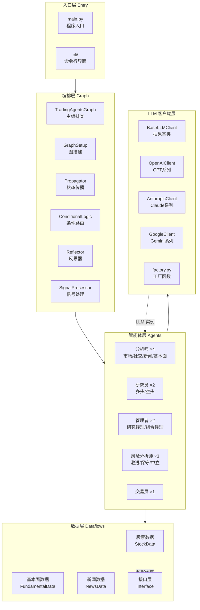

### 1.2 数据流向鸟瞰

以下是一次完整 `propagate("AAPL", "2024-01-15")` 调用的数据流总览：

```mermaid
flowchart LR
    User["用户输入<br/>ticker='AAPL'<br/>date='2024-01-15'"]
    Init["初始状态<br/>AgentState"]
    Analysts["分析师阶段<br/>4个分析师 × 工具循环"]
    Reports["4份分析报告<br/>market/sentiment/<br/>news/fundamentals"]
    Debate1["投资辩论<br/>多头 ↔ 空头"]
    Judge1["研究经理裁决<br/>investment_plan"]
    Trader["交易员<br/>trader_investment_plan"]
    Debate2["风险辩论<br/>激进 → 保守 → 中立"]
    Judge2["组合经理裁决<br/>final_trade_decision"]
    Signal["信号提取<br/>BUY/SELL/HOLD"]

    User --> Init
    Init --> Analysts
    Analysts --> Reports
    Reports --> Debate1
    Debate1 --> Judge1
    Judge1 --> Trader
    Trader --> Debate2
    Debate2 --> Judge2
    Judge2 --> Signal
```

### 1.3 核心配置参数

配置参数在 `default_config.py` 中定义，决定了图的运行行为：

| 参数 | 作用 | 默认值 | 影响 |
|------|------|--------|------|
| `llm_provider` | LLM 供应商 | `"openai"` | 决定使用哪个 LLM 客户端 |
| `deep_think_llm` | 深度思考模型 | `"o3-mini"` | 研究经理、组合经理使用 |
| `quick_think_llm` | 快速思考模型 | `"gpt-4o-mini"` | 分析师、研究员等使用 |
| `max_debate_rounds` | 牛熊辩论轮数 | `1` | 多头+空头各发言N次 |
| `max_risk_discuss_rounds` | 风险辩论轮数 | `1` | 激进+保守+中立各发言N次 |

---

## 第二章 完整工作流拓扑图

### 2.1 工作流全图（setup_graph 的完整拓扑）

这是 `setup.py` 中 `setup_graph()` 方法构建的完整 LangGraph 拓扑结构。图中标注了每个节点的类型和每条边的性质（普通边/条件边/循环边）：

```mermaid
flowchart TD
    START(["START<br/>图入口"])

    %% 分析师阶段
    subgraph Phase1["阶段一：分析师流水线"]
        direction TB

        MA["🤖 Market Analyst<br/>市场分析师<br/>LLM分析+工具调用"]
        TM["🔧 tools_market<br/>ToolNode<br/>get_stock_data + get_indicators"]
        CMA["🧹 Msg Clear Market<br/>消息清除节点"]

        SA["🤖 Social Analyst<br/>社交媒体分析师"]
        TS["🔧 tools_social<br/>ToolNode<br/>get_news"]
        CSA["🧹 Msg Clear Social"]

        NA["🤖 News Analyst<br/>新闻分析师"]
        TN["🔧 tools_news<br/>ToolNode<br/>get_news + get_global_news<br/>+ get_insider_transactions"]
        CNA["🧹 Msg Clear News"]

        FA["🤖 Fundamentals Analyst<br/>基本面分析师"]
        TF["🔧 tools_fundamentals<br/>ToolNode<br/>get_fundamentals + get_balance_sheet<br/>+ get_cashflow + get_income_statement"]
        CFA["🧹 Msg Clear Fundamentals"]
    end

    %% 投资辩论阶段
    subgraph Phase2["阶段二：投资辩论"]
        direction TB

        BR["📈 Bull Researcher<br/>多头研究员<br/>看多分析+记忆检索"]
        RR["📉 Bear Researcher<br/>空头研究员<br/>看空分析+记忆检索"]
        RM["⚖️ Research Manager<br/>研究经理<br/>综合裁决（深度LLM）"]
    end

    %% 交易决策阶段
    subgraph Phase3["阶段三：交易决策"]
        TR["💼 Trader<br/>交易员<br/>制定交易计划+记忆检索"]
    end

    %% 风险辩论阶段
    subgraph Phase4["阶段四：风险辩论"]
        direction TB

        AA["🔴 Aggressive Analyst<br/>激进分析师"]
        CA["🟢 Conservative Analyst<br/>保守分析师"]
        NA2["🟡 Neutral Analyst<br/>中立分析师"]
        PM["⚖️ Portfolio Manager<br/>组合经理<br/>最终决策（深度LLM）"]
    end

    END(["END<br/>图出口"])

    %% 分析师阶段边
    START -->|"普通边"| MA
    MA -->|"条件边: tool_calls?"| TM
    MA -->|"条件边: 无tool_calls"| CMA
    TM -->|"普通边(循环)"| MA
    CMA -->|"普通边"| SA

    SA -->|"条件边"| TS
    SA -->|"条件边"| CSA
    TS -->|"普通边(循环)"| SA
    CSA -->|"普通边"| NA

    NA -->|"条件边"| TN
    NA -->|"条件边"| CNA
    TN -->|"普通边(循环)"| NA
    CNA -->|"普通边"| FA

    FA -->|"条件边"| TF
    FA -->|"条件边"| CFA
    TF -->|"普通边(循环)"| FA

    %% 投资辩论边
    CFA -->|"普通边"| BR
    BR -->|"条件边: 达到轮数?"| RM
    BR -->|"条件边: 未达轮数"| RR
    RR -->|"条件边: 达到轮数?"| RM
    RR -->|"条件边: 未达轮数"| BR

    %% 交易决策边
    RM -->|"普通边"| TR

    %% 风险辩论边
    TR -->|"普通边"| AA
    AA -->|"条件边: 达到轮数?"| PM
    AA -->|"条件边: 未达轮数"| CA
    CA -->|"条件边: 达到轮数?"| PM
    CA -->|"条件边: 未达轮数"| NA2
    NA2 -->|"条件边: 达到轮数?"| PM
    NA2 -->|"条件边: 未达轮数"| AA

    %% 最终决策边
    PM -->|"普通边"| END

    %% 样式
    classDef analyst fill:#4A90D9,stroke:#2E6BA8,color:#fff
    classDef tool fill:#F5A623,stroke:#D4860E,color:#fff
    classDef clear fill:#9B9B9B,stroke:#6B6B6B,color:#fff
    classDef researcher fill:#7B68EE,stroke:#5A4EA0,color:#fff
    classDef manager fill:#E74C3C,stroke:#A93226,color:#fff
    classDef risk fill:#2ECC71,stroke:#239B53,color:#fff
    classDef endpoint fill:#2C3E50,stroke:#1A2530,color:#fff

    class MA,SA,NA,FA analyst
    class TM,TS,TN,TF tool
    class CMA,CSA,CNA,CFA clear
    class BR,RR researcher
    class RM,PM manager
    class AA,CA,NA2 risk
    class START,END endpoint
```

### 2.2 图的节点统计

| 节点类型 | 数量 | 节点名 |
|----------|------|--------|
| 分析师节点 | 4 | Market Analyst, Social Analyst, News Analyst, Fundamentals Analyst |
| 工具节点 | 4 | tools_market, tools_social, tools_news, tools_fundamentals |
| 消息清除节点 | 4 | Msg Clear Market/Social/News/Fundamentals |
| 研究员节点 | 2 | Bull Researcher, Bear Researcher |
| 管理者节点 | 2 | Research Manager, Portfolio Manager |
| 交易员节点 | 1 | Trader |
| 风险分析师节点 | 3 | Aggressive/Conservative/Neutral Analyst |
| 特殊节点 | 2 | START, END |
| **总计** | **18** | |

### 2.3 边类型统计

| 边类型 | 数量 | 说明 |
|--------|------|------|
| 普通边（add_edge） | 9 | 确定性路由：A 完了必定执行 B |
| 条件边（add_conditional_edges） | 7 | 动态路由：根据条件函数返回值选择目标 |
| 循环边（工具节点→分析师） | 4 | 特殊的普通边，形成工具调用循环 |

---

## 第三章 四大阶段分解

### 3.1 分析师阶段——工具调用循环

每个分析师的执行流程是相同的模式：**分析师 ↔ 工具节点 循环**。

#### 3.1.1 工具调用循环时序图

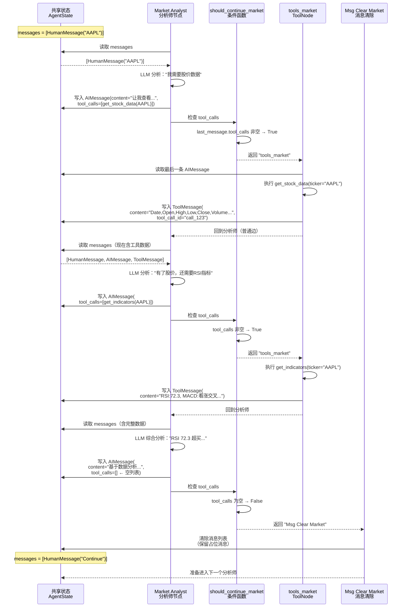

#### 3.1.2 分析师工具循环决策树

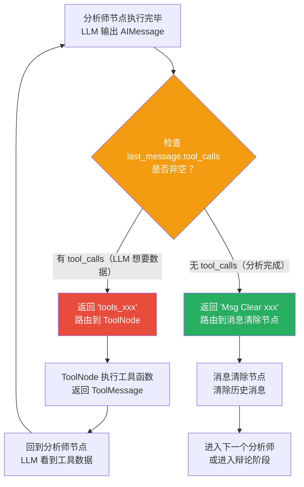

#### 3.1.3 四个分析师的工具分配

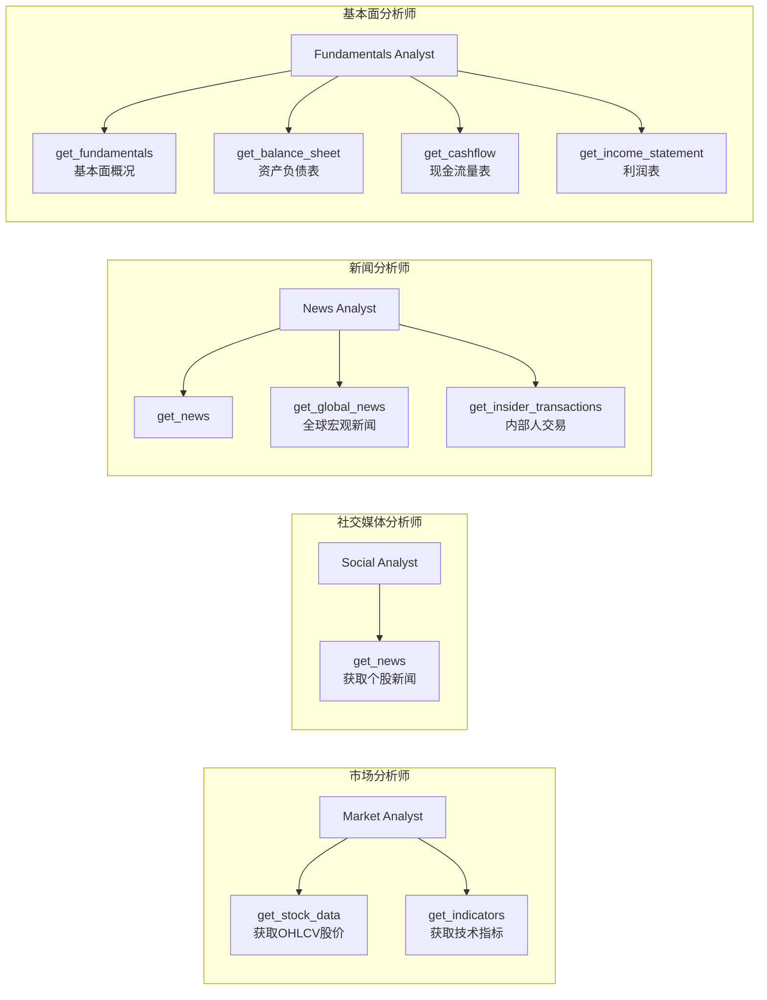

### 3.2 投资辩论阶段——牛熊交替

#### 3.2.1 牛熊辩论时序图

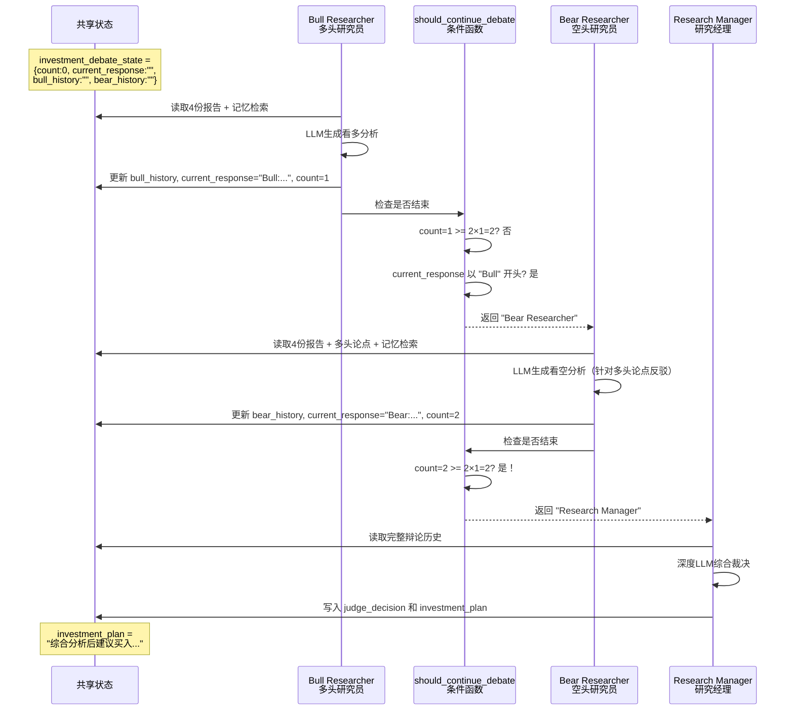

#### 3.2.2 辩论轮转决策树

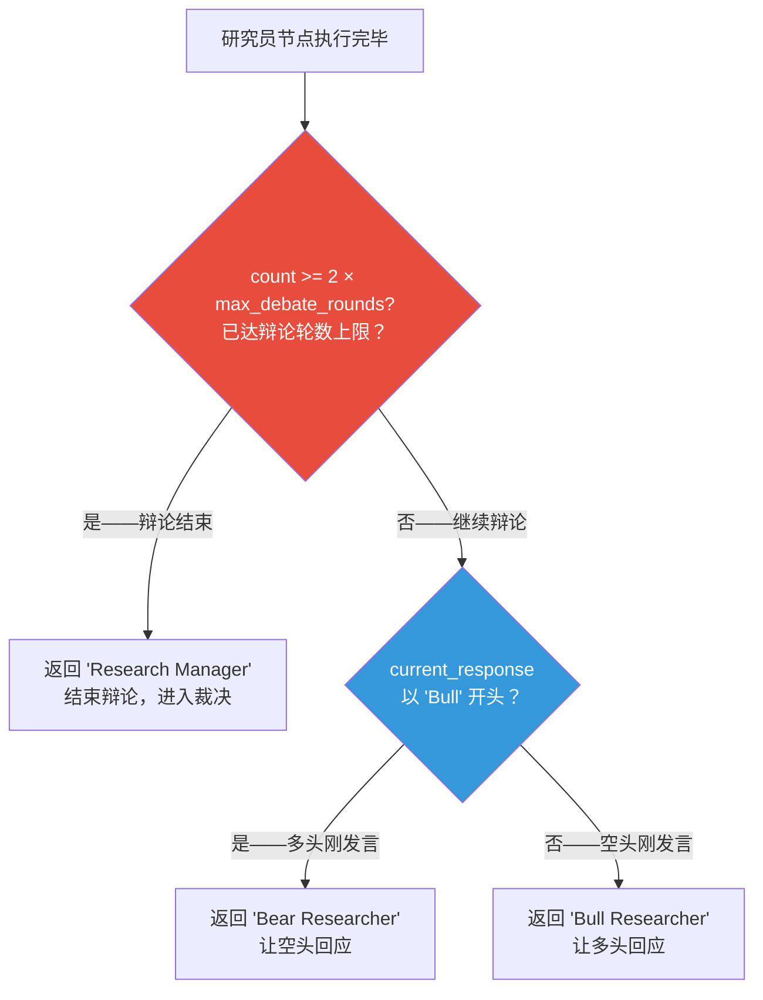

#### 3.2.3 辩论状态演进示例

以下展示 `max_debate_rounds=2` 时的完整状态演进（共4次发言）：

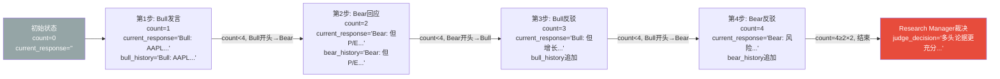

### 3.3 风险辩论阶段——三方循环

#### 3.3.1 三方辩论时序图

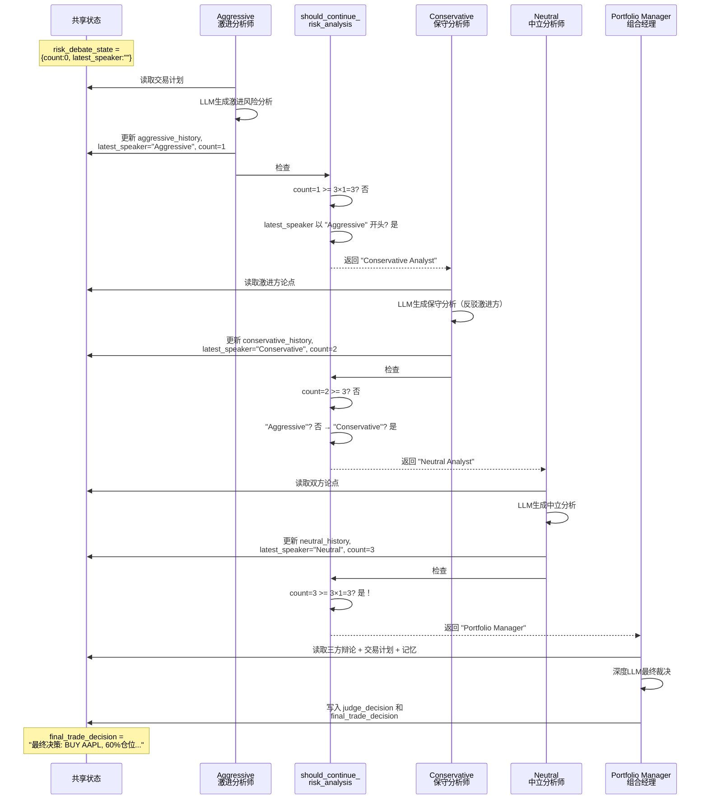

#### 3.3.2 三方辩论轮转决策树

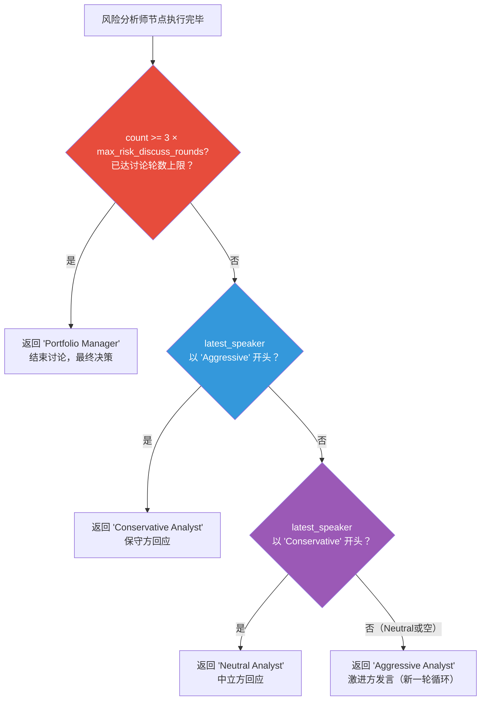

#### 3.3.3 三方辩论循环图

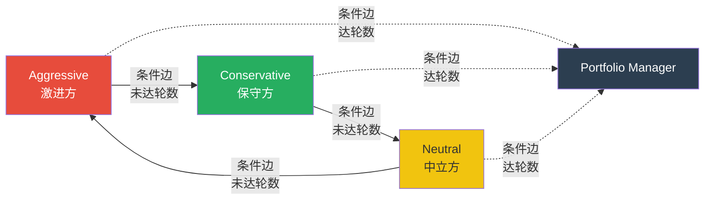

### 3.4 完整执行流程总结

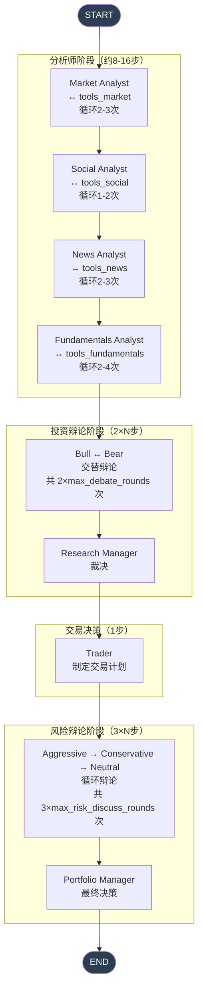

---

## 第四章 状态数据流

### 4.1 AgentState 完整结构图

`AgentState` 是整个系统的共享数据容器，继承自 `MessagesState`：

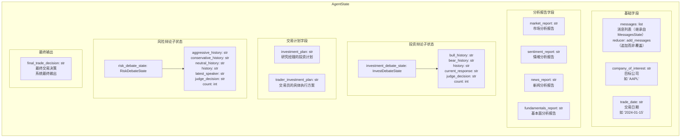

### 4.2 状态字段读写矩阵

以下矩阵展示每个节点对状态字段的读（R）和写（W）操作：

```mermaid
flowchart LR
    subgraph 图例
        L1["R = 读取"]
        L2["W = 写入"]
        L3["RW = 读写"]
    end
end
```

| 节点 | messages | company_of_interest | market_report | sentiment_report | news_report | fundamentals_report | investment_debate_state | investment_plan | trader_investment_plan | risk_debate_state | final_trade_decision |
|------|----------|---------------------|----------------|------------------|------------|---------------------|------------------------|-----------------|------------------------|-------------------|---------------------|
| Market Analyst | RW | R | W | | | | | | | | |
| Social Analyst | RW | R | | W | | | | | | | |
| News Analyst | RW | R | | | W | | | | | | |
| Fundamentals Analyst | RW | R | | | | W | | | | | |
| Bull Researcher | | R | R | R | R | R | W | | | | |
| Bear Researcher | | R | R | R | R | R | W | | | | |
| Research Manager | | R | R | R | R | R | W | W | | | |
| Trader | | R | R | R | R | R | R | R | W | | |
| Aggressive Analyst | | R | | | | | R | | R | W | |
| Conservative Analyst | | R | | | | | R | | R | W | |
| Neutral Analyst | | R | | | | | R | | R | W | |
| Portfolio Manager | | R | R | R | R | R | R | R | R | W | W |

### 4.3 初始状态结构

`Propagator.create_initial_state()` 创建的初始状态：

```mermaid
flowchart TD
    subgraph 初始状态
        I1["messages: [('human', 'AAPL')]<br/>触发第一个分析师"]
        I2["company_of_interest: 'AAPL'<br/>目标公司"]
        I3["trade_date: '2024-01-15'<br/>交易日期"]
        I4["market_report: ''<br/>等待填充"]
        I5["sentiment_report: ''"]
        I6["news_report: ''"]
        I7["fundamentals_report: ''"]
    end

    subgraph 投资辩论初始子状态
        D1["bull_history: ''"]
        D2["bear_history: ''"]
        D3["history: ''"]
        D4["current_response: ''"]
        D5["judge_decision: ''"]
        D6["count: 0 ← 关键：计数器从0开始"]
    end

    subgraph 风险辩论初始子状态
        R1["aggressive_history: ''"]
        R2["conservative_history: ''"]
        R3["neutral_history: ''"]
        R4["latest_speaker: '' ← 空字符串"]
        R5["count: 0"]
    end

    I1 -->|"触发分析师开始工作"| N1["Market Analyst"]
    D6 -->|"count累加控制辩论"| N2["辩论循环"]
    R5 -->|"count累加控制辩论"| N3["风险辩论循环"]
```

### 4.4 状态合并机制（Reducer）

LangGraph 的状态合并不是简单的"覆盖"，而是通过 reducer 函数决定如何合并：

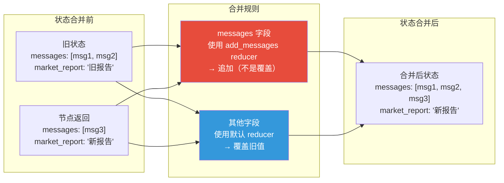

**为什么 messages 用追加而其他用覆盖？**
- `messages` 是对话历史，需要完整保留所有消息，所以用"追加"
- `market_report` 等字段是"最新结果"，新值应该替换旧值，所以用"覆盖"
- `add_messages` 是 LangGraph 内置的 reducer 函数，定义在 `MessagesState` 基类中

---

## 第五章 类与模块关系

### 5.1 Graph 子模块类关系图

`TradingAgentsGraph` 将功能拆分到 5 个子模块，遵循单一职责原则：

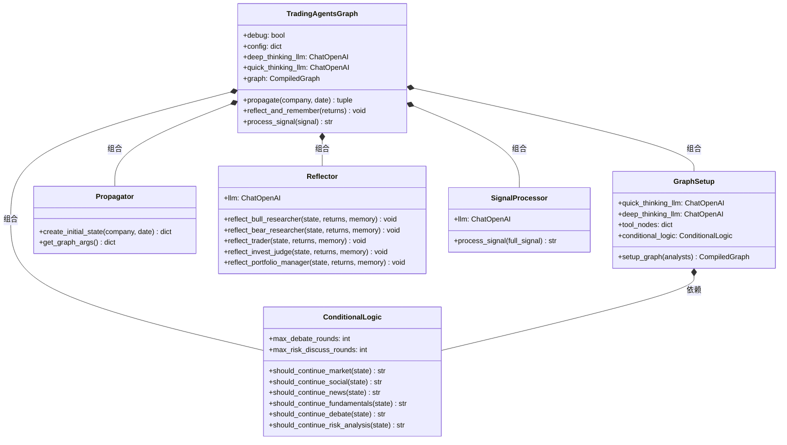

### 5.2 智能体工厂函数体系

所有智能体都通过"工厂函数"创建。工厂函数返回一个闭包，闭包符合 LangGraph 节点签名 `func(state) -> dict`：

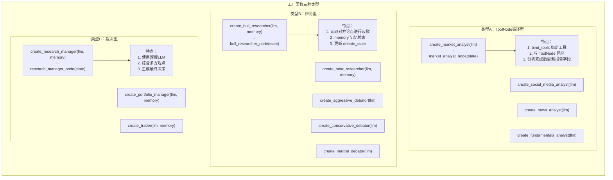

### 5.3 闭包捕获机制

工厂函数的核心是闭包——内层函数"记住"了创建时的 `llm` 和 `memory`：

```mermaid
flowchart LR
    subgraph 创建时
        C1["调用 create_bull_researcher(llm, memory)"]
        C2["llm 和 memory 被闭包捕获"]
        C3["返回 bull_researcher_node 函数"]
    end

    subgraph 执行时（后续被LangGraph调用）
        E1["LangGraph 调用 bull_researcher_node(state)"]
        E2["闭包中记住了 llm 和 memory"]
        E3["使用记忆的 llm 调用 LLM"]
        E4["使用记忆的 memory 检索历史经验"]
        E5["处理 state 并返回更新"]
    end

    C1 --> C2 --> C3
    C3 -.->|"函数对象被传递给 add_node"| E1
    E1 --> E2 --> E3 & E4 --> E5

    style C2 fill:#E74C3C,color:#fff
    style E2 fill:#E74C3C,color:#fff
```

**通俗理解**：工厂函数就像一个"招聘工厂"——你给它一个 LLM 和一个记忆库（招聘条件），它"生产"出一个节点函数（员工）。这个员工入职时就"记住"了自己的 LLM 和记忆库，以后每次被调用时都会使用这两个工具，不需要再告诉它用什么。

---

## 第六章 函数调用链

### 6.1 propagate() 完整调用链

`propagate()` 是系统的核心入口方法，以下是完整的调用链：

```mermaid
flowchart TD
    P["propagate(company_name='AAPL',<br/>trade_date='2024-01-15')"]

    P --> S1["步骤1: 创建初始状态"]
    S1 --> S1a["self.propagator.create_initial_state('AAPL', '2024-01-15')<br/>→ 返回 init_agent_state 字典"]

    P --> S2["步骤2: 获取执行参数"]
    S2 --> S2a["self.propagator.get_graph_args()<br/>→ 返回 {stream_mode:'values',<br/>config:{recursion_limit:100}}"]

    P --> S3["步骤3: 执行图"]
    S3 --> S3a{"self.debug?"}

    S3a -->|"True 调试模式"| S3b["self.graph.stream(init_agent_state, **args)<br/>→ 返回生成器，逐块输出"]
    S3b --> S3c["for chunk in stream:<br/>  pretty_print(chunk['messages'][-1])<br/>  trace.append(chunk)"]
    S3c --> S3d["final_state = trace[-1]"]

    S3a -->|"False 正常模式"| S3e["self.graph.invoke(init_agent_state, **args)<br/>→ 一次性执行完毕，返回最终状态"]

    S3d & S3e --> S4["步骤4: 保存状态"]
    S4 --> S4a["self.curr_state = final_state<br/>（供后续 reflect_and_remember 使用）"]

    S4 --> S5["步骤5: 记录日志"]
    S5 --> S5a["self._log_state(trade_date, final_state)<br/>→ 写入 JSON 文件"]

    S5 --> S6["步骤6: 返回结果"]
    S6 --> S6a["return final_state,<br/>self.process_signal(final_state['final_trade_decision'])"]

    style P fill:#2C3E50,color:#fff
    style S3a fill:#E74C3C,color:#fff
    style S6a fill:#27AE60,color:#fff
```

### 6.2 reflect_and_remember() 调用链

反思机制在交易完成后调用，对5个角色分别进行反思：

```mermaid
flowchart TD
    R["reflect_and_remember(returns_losses=0.05)"]

    R --> R1["self.reflector.reflect_bull_researcher(<br/>curr_state, returns, bull_memory)"]
    R --> R2["self.reflector.reflect_bear_researcher(<br/>curr_state, returns, bear_memory)"]
    R --> R3["self.reflector.reflect_trader(<br/>curr_state, returns, trader_memory)"]
    R --> R4["self.reflector.reflect_invest_judge(<br/>curr_state, returns, invest_judge_memory)"]
    R --> R5["self.reflector.reflect_portfolio_manager(<br/>curr_state, returns, portfolio_manager_memory)"]

    R1 --> C1["每个 reflect_xxx 内部："]
    C1 --> C1a["1. 提取市场状况（合并4份报告）"]
    C1 --> C1b["2. 提取该角色的决策内容"]
    C1 --> C1c["3. 调用 LLM 反思<br/>输入：市场状况+决策+收益<br/>输出：反思报告"]
    C1 --> C1d["4. memory.add_situations(<br/>[(市场状况, 反思报告)])"]
    C1 --> C1e["→ 存入记忆，供下次 BM25 检索"]

    style R fill:#8E44AD,color:#fff
    style C1 fill:#3498DB,color:#fff
```

### 6.3 5个角色反思的数据来源对比

```mermaid
flowchart LR
    subgraph 市场状况提取（所有角色相同）
        MS1["market_report"]
        MS2["sentiment_report"]
        MS3["news_report"]
        MS4["fundamentals_report"]
        MS1 & MS2 & MS3 & MS4 --> MS5["合并为 market situ<br/>全部4份报告拼接"]
    end

    subgraph 决策内容提取（各角色不同）
        D1["Bull Researcher<br/>→ bull_history"]
        D2["Bear Researcher<br/>→ bear_history"]
        D3["Trader<br/>→ trader_investment_plan"]
        D4["Invest Judge<br/>→ judge_decision (投资辩论)"]
        D5["Portfolio Manager<br/>→ judge_decision (风险辩论)"]
    end

    MS5 & D1 --> LLM1["LLM反思"]
    MS5 & D2 --> LLM2["LLM反思"]
    MS5 & D3 --> LLM3["LLM反思"]
    MS5 & D4 --> LLM4["LLM反思"]
    MS5 & D5 --> LLM5["LLM反思"]

    LLM1 --> M1["bull_memory.add_situations()"]
    LLM2 --> M2["bear_memory.add_situations()"]
    LLM3 --> M3["trader_memory.add_situations()"]
    LLM4 --> M4["invest_judge_memory.add_situations()"]
    LLM5 --> M5["portfolio_manager_memory.add_situations()"]
```

---

## 第七章 反思与记忆系统

### 7.1 反思闭环时序图

反思机制形成了一个"经验积累闭环"——从决策到反思到存储到检索：

```mermaid
sequenceDiagram
    participant U as 用户
    participant TAG as TradingAgentsGraph
    participant Graph as LangGraph 执行引擎
    participant Reflector as Reflector
    participant Memory as FinancialSituationMemory

    Note over U,Memory: 第一次运行（无历史经验）

    U->>TAG: propagate("AAPL", "2024-01-15")
    TAG->>Graph: 执行图
    Note over Graph: Analyst→Debate→Trader→RiskDebate→PortfolioManager
    Graph-->>TAG: final_state（含所有报告和决策）
    TAG-->>U: 返回 (final_state, "BUY")

    Note over U,Memory: 交易后反思

    U->>TAG: reflect_and_remember(returns=+0.05)
    TAG->>Reflector: 反思5个角色
    Reflector->>Reflector: 提取市场状况<br/>提取各角色决策
    Reflector->>Reflector: LLM 分析决策优劣<br/>生成反思报告
    Reflector->>Memory: add_situations([(市场状况, 反思报告)])
    Note over Memory: 存储经验：<br/>{市场状况 → 反思报告}

    Note over U,Memory: 第二次运行（有历史经验）

    U->>TAG: propagate("AAPL", "2024-03-01")
    TAG->>Graph: 执行图

    Note over Graph: 分析师阶段正常执行<br/>...

    Note over Graph: 辩论阶段
    Graph->>Memory: bull_researcher_node<br/>调用 get_memories(当前市场状况)
    Memory->>Memory: BM25 算法检索<br/>找到最相似的历史经验
    Memory-->>Graph: 返回反思报告
    Graph->>Graph: LLM 参考历史反思<br/>做出更好的决策

    Graph-->>TAG: final_state（更优的决策）
    TAG-->>U: 返回 (final_state, "BUY")
```

### 7.2 BM25 记忆检索数据流

`FinancialSituationMemory.get_memories()` 使用 BM25 算法检索相似历史经验：

```mermaid
flowchart LR
    Input["输入：<br/>当前市场状况文本<br/>'RSI:72.3, MACD看涨...'"]

    subgraph BM25检索过程
        T["1. 分词<br/>将输入文本拆分为词<br/>['RSI', '72.3', 'MACD', '看涨', ...]"]

        S["2. 评分<br/>对记忆库中每条历史经验<br/>计算 BM25 相关度分数<br/>score = IDF × TF × 归一化"]

        R["3. 排序<br/>按分数从高到低排序"]

        N["4. 归一化<br/>scores = scores / max(scores)<br/>（最高分归一化为1.0）"]

        F["5. 取Top-N<br/>取前N条最相关的经验<br/>默认 N=10"]
    end

    Output["输出：<br/>相关历史经验列表<br/>[('市场状况A', '反思报告A'),<br/> ('市场状况B', '反思报告B'),<br/> ...]"]

    Input --> T --> S --> R --> N --> F --> Output

    style T fill:#3498DB,color:#fff
    style S fill:#E74C3C,color:#fff
    style N fill:#F39C12,color:#fff
```

### 7.3 记忆存储格式

```mermaid
flowchart TD
    subgraph 记忆库结构
        M1["FinancialSituationMemory 实例"]
        M1a["situations: list<br/>存储 (市场状况, 反思报告) 元组列表"]
        M1b["bm25: BM25Okapi 实例<br/>BM25 索引，基于 situations 构建"]
    end

    subgraph 存储操作
        S1["add_situations(new_situations)"]
        S1a["1. 将新的 (市场状况, 反思报告)<br/>追加到 situations 列表"]
        S1b["2. 重新构建 BM25 索引<br/>（对所有市场状况重新分词）"]
        S1c["3. 保存到文件（持久化）"]
    end

    subgraph 检索操作
        Q1["get_memories(current_situation, n=10)"]
        Q1a["1. 对 current_situation 分词"]
        Q1b["2. bm25.get_scores(tokens)<br/>计算与每条历史的相似度分数"]
        Q1c["3. 按分数排序，取Top-N"]
        Q1d["4. 返回 [(市场状况, 反思报告), ...]"]
    end

    M1 --> S1 --> S1a --> S1b --> S1c
    M1 --> Q1 --> Q1a --> Q1b --> Q1c --> Q1d
```

### 7.4 五个独立记忆实例

```mermaid
flowchart TD
    TAG["TradingAgentsGraph"]

    TAG --> B["bull_memory<br/>多头研究员记忆<br/>存储看多分析的经验教训"]
    TAG --> Be["bear_memory<br/>空头研究员记忆<br/>存储看空分析的经验教训"]
    TAG --> T["trader_memory<br/>交易员记忆<br/>存储交易决策的经验教训"]
    TAG --> IJ["invest_judge_memory<br/>投资裁判记忆<br/>存储辩论裁决的经验教训"]
    TAG --> PM["portfolio_manager_memory<br/>组合经理记忆<br/>存储风险管理决策的经验教训"]

    B --> B1["文件: bull_memory.json"]
    Be --> Be1["文件: bear_memory.json"]
    T --> T1["文件: trader_memory.json"]
    IJ --> IJ1["文件: invest_judge_memory.json"]
    PM --> PM1["文件: portfolio_manager_memory.json"]

    style B fill:#E74C3C,color:#fff
    style Be fill:#3498DB,color:#fff
    style T fill:#F39C12,color:#fff
    style IJ fill:#9B59B6,color:#fff
    style PM fill:#2C3E50,color:#fff
```

**为什么需要 5 个独立记忆？** 每个角色的职责不同，积累的经验也不同。多头研究员积累的是"看多分析何时正确"的经验，空头研究员积累的是"看空分析何时正确"的经验。如果把它们混在一起，BM25 检索时会找到不相关的经验，反而干扰决策。

---

## 第八章 LLM 客户端体系

### 8.1 LLM 客户端类关系图

```mermaid
classDiagram
    class BaseLLMClient {
        <<abstract>>
        +provider: str
        +model: str
        +base_url: str
        +get_llm()* ChatOpenAI
        +_get_common_kwargs() dict
    }

    class OpenAIClient {
        +reasoning_effort: str
        +get_llm() ChatOpenAI
        +_select_api_type() str
    }

    class AnthropicClient {
        +effort: str
        +get_llm() ChatAnthropic
    }

    class GoogleClient {
        +thinking_level: str
        +get_llm() ChatGoogleGenerativeAI
    }

    class NormalizedChatOpenAI {
        +invoke(messages) AIMessage
        +_normalize_content(content) str
    }

    class ChatOpenAI {
        <<LangChain内置>>
        +invoke(messages) AIMessage
    }

    BaseLLMClient <|-- OpenAIClient : 继承
    BaseLLMClient <|-- AnthropicClient : 继承
    BaseLLMClient <|-- GoogleClient : 继承
    OpenAIClient ..> NormalizedChatOpenAI : 创建/使用
    NormalizedChatOpenAI --|> ChatOpenAI : 继承（子类化增强）
```

### 8.2 工厂模式——create_llm_client

`create_llm_client()` 是工厂函数，根据 `provider` 参数创建不同的客户端：

```mermaid
flowchart TD
    C["create_llm_client(<br/>provider='openai',<br/>model='gpt-5-mini',<br/>base_url=None)"]

    C --> P{"provider?"}

    P -->|"openai"| O["OpenAIClient(provider='openai',<br/>model='gpt-5-mini', ...)"]
    P -->|"anthropic"| A["AnthropicClient(provider='anthropic',<br/>model='claude-sonnet-4-...', ...)"]
    P -->|"google"| G["GoogleClient(provider='google',<br/>model='gemini-2.5-flash', ...)"]
    P -->|"其他"| E["ValueError: 不支持的provider"]

    O --> O1[".get_llm()<br/>→ 返回 NormalizedChatOpenAI<br/>（ChatOpenAI的子类）"]
    A --> A1[".get_llm()<br/>→ 返回 ChatAnthropic"]
    G --> G1[".get_llm()<br/>→ 返回 ChatGoogleGenerativeAI"]

    style C fill:#2C3E50,color:#fff
    style P fill:#E74C3C,color:#fff
```

### 8.3 OpenAIClient.get_llm() 决策流程

`OpenAIClient` 需要根据 `provider` 的具体值选择 API 类型：

```mermaid
flowchart TD
    A["OpenAIClient.get_llm()"]
    B{"provider 类型？"}

    B -->|"openai<br/>（官方OpenAI）"| C{"模型是否支持<br/>Responses API？"}
    C -->|"是（GPT-5等）"| D["使用 Responses API<br/>api_type='responses'"]
    C -->|"否（GPT-4等）"| E["使用 Chat Completions API<br/>api_type='chat_completions'"]

    B -->|"xai<br/>（Grok）"| F["使用 Chat Completions API<br/>base_url 设为 xAI 地址"]

    B -->|"openrouter"| G["使用 Chat Completions API<br/>base_url 设为 OpenRouter 地址"]

    B -->|"ollama<br/>（本地模型）"| H["使用 Chat Completions API<br/>api_key 设为占位符"]

    D & E & F & G & H --> I["创建 NormalizedChatOpenAI 实例<br/>（ChatOpenAI 的子类）"]

    I --> J["传递 _PASSTHROUGH_KWARGS<br/>（reasoning_effort, temperature 等）"]

    J --> K["返回 LLM 实例"]

    style B fill:#E74C3C,color:#fff
    style I fill:#3498DB,color:#fff
```

### 8.4 NormalizedChatOpenAI 内容规范化

`NormalizedChatOpenAI` 继承自 `ChatOpenAI`，重写 `invoke()` 方法对 LLM 输出内容进行规范化：

```mermaid
sequenceDiagram
    participant Caller as 调用方
    participant NC as NormalizedChatOpenAI
    participant Parent as ChatOpenAI (父类)
    participant LLM as OpenAI API

    Caller->>NC: invoke(messages)
    NC->>Parent: super().invoke(messages)
    Parent->>LLM: 发送API请求
    LLM-->>Parent: 返回响应
    Parent-->>NC: 返回 AIMessage

    NC->>NC: 检查 content 类型
    alt content 是字符串
        NC->>NC: 直接返回（无需处理）
    else content 是列表（多模态）
        NC->>NC: _normalize_content(content)
        Note over NC: 提取纯文本部分<br/>过滤掉非文本内容
    end

    NC-->>Caller: 返回规范化后的 AIMessage

    Note over NC,LLM: 为什么需要规范化？<br/>GPT-5等模型可能返回多模态内容<br/>（如包含图片描述的列表），<br/>但本系统只需要纯文本分析。
```

### 8.5 双 LLM 架构

系统使用两种 LLM，根据任务复杂度分配：

```mermaid
flowchart LR
    subgraph 深度思考LLM["深度思考 LLM (deep_think_llm)"]
        D1["模型: o3-mini / GPT-5<br/>特点: 推理能力强，速度慢，成本高"]
        D2["使用者:"]
        D3["Research Manager<br/>研究经理（综合辩论裁决）"]
        D4["Portfolio Manager<br/>组合经理（最终决策）"]
    end

    subgraph 快速思考LLM["快速思考 LLM (quick_think_llm)"]
        Q1["模型: gpt-4o-mini<br/>特点: 速度快，成本低，推理能力适中"]
        Q2["使用者:"]
        Q3["4个分析师<br/>市场/社交/新闻/基本面"]
        Q4["2个研究员<br/>多头/空头"]
        Q5["交易员"]
        Q6["3个风险分析师<br/>激进/保守/中立"]
        Q7["反思器 Reflector"]
        Q8["信号处理器"]
    end

    style D1 fill:#E74C3C,color:#fff
    style Q1 fill:#3498DB,color:#fff
```

**为什么用两种 LLM？** 分析师和研究员的任务是"收集数据并生成初步分析"，不需要太强的推理能力，用快速模型即可。研究经理和组合经理的任务是"综合多方观点做出最终决策"，需要更强的推理能力，用深度模型。这样在保证决策质量的同时控制了 API 调用成本。

---

## 附录：易混淆概念详解

### A1. LangGraph 状态替换 vs 合并

```mermaid
flowchart TD
    subgraph 问题
        P1["节点返回 {market_report: '新报告'}<br/>但旧状态有 {market_report: '旧报告', messages: [...]}"]
        P2["LangGraph 如何合并？"]
    end

    subgraph 规则
        R1["规则1: messages 字段<br/>→ 使用 add_messages reducer<br/>→ 追加新消息到旧列表"]
        R2["规则2: 其他字段<br/>→ 使用默认 reducer<br/>→ 新值覆盖旧值"]
        R3["规则3: 节点未返回的字段<br/>→ 保持不变"]
    end

    subgraph 结果
        O1["合并后：<br/>messages: [旧消息..., 新消息]<br/>market_report: '新报告'<br/>（覆盖了旧值）<br/>其他字段保持不变"]
    end

    P1 --> P2 --> R1 & R2 & R3 --> O1

    style R1 fill:#E74C3C,color:#fff
    style R2 fill:#3498DB,color:#fff
```

**关键影响**：`research_manager_node` 返回的字典必须包含 `investment_debate_state` 的所有字段（即使不修改），否则 LangGraph 会用默认值覆盖。这就是为什么代码中要写：

```python
# 必须保留所有旧字段，只更新需要修改的字段
return {
    "investment_debate_state": {
        "bull_history": debate_state["bull_history"],      # 保留
        "bear_history": debate_state["bear_history"],      # 保留
        "history": debate_state["history"],                  # 保留
        "current_response": debate_state["current_response"],# 保留
        "judge_decision": new_judge_decision,                # 更新
        "count": debate_state["count"],                      # 保留
    },
    "investment_plan": new_plan,  # 新增
}
```

### A2. tool_calls 的真假判断

```mermaid
flowchart TD
    A["LLM 输出 AIMessage"]
    B["AIMessage.tool_calls 属性"]

    B --> C1["情况1: 有工具调用<br/>tool_calls = [{name:'get_stock_data', ...}]<br/>→ 非空列表 → 真值"]
    B --> C2["情况2: 无工具调用<br/>tool_calls = []<br/>→ 空列表 → 假值"]

    C1 --> D1["if last_message.tool_calls: → True<br/>→ 返回 'tools_xxx'<br/>→ 路由到 ToolNode"]
    C2 --> D2["if last_message.tool_calls: → False<br/>→ 返回 'Msg Clear xxx'<br/>→ 分析完成"]

    style C1 fill:#E74C3C,color:#fff
    style C2 fill:#27AE60,color:#fff
```

### A3. count 乘数逻辑

```mermaid
flowchart TD
    subgraph 牛熊辩论
        B1["max_debate_rounds = 1"]
        B2["1轮 = 多头发言 + 空头回应 = 2次"]
        B3["终止条件: count >= 2 × max_debate_rounds<br/>= 2 × 1 = 2"]
        B4["count 0→1→2（结束）"]

        B5["max_debate_rounds = 2"]
        B6["2轮 = 4次发言"]
        B7["终止条件: count >= 2 × 2 = 4"]
        B8["count 0→1→2→3→4（结束）"]
    end

    subgraph 三方辩论
        T1["max_risk_discuss_rounds = 1"]
        T2["1轮 = 激进+保守+中立 = 3次"]
        T3["终止条件: count >= 3 × max_risk_discuss_rounds<br/>= 3 × 1 = 3"]
        T4["count 0→1→2→3（结束）"]

        T5["max_risk_discuss_rounds = 2"]
        T6["2轮 = 6次发言"]
        T7["终止条件: count >= 3 × 2 = 6"]
        T8["count 0→1→2→3→4→5→6（结束）"]
    end

    style B3 fill:#E74C3C,color:#fff
    style T3 fill:#E74C3C,color:#fff
```

### A4. getattr 动态方法拼接

```mermaid
flowchart TD
    subgraph 传统写法（冗长）
        T1["if analyst_type == 'market':<br/>    func = self.should_continue_market<br/>elif analyst_type == 'social':<br/>    func = self.should_continue_social<br/>elif analyst_type == 'news':<br/>    func = self.should_continue_news<br/>elif analyst_type == 'fundamentals':<br/>    func = self.should_continue_fundamentals"]
    end

    subgraph getattr写法（简洁）
        G1["method_name = f'should_continue_{analyst_type}'<br/># 如 'should_continue_market'"]
        G2["func = getattr(self.conditional_logic, method_name)<br/># 等价于 self.conditional_logic.should_continue_market"]
        G3["workflow.add_conditional_edges(<br/>    current_analyst, func, [...])"]
    end

    T1 -.->|"等价于"| G1
    G1 --> G2 --> G3

    style T1 fill:#E74C3C,color:#fff
    style G2 fill:#27AE60,color:#fff
```

### A5. RemoveMessage 消息删除机制

```mermaid
sequenceDiagram
    participant Node as delete_messages<br/>消息清除节点
    participant State as 共享状态
    participant Reducer as add_messages<br/>reducer

    Note over State: messages = [<br/>  SystemMessage("你是市场分析师..."),<br/>  HumanMessage("AAPL"),<br/>  AIMessage("让我查看...", tool_calls=[...]),<br/>  ToolMessage("Date,Open,High..."),<br/>  AIMessage("RSI:72.3..."),<br/>  ... (可能几十条)<br/>]

    Node->>Node: 遍历所有 messages
    Node->>Node: 为每条消息创建 RemoveMessage(id=m.id)
    Note over Node: removal_operations = [<br/>  RemoveMessage(id="msg_001"),<br/>  RemoveMessage(id="msg_002"),<br/>  ...<br/>]
    Node->>Node: 添加占位消息 HumanMessage("Continue")
    Note over Node: return {"messages":<br/>  removal_operations + [HumanMessage("Continue")]}

    Node->>Reducer: 返回 messages 更新
    Reducer->>Reducer: 识别 RemoveMessage 指令
    Reducer->>Reducer: 按照 id 删除对应消息
    Reducer->>Reducer: 追加 HumanMessage("Continue")

    Note over State: messages 合并后 = [<br/>  HumanMessage("Continue")<br/>  ← 所有旧消息已被删除<br/>  ← 只剩占位消息<br/>]

    Note over Node,Reducer: 为什么需要占位消息？<br/>某些LLM（如Anthropic Claude）<br/>要求消息列表不能为空，<br/>否则会报错。
```

### A6. 降级链构建（route_to_vendor）

`dataflows/interface.py` 中的 `route_to_vendor()` 使用策略模式 + 责任链模式实现数据源降级：

```mermaid
flowchart TD
    A["调用 get_stock_data(ticker='AAPL')"]

    A --> B["route_to_vendor(method='get_stock_data')"]

    B --> C["1. 获取方法分类<br/>get_category_for_method('get_stock_data')<br/>→ 'stock'"]

    C --> D["2. 获取主供应商<br/>config: 'stock' → 'alphavantage'"]

    D --> E["3. 构建降级链<br/>主供应商在前，其他可用供应商追加在后<br/>['alphavantage', 'yfinance', 'polygon']"]

    E --> F["4. 依次尝试"]

    F --> G{"尝试 alphavantage"}

    G -->|"成功"| H["返回数据 ✅"]
    G -->|"限流<br/>RateLimitError"| I["降级到 yfinance"]

    I --> J{"尝试 yfinance"}
    J -->|"成功"| H
    J -->|"失败"| K["降级到 polygon"]

    K --> L{"尝试 polygon"}
    L -->|"成功"| H
    L -->|"失败"| M["所有供应商都失败<br/>返回 None 或抛出异常 ❌"]

    style G fill:#27AE60,color:#fff
    style I fill:#F39C12,color:#fff
    style K fill:#E74C3C,color:#fff
    style H fill:#2C3E50,color:#fff
    style M fill:#C0392B,color:#fff
```

### A7. LCEL 管道操作符（|）

LangChain 的 LCEL（LangChain Expression Language）使用 `|` 操作符串联步骤：

```mermaid
flowchart LR
    subgraph 传统写法
        T1["result1 = prompt.invoke(data)"]
        T2["result2 = llm.invoke(result1)"]
        T3["result3 = parser.invoke(result2)"]
    end

    subgraph LCEL管道
        L1["chain = prompt | llm | parser"]
        L2["result = chain.invoke(data)"]
    end

    T1 --> T2 --> T3
    L1 --> L2

    style T1 fill:#E74C3C,color:#fff
    style L1 fill:#27AE60,color:#fff
```

**数据流**：`|` 操作符将前一步的输出作为后一步的输入，类似 Unix 管道 `|`。

### A8. 条件边路由映射的两种形式

```mermaid
flowchart TD
    subgraph 列表形式
        L1["workflow.add_conditional_edges(<br/>  'Market Analyst',<br/>  should_continue_market,<br/>  ['tools_market', 'Msg Clear Market']<br/>）"]
        L2["条件函数返回值<br/>直接作为目标节点名<br/>'tools_market' → 去名为 'tools_market' 的节点"]
        L1 --> L2
    end

    subgraph 字典形式
        D1["workflow.add_conditional_edges(<br/>  'Bull Researcher',<br/>  should_continue_debate,<br/>  {<br/>    'Bear Researcher': 'Bear Researcher',<br/>    'Research Manager': 'Research Manager'<br/>  }<br/>）"]
        D2["条件函数返回值作为key<br/>在字典中查找对应的value<br/>'Bear Researcher' → 查字典 → 去 'Bear Researcher'"]
        D1 --> D2
    end

    style L1 fill:#3498DB,color:#fff
    style D1 fill:#9B59B6,color:#fff
```

**何时用哪种？**
- 列表形式：当返回值就是节点名时使用（分析师条件边）
- 字典形式：当返回值和节点名不同时使用，或者需要更明确的映射时使用（辩论条件边）

---

## 阅读路线图

以下是推荐的学习路径：

```mermaid
flowchart TD
    Step1["第1步：阅读新手入门指南<br/>第1-2章（Python + LLM 基础）"]
    Step2["第2步：阅读本图解指南<br/>第1-2章（架构鸟瞰 + 工作流全图）"]
    Step3["第3步：阅读新手入门指南<br/>第3-4章（LangChain + LangGraph）"]
    Step4["第4步：阅读本图解指南<br/>第3章（四大阶段分解）"]
    Step5["第5步：阅读源码<br/>trading_graph.py → propagate()"]
    Step6["第6步：阅读源码<br/>setup.py → setup_graph()"]
    Step7["第7步：阅读源码<br/>conditional_logic.py"]
    Step8["第8步：阅读本图解指南<br/>第4章（状态数据流）+ 附录A1"]
    Step9["第9步：阅读源码<br/>agent_states.py + propagation.py"]
    Step10["第10步：阅读源码<br/>各 agent 文件（从 market_analyst.py 开始）"]
    Step11["第11步：阅读本图解指南<br/>第7章（反思与记忆）"]
    Step12["第12步：阅读源码<br/>reflection.py + memory.py"]
    Step13["第13步：阅读本图解指南<br/>第8章（LLM客户端）"]
    Step14["第14步：阅读源码<br/>llm_clients/ 目录"]
    Step15["第15步：阅读源码<br/>dataflows/interface.py<br/>（数据源降级）"]

    Step1 --> Step2 --> Step3 --> Step4 --> Step5
    Step5 --> Step6 --> Step7 --> Step8 --> Step9
    Step9 --> Step10 --> Step11 --> Step12
    Step12 --> Step13 --> Step14 --> Step15

    style Step1 fill:#3498DB,color:#fff
    style Step5 fill:#E74C3C,color:#fff
    style Step15 fill:#27AE60,color:#fff
```

---

> **文档版本**：v1.0
> **配套文件**：[新手入门指南](新手入门指南.md) | [README.md](../README.md)
> **适用代码版本**：TradingAgents v0.2.2
