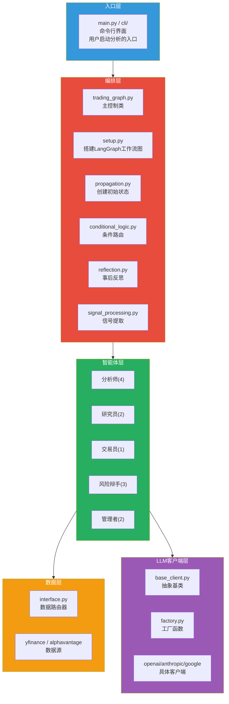
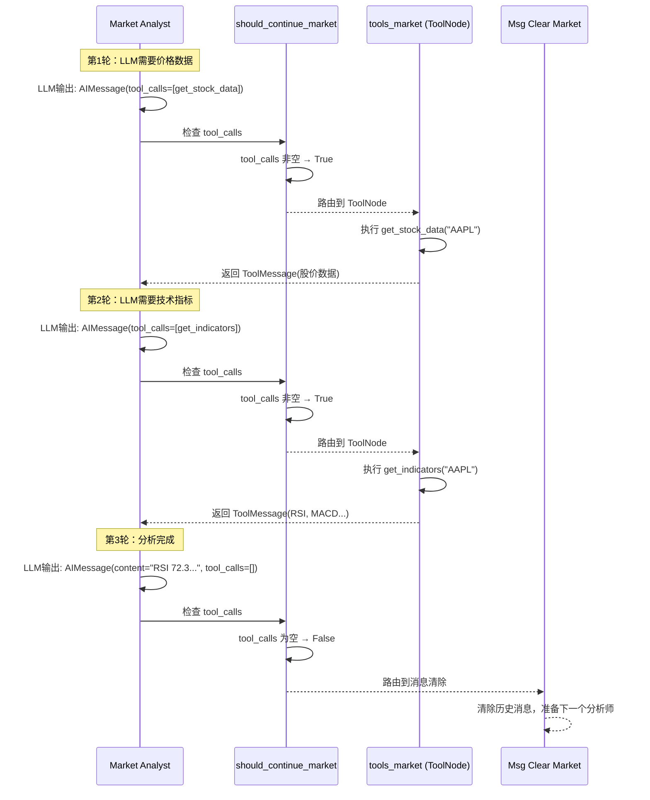
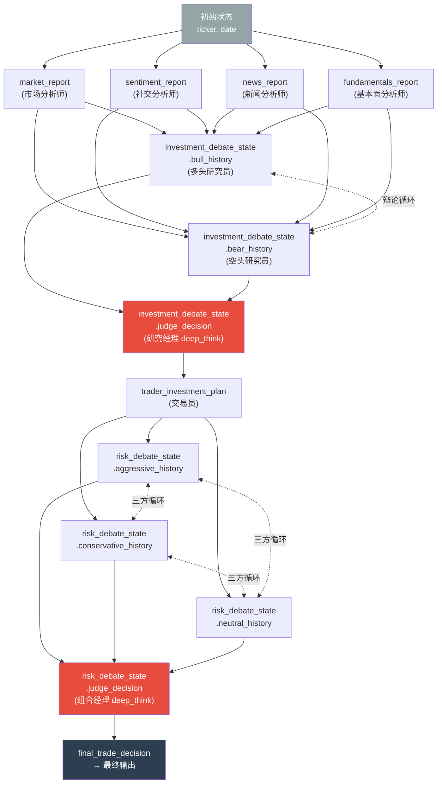
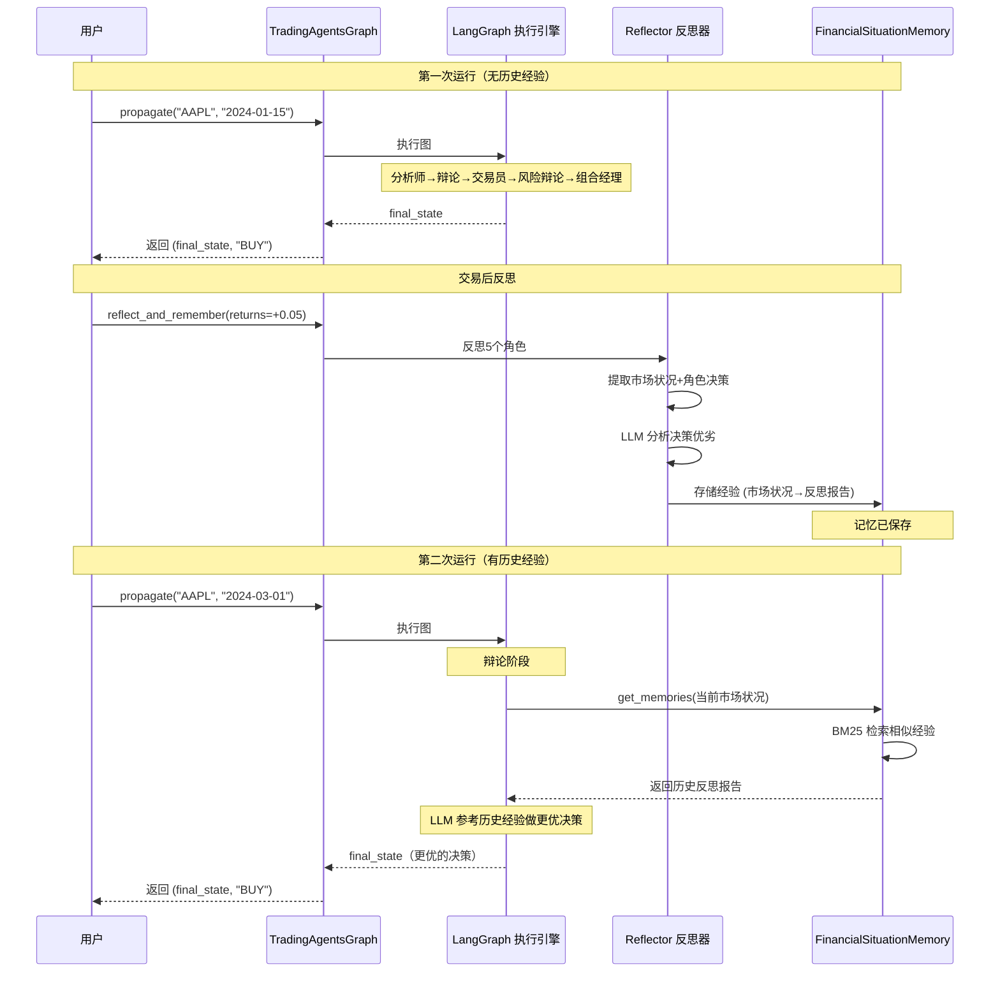

# TradingAgents 新手入门指南

> 本指南面向 **零 Python 经验、零 LangChain 经验** 的读者。
> 读完本指南后，你将具备理解本项目所有代码注释所需的前置知识。
> **无需查阅任何其他资料，本指南即是完整的知识基础。**

---

## 目录

1. [Python 基础知识](#一python-基础知识)
2. [大语言模型（LLM）基础](#二大语言模型llm基础)
3. [LangChain 框架详解](#三langchain-框架详解)
4. [LangGraph 框架详解](#四langgraph-框架详解)
5. [金融领域知识](#五金融领域知识)
6. [设计模式基础](#六设计模式基础)
7. [项目架构与工作流](#七项目架构与工作流)

---

## 一、Python 基础知识

> 如果你已经熟悉 Python，可以跳过本节。

### 1.1 什么是 Python？

Python 是一种高级编程语言，以"简洁易读"著称。你只需要理解以下几个核心概念就能读懂本项目。

### 1.2 变量与数据类型

```python
# 变量：存储数据的"盒子"，用 = 赋值
name = "NVDA"          # 字符串（str）：用引号括起来的文本
price = 150.5          # 浮点数（float）：带小数点的数字
count = 10             # 整数（int）：不带小数点的数字
is_active = True       # 布尔值（bool）：True 或 False
nothing = None         # 空值（None）：表示"什么都没有"

# 查看变量类型
print(type(name))      # 输出: <class 'str'>
```

#### None 的详细解释

`None` 是 Python 中表示"空"或"无"的特殊值。它非常常见，你需要理解什么情况下会遇到 None，以及如何安全地处理它。

```python
# 什么情况下会遇到 None？

# 1. 函数没有 return 语句时，默认返回 None
def do_something():
    print("执行了")

result = do_something()   # result 是 None

# 2. 字典用 .get() 查找不存在的键时，返回 None
config = {"name": "test"}
value = config.get("missing_key")   # value 是 None

# 3. 变量初始化为 None，表示"还没有值"
selected_stock = None     # 稍后才会赋值

# 4. 某些操作失败时可能返回 None
# 例如：正则表达式匹配失败返回 None

# 如何安全地处理 None？
# 方法一：用 is None 检查（推荐，不要用 == None）
if result is None:
    print("没有结果")

# 方法二：用 is not None
if result is not None:
    print(f"结果是: {result}")

# 方法三：用 or 提供默认值（但要注意：0、空字符串等也会被当作"假"）
name = name or "默认名称"          # 如果 name 是 None，使用默认值
name = name if name is not None else "默认名称"  # 更精确的写法
```

#### 布尔值真值判断

在 Python 中，很多值在条件判断中会被当作 `False`（假值）或 `True`（真值）：

```python
# 以下值在条件判断中都被视为 False（假值）：
bool(None)    # False — 空值
bool(0)       # False — 数字零
bool(0.0)     # False — 浮点数零
bool("")      # False — 空字符串
bool([])      # False — 空列表
bool({})      # False — 空字典
bool(set())   # False — 空集合
bool(())      # False — 空元组

# 几乎所有其他值都是 True（真值）
bool(1)             # True
bool("hello")       # True
bool([1, 2])        # True
bool({"a": 1})      # True

# 这在实际代码中非常有用：
data = []
if not data:                    # 等价于 if len(data) == 0
    print("数据为空")

name = ""
if not name:                    # 等价于 if name == ""
    print("名称为空")

result = None
if not result:                  # 等价于 if result is None
    print("没有结果")
```

### 1.3 字符串操作

#### Python 字符串是不可变的（Immutable）

这是一个非常重要的概念，很多初学者在这里犯错。

**核心规则：Python 中的字符串一旦创建，就不能被修改。** 所有"看起来修改了字符串"的操作，实际上都是创建了一个**新字符串**返回，原字符串本身没有任何变化。

```python
text = "  Hello World  "

# 以下所有方法的返回值都是"新字符串"，text 本身没有改变！
new_text1 = text.strip()            # 返回新字符串 "Hello World"
new_text2 = text.upper()            # 返回新字符串 "  HELLO WORLD  "
new_text3 = text.lower()            # 返回新字符串 "  hello world  "
new_text4 = text.replace("o", "0")  # 返回新字符串 "  Hell0 W0rld  "

# 原字符串 text 仍然是 "  Hello World  "，没有任何变化！
print(text)   # 输出: "  Hello World  "

# 如果你想"修改"字符串，必须用变量接收返回值：
text = text.strip()    # 现在 text 指向了新字符串 "Hello World"
# 注意：这不是修改了原来的字符串，而是让变量 text 指向了一个新字符串

# 字符串拼接也是创建新字符串
a = "Hello"
b = "World"
c = a + " " + b       # 创建了一个全新的字符串 "Hello World"
# a 和 b 保持不变

# 字符替换也是创建新字符串
original = "AAPL"
modified = original.replace("A", "B")  # modified = "BBPL"，original 仍是 "AAPL"

# 为什么 Python 要这样设计？
# 1. 安全：多个变量引用同一个字符串时，不会互相影响
# 2. 性能：不可变对象可以作为字典的键
# 3. 简单：不需要担心"这个字符串在别的地方被修改了"
```

#### 字符串常用操作

```python
# 字符串拼接
ticker = "AAPL"
message = "分析股票：" + ticker       # 用 + 拼接

# f-string（格式化字符串）：在字符串中嵌入变量
# 语法：f"文本 {变量名}"
report = f"当前分析的是 {ticker}，日期是 2024-01-15"

# 更多字符串方法
text = "  Hello World  "
len(text)               # 获取长度 → 15
text.startswith("  He")  # 是否以指定字符串开头 → True
text.endswith("ld  ")    # 是否以指定字符串结尾 → True
"World" in text          # 是否包含子字符串 → True
text.find("World")       # 查找子字符串位置 → 4（不存在则返回 -1）
text.count("l")          # 统计子字符串出现次数 → 3
text.split(" ")          # 按分隔符分割 → ["", "", "Hello", "World", "", ""]
"-".join(["a", "b"])     # 用分隔符连接 → "a-b"
```

### 1.4 条件判断（if / elif / else）

条件判断让程序根据不同的情况执行不同的代码：

```python
# 基本语法
age = 18

if age >= 18:
    print("成年人")
elif age >= 13:
    print("青少年")
else:
    print("儿童")

# 比较运算符
# ==  等于（注意：两个等号！一个等号是赋值）
# !=  不等于
# >   大于
# <   小于
# >=  大于等于
# <=  小于等于

# 逻辑运算符
# and  并且（两个条件都满足）
# or   或者（有一个条件满足即可）
# not  取反

# 组合条件
price = 150
volume = 100000

if price > 100 and volume > 50000:
    print("高价高成交量，值得关注")
elif price > 100 or volume > 50000:
    print("部分指标达标")
else:
    print("普通行情")

# 本项目中的实际用法
# 判断 API 提供商
provider = "openai"
if provider == "openai":
    client = OpenAIClient()
elif provider == "anthropic":
    client = AnthropicClient()
elif provider == "google":
    client = GoogleClient()
else:
    raise ValueError(f"不支持的提供商: {provider}")

# 判断是否存在工具调用
if hasattr(last_message, "tool_calls") and last_message.tool_calls:
    # 有工具调用，需要执行工具
    return "tools"
else:
    # 没有工具调用，可以继续
    return "next"
```

### 1.5 循环（for / while）

循环让程序重复执行一段代码。

#### for 循环

```python
# 遍历列表
analysts = ["market", "social", "news", "fundamentals"]
for analyst in analysts:
    print(f"正在执行: {analyst}分析师")

# 遍历字典
config = {"model": "gpt-5", "temperature": 0.7}
for key, value in config.items():
    print(f"{key} = {value}")

# 遍历指定次数
for i in range(5):          # range(5) 产生 0, 1, 2, 3, 4
    print(f"第 {i} 次尝试")

for i in range(1, 6):       # range(1, 6) 产生 1, 2, 3, 4, 5
    print(f"第 {i} 轮辩论")

# 遍历字符串（字符串也是可迭代的）
for char in "AAPL":
    print(char)             # 输出: A, A, P, L
```

#### while 循环

```python
# while 循环：只要条件为 True 就一直执行
count = 0
while count < 3:
    print(f"尝试第 {count + 1} 次")
    count += 1              # 别忘了更新条件，否则会死循环！

# 无限循环 + 条件退出（谨慎使用）
while True:
    response = get_data()
    if response is not None:
        break               # 获取到数据后退出
```

#### break 和 continue

```python
# break：立即跳出整个循环
for i in range(10):
    if i == 5:
        break               # 当 i=5 时，跳出循环，不再执行后面的
    print(i)                # 输出: 0, 1, 2, 3, 4

# continue：跳过当前这一轮，进入下一轮
for i in range(5):
    if i == 2:
        continue            # 当 i=2 时，跳过 print，直接进入 i=3
    print(i)                # 输出: 0, 1, 3, 4

# 本项目中的实际用法
# 在数据源降级链中，失败时 continue 尝试下一个
for vendor in ["yfinance", "alpha_vantage"]:
    try:
        return vendors[vendor](symbol)
    except Exception:
        continue            # 当前数据源失败，尝试下一个
raise RuntimeError("所有数据源都失败了")
```

### 1.6 字典（dict）

字典是本项目最常用的数据结构，理解字典至关重要：

```python
# 字典：键值对（key-value）的集合，用 {} 定义
# 可以把它想象成一个"标签柜"：每个抽屉（键）里存着东西（值）
config = {
    "model": "gpt-5-mini",      # 键: "model"，值: "gpt-5-mini"
    "max_debate_rounds": 1,      # 键: "max_debate_rounds"，值: 1
    "debug": True,               # 键: "debug"，值: True
}

# 读取字典中的值
model_name = config["model"]              # 用方括号 [] 取值
model_name = config.get("model")          # 用 .get() 取值（更安全，不存在时返回 None）
model_name = config.get("timeout", 30)    # 不存在时使用默认值 30

# 修改/添加字典中的值
config["debug"] = False                   # 修改已有键
config["new_key"] = "new_value"           # 添加新键

# 删除键值对
del config["debug"]                       # 删除键
value = config.pop("new_key", "默认值")    # 删除并返回该值

# 复制字典（浅拷贝）
new_config = config.copy()                # 复制一份，修改 new_config 不影响 config

# 遍历字典的三种方式
# keys()：遍历所有键
for key in config.keys():
    print(key)                           # 输出: model, max_debate_rounds

# values()：遍历所有值
for value in config.values():
    print(value)                         # 输出: gpt-5-mini, 1

# items()：同时遍历键和值（最常用）
for key, value in config.items():
    print(f"{key} = {value}")            # 输出: model = gpt-5-mini, ...

# 检查键是否存在
if "model" in config:
    print("model 配置存在")

# 字典嵌套（字典中的值也可以是字典）
state = {
    "company_of_interest": "AAPL",
    "investment_debate_state": {           # 嵌套字典
        "bull_history": "看多分析...",
        "bear_history": "看空分析...",
    }
}
# 读取嵌套字典
bull_history = state["investment_debate_state"]["bull_history"]
```

### 1.7 列表（list）

```python
# 列表：有序的数据集合，用 [] 定义
analysts = ["market", "social", "news", "fundamentals"]

# 读取列表元素（从 0 开始计数）
first = analysts[0]        # "market"
last = analysts[-1]        # "fundamentals"（-1 表示最后一个）

# 添加元素
analysts.append("custom")  # 在末尾添加一个元素

# 列表长度
length = len(analysts)     # 4

# 切片（取一段子列表）
first_two = analysts[0:2]  # ["market", "social"]
first_two = analysts[:2]   # 简写，同上

# 删除元素
analysts.remove("news")     # 删除指定值
popped = analysts.pop()     # 删除并返回最后一个元素
popped = analysts.pop(1)    # 删除并返回索引 1 的元素

# extend vs append 的重要区别
a = [1, 2, 3]
a.append([4, 5])            # append 把整个参数作为一个元素添加
print(a)                    # [1, 2, 3, [4, 5]]  ← 嵌套列表！

b = [1, 2, 3]
b.extend([4, 5])            # extend 把参数中的每个元素逐个添加
print(b)                    # [1, 2, 3, 4, 5]  ← 扁平列表

# sorted() 和 list.sort() 的区别
original = [3, 1, 2]
# sorted()：返回新列表，原列表不变
new_list = sorted(original)  # new_list = [1, 2, 3], original 仍是 [3, 1, 2]
# list.sort()：原地排序，修改原列表，返回 None
original.sort()              # original 变成了 [1, 2, 3]
# 注意：original.sort() 返回 None！不要写成 result = original.sort()

# 列表推导式（List Comprehension）
# 语法：[表达式 for 变量 in 列表 if 条件]
# 作用：用一行代码创建新列表
names = ["market", "social", "news"]
upper_names = [n.upper() for n in names]           # ["MARKET", "SOCIAL", "NEWS"]
filtered = [n for n in names if "o" in n]           # ["social", "news"]（只保留含 o 的）

# join：用分隔符连接列表中的所有字符串
words = ["Hello", "World"]
sentence = " ".join(words)   # "Hello World"
csv_line = ",".join(words)   # "Hello,World"
```

### 1.8 集合（set）

集合是 Python 中一种无序、不重复的数据结构，主要用于去重和成员检查。

```python
# 创建集合：用 {} 或 set()
tags = {"tech", "AI", "finance", "tech"}   # 重复的 "tech" 会被自动去掉
print(tags)   # 输出: {"tech", "AI", "finance"}（顺序可能不同）

# 也可以从列表创建集合（用于去重）
items = [1, 2, 2, 3, 3, 3]
unique = set(items)          # {1, 2, 3}  — 自动去重！
unique_list = list(unique)    # 再转回列表 [1, 2, 3]

# 添加和删除
tags.add("blockchain")        # 添加一个元素
tags.remove("AI")             # 删除一个元素（不存在会报错）
tags.discard("unknown")       # 删除一个元素（不存在也不报错）

# 成员检查：集合的成员检查非常快（O(1) 时间复杂度）
if "tech" in tags:
    print("包含 tech")

# 集合运算
a = {1, 2, 3}
b = {2, 3, 4}
a | b    # 并集：{1, 2, 3, 4}
a & b    # 交集：{2, 3}
a - b    # 差集：{1}（在 a 中但不在 b 中）
a ^ b    # 对称差集：{1, 4}（只在其中一个集合中）

# 何时使用集合 vs 列表？
# 集合：需要去重、快速成员检查、不在意顺序
# 列表：需要保留顺序、需要索引访问、允许重复
```

### 1.9 函数（def）

```python
# 基本函数定义
def greet(name):
    """这是一个函数的文档字符串（docstring），说明函数的作用"""
    message = f"Hello, {name}!"
    return message

# 调用函数
result = greet("World")   # result = "Hello, World!"

# 带默认参数的函数
def analyze(ticker, date="2024-01-01"):
    return f"分析 {ticker} 在 {date} 的数据"

analyze("AAPL")                    # 使用默认日期
analyze("AAPL", "2024-06-01")      # 覆盖默认日期

# *args 和 **kwargs：接收任意数量的参数
# *args：接收任意数量的"位置参数"（打包成元组）
# **kwargs：接收任意数量的"关键字参数"（打包成字典）
def func(*args, **kwargs):
    print(f"位置参数: {args}")     # (1, 2, 3)
    print(f"关键字参数: {kwargs}")  # {"name": "test", "value": 42}

func(1, 2, 3, name="test", value=42)

# **dict 解包：将字典的键值对作为关键字参数传入
config = {"model": "gpt-5", "temperature": 0.7}
create_llm(**config)   # 等价于 create_llm(model="gpt-5", temperature=0.7)
```

#### 全局变量与局部变量

理解变量的作用域非常重要，否则容易写出难以调试的 bug：

```python
# 全局变量：在函数外部定义的变量，整个文件都可以访问
api_key = "sk-123456"          # 全局变量

def get_client():
    # 局部变量：在函数内部定义的变量，只在函数内部有效
    local_key = api_key        # 可以读取全局变量
    return local_key

# 重要：在函数内部给变量赋值，默认创建的是局部变量！
x = 10                         # 全局变量

def modify_x():
    x = 20                     # 这里创建了一个新的局部变量 x，不影响全局变量！
    print(f"函数内部: {x}")

modify_x()                     # 输出: 函数内部: 20
print(f"函数外部: {x}")        # 输出: 函数外部: 10  ← 全局变量 x 没有被修改！

# 如果确实需要在函数内部修改全局变量，使用 global 关键字
def modify_global_x():
    global x                   # 声明：我要修改全局变量 x
    x = 20                     # 现在修改的是全局变量

modify_global_x()
print(f"函数外部: {x}")        # 输出: 函数外部: 20  ← 全局变量被修改了

# 最佳实践：尽量避免使用 global 关键字
# 应该通过参数传递和返回值来管理数据，而不是修改全局变量
```

### 1.10 类（class）与面向对象

```python
# 类：将数据和相关操作打包在一起的"蓝图"
# 可以理解为"自定义数据类型"
class Dog:
    # __init__ 是构造函数：创建实例时自动调用
    def __init__(self, name, age):
        # self 指向当前实例本身
        self.name = name    # 实例属性
        self.age = age

    # 实例方法：操作实例数据
    def bark(self):
        return f"{self.name} says Woof!"

    # 静态方法：不需要实例就能调用，用 @staticmethod 标记
    @staticmethod
    def species():
        return "Canis familiaris"

# 创建实例
my_dog = Dog("Buddy", 3)
print(my_dog.name)      # "Buddy"
print(my_dog.bark())    # "Buddy says Woof!"
print(Dog.species())    # "Canis familiaris"

# 继承：子类获得父类的所有属性和方法
class GuideDog(Dog):            # GuideDog 继承 Dog
    def __init__(self, name, age, owner):
        super().__init__(name, age)  # 调用父类的 __init__
        self.owner = owner

    def guide(self):
        return f"{self.name} is guiding {self.owner}"
```

### 1.11 装饰器（Decorator）

装饰器是本项目大量使用的 Python 特性，务必理解：

```python
# 装饰器：在"不修改原函数"的前提下，给函数"添加额外功能"
# 语法：在函数定义上方使用 @装饰器名

# 理解装饰器的简单类比：
# 你有一台收音机（原函数），装饰器就像给收音机套了一个"保护壳"（额外功能）
# 收音机本身的功能不变，但多了一些额外特性（比如防水、防摔）

# 示例：自定义装饰器
def log_execution(func):
    """这个装饰器在函数执行前后打印日志"""
    def wrapper(*args, **kwargs):
        print(f"开始执行: {func.__name__}")
        result = func(*args, **kwargs)    # 调用原函数
        print(f"执行完成: {func.__name__}")
        return result
    return wrapper

# 使用装饰器
@log_execution
def add(a, b):
    return a + b

add(1, 2)
# 输出:
# 开始执行: add
# 执行完成: add

# 本项目中常见的装饰器：
# @tool      → LangChain 工具装饰器，把普通函数变成"智能体可调用的工具"
# @staticmethod → 标记静态方法，不需要实例就能调用
# @abstractmethod → 标记抽象方法，子类必须实现
# @wraps(func) → 保留原函数的元信息（名称、文档字符串等）
```

### 1.12 类型注解（Type Hints）

本项目代码中大量使用类型注解，它们不影响运行，但提高了可读性：

```python
# 需要先导入类型注解所需的类型
from typing import Optional, Any, Annotated, TypedDict

# 类型注解：为变量和函数参数标注"期望的类型"
# Python 运行时不检查类型，但 IDE 和类型检查工具会使用

# 变量类型注解
name: str = "hello"                    # name 应该是字符串
count: int = 10                        # count 应该是整数
items: list = []                       # items 应该是列表
prices: list[float] = [1.2, 3.4]      # prices 应该是浮点数列表
config: dict[str, Any] = {}            # config 应该是字典（键为 str，值为任意类型）

# 函数类型注解
def greet(name: str) -> str:           # 参数 name 是 str，返回值是 str
    return f"Hello, {name}"

# Optional：表示"可以是某个类型，也可以是 None"
# 需要 from typing import Optional
def find_user(user_id: int) -> Optional[str]:
    # 返回值可能是 str，也可能是 None
    if user_id in users:
        return users[user_id]
    return None

# Annotated：在类型基础上添加元数据
# 需要 from typing import Annotated
# 语法：Annotated[类型, "元数据"]
# 元数据不影响运行，但可以被框架（如 LangChain）读取
def get_data(
    symbol: Annotated[str, "股票代码，如 AAPL"],    # "股票代码"是元数据描述
) -> str:
    ...
```

#### TypedDict 详解

`TypedDict` 是 Python 3.8+ 引入的一种类型注解方式，用于给字典的键值对标注类型。**它本质上就是普通的 dict，运行时没有任何特殊行为。**

```python
from typing import TypedDict

# 定义一个 TypedDict：规定字典中应该有哪些键，以及每个键对应什么类型
class AgentState(TypedDict):
    messages: list
    report: str
    count: int

# 创建符合 TypedDict 定义的字典（和普通字典完全一样）
state: AgentState = {
    "messages": [],
    "report": "",
    "count": 0,
}

# 重要：TypedDict 只是类型注解，运行时就是普通 dict
print(type(state))   # 输出: <class 'dict'>  ← 注意：是 dict，不是 AgentState！

# 这意味着：
# 1. TypedDict 不会在运行时检查类型
state["count"] = "wrong"   # 运行时不会报错（虽然类型注解说 count 应该是 int）

# 2. TypedDict 不会阻止你添加额外的键
state["extra_key"] = "whatever"   # 运行时不会报错

# 3. TypedDict 的作用仅限于：
#    - IDE 自动补全提示
#    - 静态类型检查工具（如 mypy、pyright）在开发时发现错误
#    - 代码可读性：告诉其他开发者这个字典应该有什么结构

# 本项目中的 TypedDict 示例
# 在 LangGraph 中，TypedDict 用于定义图的状态结构
# 这帮助 IDE 和开发者理解每个字段的类型
class InvestmentState(TypedDict):
    company_of_interest: str
    investment_debate_state: dict     # 嵌套字典的类型注解
```

### 1.13 异常处理

```python
# try-except：捕获并处理错误，防止程序崩溃
try:
    result = 10 / 0                 # 会抛出 ZeroDivisionError
except ZeroDivisionError as e:
    print(f"出错了: {e}")            # 处理特定错误
except Exception as e:
    print(f"未知错误: {e}")           # 捕获所有错误
else:
    print("没有错误时执行")
finally:
    print("无论如何都执行")            # 无论是否出错都执行

# 主动抛出异常
def validate_age(age):
    if age < 0:
        raise ValueError("年龄不能为负数")
```

### 1.14 导入模块（import）

```python
# import：导入其他 Python 文件（模块）中的代码

# 导入整个模块
import os                    # 导入 Python 标准库的 os 模块
os.makedirs("dir")          # 使用 os 模块的 makedirs 函数

# 导入模块并起别名
import pandas as pd          # 导入 pandas 并简写为 pd
df = pd.DataFrame()          # 用 pd 代替 pandas

# 从模块中导入特定内容
from datetime import datetime, date   # 只导入 datetime 和 date
now = datetime.now()

# 从模块导入所有内容（通配符导入，一般不推荐）
from tradingagents.agents import *     # 导入 __all__ 列表中的所有内容

# 相对导入（在包内部使用）
from .base_client import BaseLLMClient  # . 表示当前目录
from ..default_config import DEFAULT_CONFIG  # .. 表示上级目录
```

### 1.15 lambda 匿名函数

```python
# lambda：一行代码定义小函数
# 语法：lambda 参数: 返回值

# 等价写法
# lambda 写法
double = lambda x: x * 2

# def 写法（完全等价）
def double(x):
    return x * 2

# 常用于排序、回调等场景
users = [("Alice", 30), ("Bob", 25)]
users.sort(key=lambda u: u[1])     # 按年龄排序

# 本项目中的用法：延迟执行
# lambda 用于"延迟执行"——先定义好函数，稍后再调用
def yf_retry(func, max_retries=3):
    for attempt in range(max_retries):
        try:
            return func()    # 在这里才真正调用
        except:
            pass

# 使用时传入 lambda
yf_retry(lambda: yf.download("AAPL"))   # 下载操作不会立即执行
# 只在 func() 调用时才执行下载
```

### 1.16 其他常用内置函数

```python
# isinstance：检查对象是否是某个类型
isinstance("hello", str)          # True
isinstance([1, 2], list)          # True
isinstance(42, (int, float))      # True（可以是多种类型之一）

# 项目中的实际用法
# class Dog: ...
# my_dog = Dog("Buddy", 3)
# getattr：动态获取对象的属性
# method = getattr(my_dog, "bark")  # 等价于 my_dog.bark
# 好处：方法名可以是字符串变量，运行时决定

# hasattr：检查对象是否有某个属性
# if hasattr(my_dog, "name"):
#     print(my_dog.name)

# enumerate：遍历时同时获取索引和值
for i, item in enumerate(["a", "b", "c"]):
    print(f"索引 {i}: {item}")

# enumerate 的 start 参数（从指定数字开始计数）
for i, item in enumerate(["a", "b", "c"], start=1):
    print(f"第 {i} 个: {item}")   # 输出: 第 1 个: a, 第 2 个: b, 第 3 个: c
```

#### timedelta 日期计算

```python
from datetime import datetime, timedelta

# timedelta 表示一个时间差（例如：3天、2小时）
today = datetime.now()

# 计算 7 天前的日期
seven_days_ago = today - timedelta(days=7)

# 计算 30 天后的日期
thirty_days_later = today + timedelta(days=30)

# 计算两个日期之间的天数差
date1 = datetime(2024, 1, 1)
date2 = datetime(2024, 6, 1)
diff = date2 - date1            # diff 是一个 timedelta 对象
print(diff.days)                # 输出: 152

# 本项目中的实际用法：获取过去一年的数据
from datetime import date
trade_date = date(2024, 5, 10)
start_date = trade_date - timedelta(days=365)   # 一年前的日期
```

#### with 语句（资源管理）

```python
# with 语句：自动管理资源，确保资源在使用后被正确关闭
# 类比：就像自动门，你走进去（进入 with 块），出来时门自动关上（资源自动释放）

# 文件操作
# 传统写法（需要手动关闭）
f = open("data.txt", "r", encoding="utf-8")
content = f.read()
f.close()                          # 必须手动关闭！忘记关闭会导致资源泄漏

# with 写法（自动关闭，推荐！）
with open("data.txt", "r", encoding="utf-8") as f:
    content = f.read()
# 离开 with 块后，文件自动关闭，不用担心忘记 f.close()

# 写入文件
with open("output.txt", "w", encoding="utf-8") as f:
    f.write("Hello, World!")

# 逐行读取
with open("data.txt", "r", encoding="utf-8") as f:
    for line in f:
        print(line.strip())

# with 语句不仅用于文件，任何需要"打开-使用-关闭"的资源都可以用
# 例如：数据库连接、网络连接、锁等
```

---

## 二、大语言模型（LLM）基础

### 2.1 什么是大语言模型（LLM）？

大语言模型（Large Language Model，简称 LLM）是一种 AI 系统，能理解和生成人类语言。你可以把它理解为一个"超级聪明的对话机器人"。

**常见的 LLM 有：**
- **GPT 系列**（OpenAI 公司）：如 GPT-4、GPT-5
- **Claude 系列**（Anthropic 公司）：如 Claude 3.5、Claude 4
- **Gemini 系列**（Google 公司）：如 Gemini Pro、Gemini Flash
- **Grok 系列**（xAI 公司）：如 Grok 4

### 2.2 LLM 的工作方式

#### API 调用的完整流程

要理解 LLM 如何工作，首先需要了解一次完整的 API 调用经历了哪些步骤。以下是从代码到响应的每一步：

```
步骤 1：准备请求数据
  你的代码构造一个请求，包含：
  ┌─────────────────────────────────────────────┐
  │  model: "gpt-5-mini"                        │  指定使用哪个模型
  │  messages: [                                │
  │    {"role": "system", "content": "你是分析师"},│  系统提示词
  │    {"role": "user", "content": "分析AAPL"},  │  用户问题
  │  ]                                          │
  │  temperature: 0.7                           │  控制随机性
  │  max_tokens: 2000                           │  限制输出长度
  └─────────────────────────────────────────────┘

步骤 2：发送 HTTP 请求
  你的代码通过互联网将请求数据发送到 LLM 提供商的服务器。
  请求地址示例：https://api.openai.com/v1/chat/completions
  请求头中携带 API Key 用于身份验证。

步骤 3：模型推理
  服务器收到请求后：
  1. 验证 API Key 是否有效
  2. 将 messages 中的所有文本转换成 token（令牌）
  3. 模型基于 token 序列进行推理计算
  4. 生成的每个 token 都是基于概率选择的结果

步骤 4：返回响应
  服务器将生成的文本打包成 JSON 格式返回：
  ┌─────────────────────────────────────────────┐
  │  {                                          │
  │    "choices": [{                            │
  │      "message": {                           │
  │        "role": "assistant",                 │
  │        "content": "根据分析，AAPL..."        │
  │      }                                      │
  │    }],                                      │
  │    "usage": {                               │
  │      "prompt_tokens": 45,   输入用了45个token│
  │      "completion_tokens": 150, 输出用了150个 │
  │      "total_tokens": 195    总共195个token  │
  │    }                                        │
  │  }                                          │
  └─────────────────────────────────────────────┘

步骤 5：解析响应
  你的代码解析 JSON 响应，提取出 AI 的回复文本。
```

```
整体流程图：
用户输入（Prompt/提示词）
    │
    ▼
┌─────────────┐     HTTP 请求      ┌──────────────┐
│  你的代码    │ ─────────────────▶ │  LLM 服务器   │
│  (Python)   │                    │  (远程)      │
│             │ ◀───────────────── │              │
└─────────────┘     JSON 响应      └──────────────┘
    │
    ▼
模型输出（Response/响应）
```

#### 关键概念

- **Prompt（提示词）**：你发给 LLM 的文本。就像你向 ChatGPT 提问一样。
- **Response（响应）**：LLM 返回的文本。
- **System Prompt（系统提示词）**：一段特殊的提示词，定义 AI 的"角色"和"行为规范"。
  - 例如："你是一位专业的市场分析师，负责分析技术指标..."
- **API Key（API 密钥）**：一串密码，用于验证你有权使用 LLM 服务。类似一把"钥匙"。它通常在 HTTP 请求头中发送，告诉服务器"我是付费用户，请让我使用你的模型"。
- **Token（令牌）**：LLM 计算费用的单位。输入和输出都按 token 数计费。大约 1 个中文字 ≈ 2 个 token，1 个英文单词 ≈ 1-2 个 token。

#### Context Window（上下文窗口）

上下文窗口是 LLM 最重要的限制之一，也是理解 LLM 行为的关键概念。

**什么是上下文窗口？**

每个 LLM 都有一个"最大输入长度"限制，称为上下文窗口（Context Window）。它决定了 LLM 一次能"看到"多少内容。这个限制以 token 数计算。

```
常见的上下文窗口大小：
- GPT-4o:        128K tokens  （约 10 万英文单词，或 6 万汉字）
- GPT-4o-mini:   128K tokens
- Claude 3.5:    200K tokens
- Gemini 1.5 Pro: 1M tokens   （约 75 万英文单词）

类比：上下文窗口就像 LLM 的"短期记忆"
- 你和一个记忆力只有 5 分钟的人聊天，5 分钟前的内容他就忘了
- 类似地，超出上下文窗口的对话历史会被"截断"
```

**上下文窗口限制的实际影响：**

```python
# 假设上下文窗口是 128K tokens
# 如果对话历史越来越长，最终会超出限制

messages = [
    # ... 100 条历史消息，已经用了 100K tokens ...
    SystemMessage(content="你是分析师"),           # 1K tokens
    HumanMessage(content="这是100页的财报..."),     # 50K tokens
]
# 总 token 数 = 100K + 1K + 50K = 151K tokens
# 超过了 128K 的上下文窗口！模型会报错或截断最早的消息

# 解决方案：
# 1. 定期清除旧消息（本项目中的做法，用 RemoveMessage 清理）
# 2. 使用"摘要"代替完整的对话历史
# 3. 将长文档拆分成多个小块分别处理
```

### 2.3 什么是"工具调用"（Function Calling / Tool Calling）？

这是本项目最核心的概念之一。

**问题**：LLM 本身只能"说话"，不能获取实时数据、不能做计算、不能上网搜索。

**解决方案**：工具调用。你事先告诉 LLM："你有这些工具可用"，然后 LLM 在需要时可以"请求"调用某个工具。

```
步骤 1: 你告诉 LLM
  "你可以使用 get_stock_data 工具来获取股票数据"
  "该工具需要参数：symbol（股票代码）、start_date、end_date"

步骤 2: LLM 分析用户的问题，决定是否需要工具
  用户问："分析 AAPL 的市场数据"
  LLM 思考："我需要先获取 AAPL 的价格数据"

步骤 3: LLM 输出"工具调用请求"（tool_call）
  tool_call = {
      "name": "get_stock_data",
      "args": {"symbol": "AAPL", "start_date": "2024-01-01", "end_date": "2024-06-01"}
  }
  （注意：LLM 只是"请求"调用，真正的执行由程序代码完成）

步骤 4: 程序代码执行工具函数，获取数据
  data = get_stock_data("AAPL", "2024-01-01", "2024-06-01")

步骤 5: 将工具结果返回给 LLM
  LLM 看到数据后，生成分析报告
```

### 2.4 什么是"消息"（Message）？

LLM 的对话是通过"消息列表"来管理的：

```python
messages = [
    SystemMessage(content="你是一位市场分析师"),      # 系统消息：定义 AI 角色
    HumanMessage(content="请分析 AAPL 的数据"),       # 人类消息：用户的问题
    AIMessage(content="好的，我来分析..."),            # AI 消息：AI 的回答
    ToolMessage(content="AAPL 收盘价: 150.5"),       # 工具消息：工具返回的数据
]
```

- **SystemMessage**：设定 AI 的角色和行为规范
- **HumanMessage**：用户/人类发送的消息
- **AIMessage**：AI 模型生成的回复
- **ToolMessage**：工具（函数）执行后返回的结果

### 2.5 温度（Temperature）与推理能力

#### 温度参数详解

温度（Temperature）控制 LLM 输出的"随机性"和"创造性"。它是一个从 0 到 2 的浮点数（不同模型可能有细微差异）。

**温度的工作原理：**

LLM 在生成每个 token 时，会计算一个概率分布（即"下一个 token 应该是什么"的概率）。温度参数调整这个概率分布：

```
温度 = 0（最确定）
  ┌────────────────────────────────────────────┐
  │ 下一个 token 的概率分布：                    │
  │ "涨"  → 99.9%     ← 模型几乎只选概率最高的   │
  │ "跌"  → 0.1%                               │
  │ "平"  → 0.0%                               │
  └────────────────────────────────────────────┘
  → 输出：每次几乎一样，非常确定

温度 = 1（平衡）
  ┌────────────────────────────────────────────┐
  │ 下一个 token 的概率分布：                    │
  │ "涨"  → 60%                                │
  │ "跌"  → 25%                                │
  │ "平"  → 15%                                │
  └────────────────────────────────────────────┘
  → 输出：有一定变化，但高概率 token 仍占优势

温度 = 2（最随机）
  ┌────────────────────────────────────────────┐
  │ 下一个 token 的概率分布：                    │
  │ "涨"  → 40%        ← 概率被"拉平"了         │
  │ "跌"  → 35%                                │
  │ "平"  → 25%                                │
  └────────────────────────────────────────────┘
  → 输出：更多样、更有创意，但可能不准确
```

**选择建议：**

| 温度范围 | 适合场景 | 示例 |
|----------|----------|------|
| 0 ~ 0.3 | 代码生成、数学计算、事实性回答、数据提取 | 提取财务报表数据、生成 JSON |
| 0.3 ~ 0.7 | 日常对话、分析报告、翻译 | 分析股票趋势、撰写市场评论 |
| 0.7 ~ 1.0 | 创意写作、头脑风暴、营销文案 | 生成投资故事、撰写广告 |
| 1.0 ~ 2.0 | 大幅创意、随机生成 | 诗歌创作、艺术性内容 |

**本项目中的温度设置：**
- 分析师（需要准确分析）：较低温度（0.3 ~ 0.5）
- 辩论（需要创造性论证）：中等温度（0.5 ~ 0.7）

#### 推理能力（Reasoning）

某些高级 LLM（如 GPT-5、Claude Opus）支持"思考"能力，可以在回答前进行推理。这相当于给 LLM 一个"草稿纸"，让它先思考再回答。

- `reasoning_effort`（OpenAI）：low / medium / high
- `effort`（Anthropic）：low / medium / high
- `thinking_level`（Google）：minimal / low / high

### 2.6 为什么 LLM 会"幻觉"（Hallucination）？

**幻觉**是指 LLM 生成的内容看起来合理，但实际上与事实不符的现象。

**为什么会产生幻觉？**

1. **概率生成本质**：LLM 不是"知识库"，而是"概率预测器"。它每次都选择"最可能的下一个 token"，而不是"最正确的事实"。所以它可能生成流畅但错误的内容。

2. **训练数据局限**：LLM 只知道训练数据中的内容，且训练数据有截止日期。如果问它训练截止日期之后的事情，它只能"猜测"。

3. **缺乏真正的理解**：LLM 不理解"真假"，它只是学会了"什么样的文本看起来像真的"。就像一个人背下了所有考试的答案，但完全不懂背后的知识。

4. **上下文不足**：当你问 LLM 一个需要具体信息的问题，但没有给它足够的上下文时，它会"编造"信息来填补空白。

**如何减少幻觉？**

```python
# 方法 1：使用工具调用获取真实数据（本项目核心做法）
# 不让 LLM 凭记忆"猜"股价，而是让它调用工具获取真实数据
# LLM 请求: get_stock_data("AAPL", "2024-01-01", "2024-06-01")
# 工具返回: 真实价格数据
# LLM 基于真实数据给出分析 → 减少幻觉

# 方法 2：降低温度
# 温度越低，模型越倾向于选择高概率 token，输出越保守和准确
llm = ChatOpenAI(model="gpt-5-mini", temperature=0.1)

# 方法 3：在 System Prompt 中明确要求
SystemMessage(content="如果你不确定，请明确说'我不确定'，不要编造信息。")

# 方法 4：让多个 LLM 互相验证（本项目中的辩论机制）
# 多头研究员和多空研究员互相辩论，减少单一模型的偏见
```

### 2.7 Embedding（嵌入向量）通俗解释

**什么是 Embedding？**

Embedding 是将文本转换成数字向量（一串数字）的技术。它让计算机能够"理解"文本之间的语义关系。

```
类比：一个"语义地图"

想象一张巨大的地图，地图上的每个点是一个词或一句话。
- 意思相近的文本，在地图上距离很近
- 意思不同的文本，在地图上距离很远

例如：
  "苹果"     → [0.12, 0.85, -0.33, ...]  (一个 768 维的向量)
  "水果"     → [0.11, 0.83, -0.31, ...]  (和"苹果"很接近)
  "特斯拉"   → [-0.45, 0.21, 0.78, ...]   (和"苹果"很远)
```

**Embedding 的用途：**

```python
# 1. 语义搜索：找到意思最接近的文本
# 用户问："哪只股票做电动车？"
# embedding 计算发现 "TSLA" 的描述和这个问题最接近 → 返回特斯拉

# 2. 相似度计算：比较两段文本的意思是否相近
# 两段分析报告的 embedding 向量相近 → 它们观点相似

# 3. 记忆检索：从历史记忆中找出最相关的经验
# 本项目中的 FinancialSituationMemory 使用 embedding 来检索相似的历史情况
# 当前情况 → embedding → 检索 → 找到最相似的历史经验 → 辅助决策
```

**简单理解：** Embedding 就是把"文字的意思"压缩成一个数字列表，意思相近的文本，数字列表也相近。

### 2.8 JSON 格式与 LLM 结构化输出

**什么是 JSON？**

JSON（JavaScript Object Notation）是一种轻量级的数据交换格式，是 LLM API 通信的标准格式。

```python
# JSON 的基本结构（和 Python 字典非常像）
{
    "name": "AAPL",
    "price": 150.5,
    "indicators": ["macd", "rsi"],
    "config": {
        "period": "1y"
    }
}

# Python 中使用 json 模块
import json

# Python 字典 → JSON 字符串
data = {"name": "AAPL", "price": 150.5}
json_str = json.dumps(data)           # 字典转 JSON 字符串
# json_str = '{"name": "AAPL", "price": 150.5}'

# JSON 字符串 → Python 字典
parsed = json.loads(json_str)         # JSON 字符串转字典
print(parsed["name"])                 # "AAPL"
```

**为什么 LLM 和 JSON 密切相关？**

1. **API 通信格式**：LLM API 的请求和响应都是 JSON 格式
2. **工具调用**：LLM 的 tool_calls 以 JSON 格式返回
3. **结构化输出**：可以要求 LLM 以 JSON 格式输出，便于程序解析

```python
# LLM 的 JSON 响应示例
# 你发给 LLM 的：
# {"role": "user", "content": "分析 AAPL 的股价"}

# LLM 返回的：
# {
#   "choices": [{
#     "message": {
#       "role": "assistant",
#       "content": "根据分析，AAPL 股价...",
#       "tool_calls": [                         ← 这也是 JSON 格式
#         {
#           "name": "get_stock_data",
#           "arguments": "{\"symbol\": \"AAPL\"}"  ← JSON 中的 JSON
#         }
#       ]
#     }
#   }]
# }

# 结构化输出：让 LLM 返回 JSON 格式的数据
# 提示词：请以 JSON 格式返回，包含 "decision" 和 "reason" 字段
# LLM 返回：
# {
#   "decision": "BUY",
#   "reason": "技术指标显示..."
# }
# 然后你的代码可以直接用 json.loads() 解析
```

---

## 三、LangChain 框架详解

### 3.1 什么是 LangChain？

**问题**：直接调用 LLM API 需要写大量重复代码（发 HTTP 请求、解析 JSON 响应、管理对话历史等）。

**解决方案**：LangChain 是一个 Python 库，封装了与 LLM 交互的常用操作，让开发者可以更简洁地构建 AI 应用。

**类比**：
- 直接用 LLM API 相当于手动写信、贴邮票、去邮局寄信
- 用 LangChain 相当于用电子邮件客户端：输入内容，点击发送，自动处理

**LangChain 在本项目中的价值**：本项目大量使用 LangChain 的以下核心功能：
- `ChatPromptTemplate`：构建提示词模板
- `@tool` 装饰器：定义可被 LLM 调用的工具函数
- `bind_tools`：将工具列表绑定到 LLM
- `|` 管道操作符：将多个步骤串联成链

---

### 3.2 LangChain 的核心概念

#### 3.2.1 LLM 实例

LangChain 封装了各供应商的 LLM 调用接口，将不同供应商的 API 差异统一为相同的 `invoke()` 调用方式：

```python
# 创建 OpenAI 的 LLM 实例
from langchain_openai import ChatOpenAI

llm = ChatOpenAI(
    model="gpt-5-mini",           # 模型名称
    api_key="sk-xxx",             # API 密钥
    base_url="https://api.openai.com/v1",  # API 地址（可选，默认用 OpenAI 官方地址）
    temperature=0.7,              # 温度（0-2），越高越随机
    max_tokens=4096,              # 最大输出 token 数
)

# 调用 LLM
response = llm.invoke("你好，请介绍一下自己")
# response 是一个 AIMessage 对象
# response.content 包含 LLM 返回的文本
print(response.content)  # "你好！我是一个 AI 助手..."
```

**多供应商支持**：LangChain 为不同 LLM 供应商提供了统一的接口。无论底层是 OpenAI、Anthropic 还是 Google，都使用相同的 `invoke()` 方法：

```python
# OpenAI
from langchain_openai import ChatOpenAI
llm = ChatOpenAI(model="gpt-5-mini")

# Anthropic (Claude)
from langchain_anthropic import ChatAnthropic
llm = ChatAnthropic(model="claude-sonnet-4-20250514")

# Google (Gemini)
from langchain_google_genai import ChatGoogleGenerativeAI
llm = ChatGoogleGenerativeAI(model="gemini-2.5-flash")

# 三种 LLM 的调用方式完全一致：
response = llm.invoke("你好")
```

---

#### 3.2.2 BaseMessage 类型体系详解

在深入理解提示词模板之前，必须先理解 LangChain 的消息类型体系。因为 LLM 的对话本质上就是"消息列表"，而 LangChain 用一套面向对象的类型系统来管理这些消息。

**继承关系**：

```
BaseMessage（基类）
├── SystemMessage    # 系统消息：定义 AI 的角色和行为规范
├── HumanMessage     # 人类消息：用户/人类发送的消息
├── AIMessage        # AI 消息：AI 模型生成的回复
│   └── (tool_calls 属性：AI 可能请求调用工具)
└── ToolMessage      # 工具消息：工具函数执行后返回的结果
    └── (tool_call_id 属性：关联到具体的工具调用)
```

**各消息类型的详细说明**：

```python
from langchain_core.messages import (
    SystemMessage, HumanMessage, AIMessage, ToolMessage, BaseMessage
)

# 1. SystemMessage：定义 AI 的角色和行为
#    特有属性：content（字符串）
sys_msg = SystemMessage(
    content="你是一位专业的市场分析师，请基于数据给出客观分析。"
    # 注意：额外可以传入 additional_kwargs 存储元数据
)

# 2. HumanMessage：用户发送的消息
#    特有属性：content（字符串或列表）
human_msg = HumanMessage(
    content="请分析 AAPL 的市场数据"
    # content 也可以是多模态内容列表（如 [{"type": "text", "text": "..."}, {"type": "image_url", ...}]）
)

# 3. AIMessage：AI 的回复
#    特有属性：content（字符串）、tool_calls（工具调用请求列表）、response_metadata（响应元数据）
ai_msg = AIMessage(
    content="好的，我需要先获取 AAPL 的价格数据。",
    tool_calls=[  # 当 AI 决定调用工具时，这里会有内容
        {
            "name": "get_stock_data",       # 要调用的工具名称
            "args": {                       # 传给工具的参数
                "symbol": "AAPL",
                "start_date": "2024-01-01"
            },
            "id": "call_abc123",            # 工具调用的唯一 ID
            "type": "tool_call"
        }
    ],
    response_metadata={                     # 响应元数据
        "token_usage": {"prompt_tokens": 100, "completion_tokens": 50},
        "model_name": "gpt-5-mini",
        "finish_reason": "tool_calls",      # 结束原因：stop、tool_calls、length 等
    }
)

# 4. ToolMessage：工具执行后的返回结果
#    特有属性：content（字符串）、tool_call_id（必须，关联到 AIMessage 中的 tool_call）、name（可选，工具名称）
tool_msg = ToolMessage(
    content="AAPL,2024-01-01,185.50,187.20,184.80,186.50,50000000",
    tool_call_id="call_abc123",  # 必须与 AIMessage 中的 tool_call id 一致
    name="get_stock_data"        # 可选，工具名称
)
```

**消息列表的结构**：一次完整的 LLM 对话由消息列表组成，每个元素是上述四种消息类型之一：

```python
messages = [
    SystemMessage(content="你是一位市场分析师"),          # 索引 0：系统消息
    HumanMessage(content="请分析 AAPL 的数据"),           # 索引 1：用户问题
    AIMessage(content="好的，我需要获取数据",             # 索引 2：AI 回复
              tool_calls=[{"name": "get_stock_data", "args": {...}, "id": "call_1"}]),
    ToolMessage(content="AAPL 收盘价: 150.5",             # 索引 3：工具返回
                tool_call_id="call_1"),
    AIMessage(content="根据数据，AAPL 呈上涨趋势..."),    # 索引 4：AI 最终回复
]
```

**为什么消息列表的顺序很重要**：LLM 是"无状态"的——它不记得之前的对话。每次调用 LLM 时，你必须把完整的对话历史（消息列表）传给它。LLM 按顺序读取消息，前面的消息为后面的消息提供上下文。这就是为什么 LangGraph 的状态中需要维护 `messages` 列表。

---

#### 3.2.3 提示词模板（ChatPromptTemplate）

**问题**：每次调用 LLM 都要手动拼接字符串，不够灵活且容易出错。例如，你需要根据不同角色、不同问题动态生成提示词。

**解决方案**：提示词模板——预定义好"骨架"，运行时填入变量。

**`ChatPromptTemplate.from_messages` 的完整参数说明**：

`from_messages()` 接收一个**列表**，列表中的每个元素描述一条消息。每个元素可以是一个**元组**或**消息对象**：

```python
from langchain_core.prompts import ChatPromptTemplate, MessagesPlaceholder

prompt = ChatPromptTemplate.from_messages([
    # 方式一：元组格式 (角色, 内容)
    # 角色可以是 "system"、"human"、"ai"、"placeholder"
    ("system", "你是一位{role}，请用{language}回答问题。"),  # 系统消息模板
    ("human", "{question}"),                                # 人类消息模板

    # 方式二：MessagesPlaceholder 对象
    # 在运行时插入一个消息列表（详见 3.2.4 节）
    MessagesPlaceholder(variable_name="history"),            # 历史消息占位符

    # 方式三：直接传入消息对象（静态内容，无变量）
    SystemMessage(content="这是一个固定的系统提示"),         # 已预定义的消息
])
```

**元组中各角色的含义**：

| 角色 | 含义 | 生成的 Message 类型 | 说明 |
|------|------|---------------------|------|
| `"system"` | 系统消息 | `SystemMessage` | 定义 AI 的角色和行为规范，通常放在消息列表的最前面 |
| `"human"` | 人类消息 | `HumanMessage` | 代表用户/人类输入的问题或指令 |
| `"ai"` | AI 消息 | `AIMessage` | 代表 AI 之前的回复，用于提供对话上下文 |
| `"placeholder"` | 占位符 | 由 `MessagesPlaceholder` 决定 | 在运行时动态插入消息列表 |

**`invoke()` 方法的输入输出详解**：

LangChain 使用 `invoke()` 方法（而非 `format()`）来填充模板变量。这是 LangChain 统一的执行接口。

```python
# 定义模板
prompt = ChatPromptTemplate.from_messages([
    ("system", "你是一位{role}，请回答用户的问题。"),
    ("human", "{question}"),
])

# 使用 invoke() 填充变量
# 输入：一个字典，键是模板中的变量名，值是要填充的内容
result = prompt.invoke({
    "role": "市场分析师",
    "question": "分析 AAPL 的趋势"
})

# 输出：ChatPromptValue 对象
# 它内部包含一个消息列表，但消息中的变量已被替换为实际值
print(type(result))  # <class 'langchain_core.prompt_values.ChatPromptValue'>
print(result)
# ChatPromptValue(messages=[
#     SystemMessage(content="你是一位市场分析师，请回答用户的问题。"),
#     HumanMessage(content="分析 AAPL 的趋势")
# ])

# 可以通过 .to_messages() 获取消息列表
messages = result.to_messages()
print(messages[0].content)  # "你是一位市场分析师，请回答用户的问题。"

# 也可以直接通过 .messages 属性访问
print(result.messages)
```

**`invoke()` 与 `format()` 的区别**：

| 方法 | 返回值类型 | 用途 | 适用场景 |
|------|-----------|------|----------|
| `invoke(dict)` | `ChatPromptValue` | 标准方式，返回包含消息对象的结构化结果 | 与 LangChain 链（chain）配合使用 |
| `format(**kwargs)` | `str` | 旧版 API，直接返回拼接后的字符串 | 简单场景，不推荐在新代码中使用 |

**重要提示**：`ChatPromptTemplate` 推荐使用 `invoke()` 而非 `format()`。`invoke()` 返回的是 `ChatPromptValue` 对象，可以直接传给 LLM 的 `invoke()` 方法。而 `format()` 返回的是纯字符串，丢掉了消息结构信息。

**输入 dict 到模板变量的映射过程**：

```
invoke({"role": "市场分析师", "question": "分析 AAPL"})
    │
    ├── 扫描模板中所有 {变量名} 占位符 → 找到 {role} 和 {question}
    │
    ├── 在输入 dict 中查找对应键 → role="市场分析师", question="分析 AAPL"
    │
    ├── 替换模板中的占位符 → 生成实际消息内容
    │
    └── 返回 ChatPromptValue 对象
```

**变量缺失时的行为**：如果 `invoke()` 传入的 dict 中缺少某个模板变量，LangChain 会抛出 `KeyError` 异常，提示缺少哪个变量。这有助于在开发阶段尽早发现模板定义错误。

---

#### 3.2.4 MessagesPlaceholder 详解

**问题**：对话历史（消息列表）的长度是动态的，无法用简单的 `{变量}` 占位符来表示。你需要一个能"插入整个消息列表"的机制。

**解决方案**：`MessagesPlaceholder` 是一个特殊的占位符，它在运行时接收一个**消息列表**作为输入。

```python
from langchain_core.prompts import ChatPromptTemplate, MessagesPlaceholder

prompt = ChatPromptTemplate.from_messages([
    ("system", "你是一位{role}，请回答用户的问题。"),
    MessagesPlaceholder(variable_name="history"),  # 历史消息占位符
    ("human", "{question}"),                       # 当前问题
])

# 运行时：history 是一个消息列表
result = prompt.invoke({
    "role": "市场分析师",
    "history": [                    # 消息列表
        HumanMessage(content="之前我问过 AAPL 的走势"),
        AIMessage(content="当时 AAPL 处于上升趋势"),
    ],
    "question": "现在 AAPL 怎么样了？"
})

# 结果中，history 的消息列表被插入到 system 和 human 之间
print(result.to_messages())
# [
#     SystemMessage(content="你是一位市场分析师，请回答用户的问题。"),
#     HumanMessage(content="之前我问过 AAPL 的走势"),     # ← 来自 history
#     AIMessage(content="当时 AAPL 处于上升趋势"),         # ← 来自 history
#     HumanMessage(content="现在 AAPL 怎么样了？"),
# ]
```

**消息列表的格式要求**：
- `history` 的值必须是一个**列表**
- 列表中的每个元素必须是 `BaseMessage` 的子类实例（`SystemMessage`、`HumanMessage`、`AIMessage`、`ToolMessage`）
- 如果传入的是元组或字符串，LangChain 也会尝试转换，但推荐使用消息对象以确保类型安全

**MessagesPlaceholder 的常见使用场景**：

1. **对话历史**：将之前的对话历史插入到新提示词中，让 LLM 能"记住"之前的对话
2. **工具调用结果**：将工具返回的消息列表插入到提示词中
3. **多轮对话**：在每一轮对话中，将之前的消息列表作为上下文传入

**MessagesPlaceholder 的可选参数**：

```python
MessagesPlaceholder(
    variable_name="history",  # 变量的名称（必需）
    optional=False,           # 是否可选。如果为 True，变量不存在时不会报错
    n_messages=5,             # 可选：只取最近的 N 条消息（用于限制上下文长度）
)
```

---

#### 3.2.5 partial() 方法详解

**问题**：有些模板变量在创建模板时就已经确定，不需要在每次调用时都传入。例如，`role` 在一个智能体中始终是"市场分析师"，不需要每次调用 `invoke()` 时都传。

**解决方案**：`partial()` 方法允许你**分步填充**模板变量。先填充固定的变量，后续再填充动态的变量。

```python
# 第 1 步：创建包含所有变量的模板
prompt = ChatPromptTemplate.from_messages([
    ("system", "你是一位{role}。可用的工具有：{tool_names}"),
    MessagesPlaceholder(variable_name="history"),
    ("human", "{question}"),
])

# 第 2 步：使用 partial() 填充固定变量（角色和工具名称）
# 这些变量在创建提示词时就已经确定，不会改变
prompt = prompt.partial(
    role="市场分析师",
    tool_names="get_stock_data, get_indicators"
)

# 第 3 步：运行时使用 invoke() 填充动态变量（历史消息和具体问题）
# 这些变量在每次调用时都可能不同
result = prompt.invoke({
    "history": [...],  # 动态：对话历史
    "question": "分析 AAPL 的趋势",  # 动态：用户问题
})
```

**哪些变量适合 `partial()`，哪些适合 `invoke()` 时填充？**

| 适合 `partial()` 的变量 | 适合 `invoke()` 时填充的变量 |
|-----------------------|---------------------------|
| 角色定义（`role`） | 用户问题（`question`） |
| 工具名称列表（`tool_names`） | 对话历史（`history`） |
| 系统配置（如日期格式、输出格式要求） | 动态数据（如股票代码、分析日期） |
| 在创建模板时已知的常量 | 在每次调用时可能不同的值 |

**`partial()` 的内部机制**：`partial()` 返回一个新的 `ChatPromptTemplate` 对象，其中已被填充的变量不再需要在后续的 `invoke()` 中提供。这个新对象与原对象共享相同的模板结构，只是部分变量已被"冻结"。

**`partial()` vs `invoke()` 的区别**：

| 方法 | 返回值 | 是否可继续填充 | 用途 |
|------|--------|---------------|------|
| `partial(**kwargs)` | 新的 `ChatPromptTemplate` 对象 | 是，可以继续 `partial()` 或 `invoke()` | 分步填充，冻结部分变量 |
| `invoke(dict)` | `ChatPromptValue` 对象 | 否，已经是最终结果 | 最终执行，生成消息列表 |

```python
# 正确的分步填充流程：
# 创建模板 → partial 填充固定变量 → invoke 填充动态变量 → 得到 ChatPromptValue

# 错误示范：不要用 invoke 分步填充
# result = prompt.invoke({"role": "分析师"})  # 错误！会因缺少 question 变量而报错
# result.invoke({"question": "..."})  # 错误！ChatPromptValue 没有 invoke 方法
```

**本项目的实际用法**：在本项目中，每个智能体（如市场分析师）的提示词模板在初始化时用 `partial()` 填充了角色和工具名称，然后在每次执行时用 `invoke()` 填充当前问题和历史消息。这样实现了"模板定义一次，动态执行多次"的效率。

---

#### 3.2.6 工具（@tool 装饰器）

工具是 LLM 可以"请求调用"的函数。LangChain 用 `@tool` 装饰器将普通 Python 函数变成工具。

**基本用法**：

```python
from langchain_core.tools import tool
from typing import Annotated

@tool
def get_stock_data(
    symbol: Annotated[str, "股票代码，如 AAPL"],          # 参数描述
    start_date: Annotated[str, "起始日期，格式 YYYY-MM-DD"],
    end_date: Annotated[str, "结束日期，格式 YYYY-MM-DD"],
) -> str:
    """获取指定股票在指定日期范围内的价格数据。"""              # docstring = 工具描述
    # 实际获取数据的代码
    return "AAPL,2024-01-01,150.5,..."
```

**`@tool` 装饰器的内部机制详解**：

装饰器做的事情可以分为以下几步：

**第 1 步：提取工具元数据**

```python
# @tool 自动从函数中提取以下信息：
# 1. 工具名称 = 函数名 → "get_stock_data"
# 2. 工具描述 = 函数 docstring → "获取指定股票在指定日期范围内的价格数据。"
# 3. 参数列表 = 函数的参数签名
```

**第 2 步：从类型注解和 Annotated 元数据生成 JSON Schema**

`@tool` 装饰器将 Python 函数的参数签名转换为标准的 JSON Schema 格式。这个 JSON Schema 会被发送给 LLM，让 LLM 知道如何调用这个工具。

```python
# 上面的 get_stock_data 函数会被自动转换为以下 JSON Schema：

{
    "type": "function",
    "function": {
        "name": "get_stock_data",                    # 来自函数名
        "description": "获取指定股票在指定日期范围内的价格数据。",  # 来自 docstring
        "parameters": {
            "type": "object",
            "properties": {
                "symbol": {
                    "type": "string",
                    "description": "股票代码，如 AAPL"     # 来自 Annotated 的元数据
                },
                "start_date": {
                    "type": "string",
                    "description": "起始日期，格式 YYYY-MM-DD"
                },
                "end_date": {
                    "type": "string",
                    "description": "结束日期，格式 YYYY-MM-DD"
                }
            },
            "required": ["symbol", "start_date", "end_date"]  # 所有无默认值的参数
        }
    }
}
```

**Annotated 的作用**：`Annotated[类型, "描述文字"]` 中的"描述文字"会被提取为 JSON Schema 中参数的 `description` 字段。如果参数没有使用 `Annotated`，`@tool` 也能识别参数类型，但不会生成描述信息。

```python
# 对比：有无 Annotated 的区别

# 有 Annotated：LLM 能看到参数描述，更准确地传参
@tool
def good_tool(symbol: Annotated[str, "股票代码，如 AAPL"]) -> str:
    """获取股票数据"""
    ...

# 无 Annotated：LLM 只能看到参数名和类型，可能传错参数
@tool
def bad_tool(symbol: str) -> str:
    """获取股票数据"""
    ...
```

**第 3 步：包装函数**

`@tool` 装饰器将原函数包装为一个 `StructuredTool` 对象。这个对象具有以下属性：

```python
tool = get_stock_data  # 被 @tool 装饰后，get_stock_data 是一个 StructuredTool 对象

print(tool.name)        # "get_stock_data"
print(tool.description) # "获取指定股票在指定日期范围内的价格数据。"
print(tool.args_schema) # 参数的 JSON Schema（Pydantic 模型）

# 调用工具
result = tool.invoke({"symbol": "AAPL", "start_date": "2024-01-01", "end_date": "2024-06-01"})
# 等价于：get_stock_data("AAPL", "2024-01-01", "2024-06-01")
```

**`return_direct` 参数**：当 `@tool` 设置 `return_direct=True` 时，工具的结果会直接返回给用户，不再交给 LLM 进行二次处理：

```python
@tool(return_direct=True)
def calculate(expression: Annotated[str, "数学表达式"]) -> str:
    """计算数学表达式的结果"""
    return str(eval(expression))
```

**本项目中 @tool 的典型用法**：所有数据获取函数（如 `get_stock_data`、`get_indicators`、`get_fundamentals` 等）都使用了 `@tool` 装饰器。LLM 通过分析 JSON Schema 理解这些工具的功能，并在需要时生成正确的 tool_call。

---

#### 3.2.7 工具绑定（bind_tools）

**问题**：LLM 默认不知道有哪些工具可用。你需要把工具信息"告诉"LLM。

**解决方案**：`bind_tools()` 将工具列表绑定到 LLM 实例上，这样 LLM 在调用时就知道可以使用哪些工具了。

**基本用法**：

```python
# 将工具列表绑定到 LLM 实例
llm_with_tools = llm.bind_tools([get_stock_data, get_indicators])

# 调用绑定了工具的 LLM
response = llm_with_tools.invoke("请分析 AAPL 的市场数据")
```

**`bind_tools` 的内部机制详解**：

当你调用 `llm.bind_tools([tool1, tool2, ...])` 时，LangChain 内部做了以下事情：

**第 1 步：提取每个工具的 JSON Schema**

```python
# 对每个工具，调用其 args_schema 属性获取 JSON Schema
# 工具 1：get_stock_data
{
    "type": "function",
    "function": {
        "name": "get_stock_data",
        "description": "获取指定股票的价格数据。",
        "parameters": {
            "type": "object",
            "properties": {
                "symbol": {"type": "string", "description": "股票代码"},
                "start_date": {"type": "string", "description": "起始日期"},
                "end_date": {"type": "string", "description": "结束日期"}
            },
            "required": ["symbol", "start_date", "end_date"]
        }
    }
}

# 工具 2：get_indicators
{
    "type": "function",
    "function": {
        "name": "get_indicators",
        "description": "获取技术指标数据。",
        "parameters": {
            "type": "object",
            "properties": {
                "symbol": {"type": "string", "description": "股票代码"},
                "indicator": {"type": "string", "description": "指标名称"}
            },
            "required": ["symbol", "indicator"]
        }
    }
}
```

**第 2 步：将 JSON Schema 列表放入 OpenAI API 的 `tools` 参数中**

```python
# bind_tools 内部实际上是在构造 OpenAI API 请求时，将 tools 参数设置为：
# 这个 tools 参数会被包含在 HTTP 请求的 body 中发送给 OpenAI

# 最终发送给 OpenAI API 的请求体大致如下：
{
    "model": "gpt-5-mini",
    "messages": [
        {"role": "system", "content": "你是一位市场分析师..."},
        {"role": "user", "content": "请分析 AAPL 的市场数据"}
    ],
    "tools": [  # ← bind_tools 的结果在这里
        {
            "type": "function",
            "function": {
                "name": "get_stock_data",
                "description": "获取指定股票的价格数据。",
                "parameters": { ... }
            }
        },
        {
            "type": "function",
            "function": {
                "name": "get_indicators",
                "description": "获取技术指标数据。",
                "parameters": { ... }
            }
        }
    ],
    "tool_choice": "auto",  # LLM 自行决定是否调用工具
    "temperature": 0.7
}
```

**第 3 步：LLM 收到请求后，决定是否调用工具**

LLM 看到 `tools` 参数后，会分析用户问题，判断是否需要调用工具。如果需要，它会在响应中返回 `tool_calls`。

**第 4 步：LangChain 解析 LLM 的响应**

```python
response = llm_with_tools.invoke("请分析 AAPL 的市场数据")

# 如果 LLM 决定调用工具：
print(response.tool_calls)
# [
#     {
#         "name": "get_stock_data",
#         "args": {"symbol": "AAPL", "start_date": "2024-01-01", "end_date": "2024-06-01"},
#         "id": "call_abc123",
#         "type": "tool_call"
#     }
# ]
print(response.content)  # "" 或 "好的，让我获取数据..."

# 如果 LLM 不需要调用工具：
print(response.tool_calls)  # []（空列表）
print(response.content)  # "根据我的分析，AAPL..."
```

**`tool_choice` 参数**：可以通过 `tool_choice` 控制 LLM 的工具调用行为：

```python
# "auto"（默认）：LLM 自行决定是否调用工具
llm.bind_tools(tools, tool_choice="auto")

# "any"：LLM 必须调用至少一个工具
llm.bind_tools(tools, tool_choice="any")

# "none"：LLM 不得调用工具（即使有工具可用）
llm.bind_tools(tools, tool_choice="none")

# 指定特定工具：LLM 必须调用指定的工具
llm.bind_tools(tools, tool_choice="get_stock_data")
```

---

#### 3.2.8 LCEL 管道操作符（|）

**什么是 LCEL？**

LCEL（LangChain Expression Language，LangChain 表达式语言）是 LangChain 的核心设计模式。它使用 `|`（管道操作符）将多个处理步骤串联起来，形成一个"链"（Chain）。

**为什么用 `|` 而不是传统函数调用？**

传统方式（嵌套函数调用）：
```python
# 传统嵌套调用：从内向外读，不直观
result = llm.invoke(prompt.invoke({"question": "分析 AAPL"}))
# 执行顺序：先 prompt.invoke()，再 llm.invoke()
# 但阅读顺序：先看到 llm.invoke()，再看到 prompt.invoke()
# 阅读顺序和执行顺序相反！
```

LCEL 方式（管道操作符）：
```python
# LCEL 方式：从左向右读，直观
chain = prompt | llm
result = chain.invoke({"question": "分析 AAPL"})
# 阅读顺序 = 执行顺序：prompt → llm
# 数据从左向右流动，清晰易懂
```

**`|` 内部做了什么？**

`|` 操作符在 LangChain 中通过 Python 的 `__or__` 魔术方法实现。当一个 `Runnable` 对象（如 `prompt`）与另一个 `Runnable` 对象（如 `llm`）通过 `|` 连接时：

```python
# prompt | llm 的内部等价于：

class RunnableSequence:
    def __init__(self, first, second):
        self.first = first   # prompt
        self.second = second # llm

    def invoke(self, input):
        # 第 1 步：执行 first（prompt）
        intermediate = self.first.invoke(input)
        # 第 2 步：将 first 的输出作为 second（llm）的输入
        output = self.second.invoke(intermediate)
        return output

# 所以 prompt | llm 实际上创建了一个 RunnableSequence 对象
```

**多个 `|` 如何串联？**

```python
# 三个步骤的链
chain = prompt | llm | output_parser

# 等价于：
chain = RunnableSequence(
    RunnableSequence(prompt, llm),
    output_parser
)

# 数据流：
# 输入 → prompt.invoke(input) → llm.invoke(prompt_output) → output_parser.invoke(llm_output) → 输出
```

**数据如何流动——完整示例**：

```python
from langchain_core.prompts import ChatPromptTemplate
from langchain_openai import ChatOpenAI
from langchain_core.output_parsers import StrOutputParser

# 定义链
prompt = ChatPromptTemplate.from_messages([
    ("system", "你是一位{role}。"),
    ("human", "{question}"),
])
llm = ChatOpenAI(model="gpt-5-mini")
parser = StrOutputParser()  # 从 AIMessage 中提取 content 字符串

chain = prompt | llm | parser

# 执行链时，数据流动如下：
result = chain.invoke({"role": "分析师", "question": "分析 AAPL"})

# 第 1 步：prompt.invoke({"role": "分析师", "question": "分析 AAPL"})
#   → ChatPromptValue（包含格式化后的消息）

# 第 2 步：llm.invoke(ChatPromptValue)
#   → AIMessage(content="根据分析，AAPL...")

# 第 3 步：parser.invoke(AIMessage)
#   → "根据分析，AAPL..."（纯字符串）

# 最终 result = "根据分析，AAPL..."
```

**LCEL 链中常见的组件**：

| 组件 | 作用 | 输入 | 输出 |
|------|------|------|------|
| `ChatPromptTemplate` | 格式化提示词 | dict | `ChatPromptValue` |
| `ChatOpenAI` / 其他 LLM | 调用 LLM | `ChatPromptValue` 或消息列表 | `AIMessage` |
| `StrOutputParser` | 提取文本 | `AIMessage` | `str` |
| `bind_tools(tools)` | 绑定工具 | 同上 | `AIMessage`（可能含 tool_calls） |
| 自定义函数 | 任意处理 | 任意 | 任意 |

**为什么 LCEL 设计如此重要**：

1. **可组合性**：任何 `Runnable` 对象都可以通过 `|` 组合，无需修改已有代码
2. **可读性**：从左到右阅读，执行顺序一目了然
3. **自动并行**：LangChain 可以自动识别链中可并行的部分并优化执行
4. **统一接口**：所有组件都支持 `invoke()`、`stream()`、`batch()` 等统一方法

---

#### 3.2.9 invoke 方法详解

`invoke()` 是 LangChain 中"执行"操作的统一方法。无论是 LLM、提示词模板还是链，都使用 `invoke()` 来执行。

```python
# 对 LLM 执行
response = llm.invoke("你好")              # 发送消息并获取回复
# 返回：AIMessage

# 对提示词模板执行
prompt_result = template.invoke({"name": "AAPL"})  # 填充模板变量
# 返回：ChatPromptValue

# 对链执行
result = chain.invoke(input_data)            # 执行整个链
# 返回：取决于链的最后一个组件

# 对图执行
final_state = graph.invoke(initial_state)     # 执行整个工作流图
# 返回：dict（最终状态）
```

**`invoke()` 的输入类型要求**：

| 调用对象 | 期望的输入类型 | 示例 |
|----------|--------------|------|
| `ChatOpenAI.invoke()` | `str`、`list[BaseMessage]` 或 `ChatPromptValue` | `llm.invoke("你好")` 或 `llm.invoke([HumanMessage(...)])` |
| `ChatPromptTemplate.invoke()` | `dict` | `prompt.invoke({"role": "分析师", "question": "..."})` |
| `RunnableSequence.invoke()` | 取决于链的第一个组件的输入类型 | `chain.invoke({"question": "..."})` |
| `StateGraph.invoke()` | `dict` | `graph.invoke({"messages": [], "count": 0})` |

---

#### 3.2.10 RunnableConfig 概念

**什么是 RunnableConfig？**

`RunnableConfig` 是 LangChain 中传递**元数据**的机制。它允许你在调用链时附带一些额外的配置信息，比如回调函数、标签、元数据等，而不需要修改链本身。

**RunnableConfig 可以传递什么？**

```python
from langchain_core.runnables import RunnableConfig

config: RunnableConfig = {
    # 1. callbacks：回调函数列表，用于监控链的执行过程
    "callbacks": [my_callback_handler],

    # 2. tags：标签列表，用于分类和过滤
    "tags": ["production", "market_analyst"],

    # 3. metadata：自定义元数据，可以是任意键值对
    "metadata": {
        "user_id": "123",
        "session_id": "abc",
        "ticker": "AAPL",
    },

    # 4. run_name：当前运行的名称，用于日志和追踪
    "run_name": "analyze_AAPL",

    # 5. max_concurrency：最大并发数
    "max_concurrency": 5,

    # 6. recursion_limit：递归限制（对 LangGraph 特别重要）
    "recursion_limit": 50,

    # 7. configurable：可配置的运行时参数
    "configurable": {
        "thread_id": "session_123",
        "checkpoint_ns": "my_namespace",
    }
}

# 使用时将 config 传入 invoke()
result = chain.invoke(input_data, config=config)
```

**本项目中 RunnableConfig 的典型用法**：

```python
# 在节点函数中接收 config
def analyst_node(state, config: RunnableConfig):
    # 从 config 中获取可配置参数
    user_id = config.get("configurable", {}).get("user_id", "unknown")
    thread_id = config.get("configurable", {}).get("thread_id", "default")

    # 从 config 中获取 metadata
    metadata = config.get("metadata", {})

    # 执行分析...
    return {"report": "分析结果..."}

# 调用时传入 config
graph.invoke(initial_state, config={
    "configurable": {"thread_id": "session_123"}
})
```

**为什么需要 RunnableConfig？**

1. **关注点分离**：业务逻辑（链/图的结构）与运行配置（日志、追踪、限流）分离
2. **可追踪性**：通过 tags 和 metadata 可以在日志系统中过滤和搜索特定的执行
3. **断点续传**：LangGraph 使用 `configurable.thread_id` 来识别不同的对话线程，实现 checkpoint 的持久化（详见 4.13 节）

---

#### 3.2.11 为什么需要 content_normalize

**问题**：不同 LLM 供应商返回的消息格式不尽相同，导致下游代码需要处理多种格式。

**具体差异**：

```python
# OpenAI 的 AIMessage
response = openai_llm.invoke("你好")
print(type(response.content))  # <class 'str'>
print(response.content)        # "你好！我是 AI 助手..."

# 某些 LLM 的 AIMessage
response = some_llm.invoke("你好")
print(type(response.content))  # <class 'list'>
print(response.content)        # [{"type": "text", "text": "你好！"}]
# 或者 content 可能是 None，而实际内容在 additional_kwargs 中
```

**解决方案**：`content_normalize` 函数将不同格式的 content 统一为标准的字符串格式。

```python
def content_normalize(content):
    """将不同 LLM 返回的 content 统一为字符串"""
    if isinstance(content, str):
        # 情况 1：已经是字符串，直接返回
        return content
    elif isinstance(content, list):
        # 情况 2：是列表（如 [{"type": "text", "text": "..."}]）
        # 只提取 text 类型的内容
        return "".join(
            item["text"] for item in content
            if isinstance(item, dict) and item.get("type") == "text"
        )
    elif content is None:
        # 情况 3：content 为 None（某些 LLM 可能把内容放在别处）
        return ""
    else:
        # 情况 4：其他类型，转为字符串
        return str(content)

# 使用示例
msg = some_llm.invoke("你好")
text = content_normalize(msg.content)  # 无论 content 是什么格式，都能得到字符串
```

**本项目中为什么需要这个函数**：TradingAgents 支持多种 LLM 供应商（OpenAI、Anthropic、Google），不同供应商的 AIMessage 格式可能不同。`content_normalize` 确保下游代码（如报告提取、信号处理）始终拿到统一的字符串格式，避免因格式差异导致的 bug。

---

### 3.3 LangChain 在本项目中的角色

```
用户代码调用 graph.propagate("AAPL", "2024-01-15")
  │
  ├── LangGraph 编排多个智能体（详见下一节）
  │     │
  │     ├── 智能体 1（市场分析师）
  │     │     ├── LangChain ChatPromptTemplate 格式化提示词
  │     │     ├── LangChain partial() 填充固定变量（角色、工具列表）
  │     │     ├── LangChain invoke() 填充动态变量（用户问题、历史消息）
  │     │     ├── LangChain bind_tools 绑定工具
  │     │     ├── LangChain | 管道操作符串联模板和 LLM
  │     │     ├── LangChain LLM invoke 调用 LLM
  │     │     └── LLM 可能返回 tool_calls
  │     │
  │     ├── 工具节点执行工具调用
  │     │     └── LangChain @tool 装饰的工具函数
  │     │
  │     └── 智能体 2（新闻分析师）...
  │
  └── 返回最终决策
```

---

## 四、LangGraph 框架详解

### 4.1 什么是 LangGraph？

**问题**：单个 LLM 调用只能做一件事。如果要实现"多个 AI 协作、按顺序执行、互相辩论、条件分支、循环"这样复杂的工作流，需要自己写大量编排逻辑。

**解决方案**：LangGraph 是 LangChain 团队开发的"工作流编排框架"，将复杂的 AI 协作流程建模为"图"（Graph）。

**类比**：
- LangChain = 让一个 AI 更聪明（工具、记忆、提示词模板）
- LangGraph = 让多个 AI 协作（编排、路由、循环、状态管理）

**LangGraph 的核心价值**：
1. **状态管理**：所有节点共享一个状态字典，数据在节点间自动流转
2. **循环支持**：支持条件边和循环，实现"LLM 调用工具 → 看到结果 → 再调用"的 Agent 循环
3. **断点续传**：通过 checkpoint 机制支持中断、恢复和人工干预
4. **流式输出**：通过 `stream()` 方法实时查看每个节点的输出

---

### 4.2 图（Graph）的基本概念

```
    ┌──────────┐         ┌──────────┐
    │ 节点 A   │ ──边──▶ │ 节点 B   │
    └──────────┘         └──────────┘
                              │
                         条件边
                              │
                    ┌─────────┴─────────┐
                    ▼                   ▼
              ┌──────────┐        ┌──────────┐
              │ 节点 C   │        │ 节点 D   │
              └──────────┘        └──────────┘
```

- **节点（Node）**：图中的一个处理步骤。每个节点是一个 Python 函数，接收状态、返回状态更新。
- **边（Edge）**：节点之间的连接，表示数据流动方向。分为普通边（固定路径）和条件边（动态路由）。
- **条件边（Conditional Edge）**：根据条件判断函数的结果决定下一个节点（实现分支和循环）。
- **状态（State）**：在节点间传递的共享数据字典。所有节点都能读写这个状态。

---

### 4.3 StateGraph 的工作机制

`StateGraph` 是 LangGraph 的核心类。下面是一个完整的示例，展示从创建到执行的全过程：

```python
from langgraph.graph import StateGraph, START, END
from typing import TypedDict
from langchain_core.messages import HumanMessage, AIMessage

# 第 1 步：定义状态类型（TypedDict）
class MyState(TypedDict):
    messages: list       # 消息列表
    report: str          # 分析报告
    count: int           # 计数器

# 第 2 步：创建图
workflow = StateGraph(MyState)

# 第 3 步：定义节点函数（必须先定义，才能添加）
def analyst_node(state):
    """分析师节点：读取状态，执行分析，返回更新"""
    # 读取状态中的值
    messages = state["messages"]
    count = state.get("count", 0)

    # 执行分析逻辑（这里简化处理）
    analysis_result = f"第 {count} 轮分析：市场趋势向好"

    # 创建 AI 消息
    new_msg = AIMessage(content=analysis_result)

    # 返回状态更新（只返回需要更新的字段）
    return {
        "report": analysis_result,
        "messages": [new_msg],
        "count": count + 1,
    }

def researcher_node(state):
    """研究员节点：读取分析报告，进行深入研究"""
    # 读取分析师生成的报告
    report = state["report"]

    # 创建研究消息
    new_msg = AIMessage(content=f"基于报告 '{report}' 的深入研究：建议买入")

    # 返回状态更新
    return {
        "report": f"研究报告：{report}",
        "messages": [new_msg],
    }

# 第 4 步：添加节点
workflow.add_node("analyst", analyst_node)      # 节点名称必须是字符串
workflow.add_node("researcher", researcher_node)

# 第 5 步：添加边（定义执行顺序）
# 普通边：A → B（执行完 A 一定执行 B）
workflow.add_edge(START, "analyst")        # 从 START 开始，执行 analyst
workflow.add_edge("analyst", "researcher") # analyst 完成后执行 researcher
workflow.add_edge("researcher", END)       # researcher 完成后结束

# 第 6 步：添加条件边（根据条件选择下一个节点）
def route_function(state):
    """条件判断函数：根据状态决定下一个节点"""
    if state["count"] < 3:
        return "analyst"    # 轮数不够，回到 analyst 继续
    else:
        return "end"        # 轮数够了，结束

workflow.add_conditional_edges(
    "analyst",              # 从哪个节点出发
    route_function,         # 条件判断函数：接收 state，返回字符串
    {
        "analyst": "analyst",  # 如果返回 "analyst"，路由到 analyst 节点（形成循环）
        "end": END,            # 如果返回 "end"，路由到 END（结束图）
    }
)

# 第 7 步：编译图
# compile() 会验证图结构是否正确，并生成可执行对象
graph = workflow.compile()

# 第 8 步：执行图
# 方式一：invoke（一次性执行完毕，返回最终状态）
final_state = graph.invoke({
    "messages": [HumanMessage(content="开始分析")],
    "report": "",
    "count": 0,
})
print(final_state["report"])  # 最终的分析报告

# 方式二：stream（逐块获取输出，可以看到每个节点的中间结果）
for chunk in graph.stream({
    "messages": [HumanMessage(content="开始分析")],
    "report": "",
    "count": 0,
}):
    # chunk 是每个节点执行后的状态更新
    print(chunk)
```

**StateGraph 的完整生命周期**：

```
第 1 步：定义 State 类型
   → 使用 TypedDict 定义状态的字段和类型
   → 可选：使用 Annotated 配置 reducer

第 2 步：创建 StateGraph 实例
   → workflow = StateGraph(MyState)

第 3 步：定义节点函数
   → 每个节点是一个函数：接收 state 字典，返回 state 更新字典

第 4 步：添加节点
   → workflow.add_node("node_name", node_function)

第 5 步：添加边
   → workflow.add_edge(source, target)          # 普通边
   → workflow.add_conditional_edges(source, fn, mapping)  # 条件边

第 6 步：编译图
   → graph = workflow.compile()
   → 此时验证：所有节点都有入边、条件边的映射完整、无孤立节点

第 7 步：执行图
   → graph.invoke(initial_state)    # 同步执行
   → graph.stream(initial_state)    # 流式执行
```

**每一步可以做什么，不能做什么**：

| 阶段 | 可以做什么 | 不能做什么 |
|------|-----------|-----------|
| 定义 State | 定义字段、配置 reducer | 不能包含运行时才能确定的值 |
| 定义节点函数 | 读取状态、调用 LLM、执行工具、返回更新 | 不能修改图结构 |
| 添加节点/边 | 构建图结构 | 添加后不能删除（但可以重新创建图） |
| 编译 | 验证图结构 | 编译后不能再添加节点或边 |
| 执行 | 传入初始状态、获取结果 | 执行过程中不能修改图结构 |

---

### 4.4 节点函数的签名要求

节点函数是 LangGraph 中最重要的概念之一。理解它的签名要求至关重要。

**基本签名**：

```python
def node_function(state: dict) -> dict:
    """节点函数的标准签名"""
    # 参数：state 是当前图的状态字典
    # 返回：一个字典，包含需要更新的字段
    return {"field_name": new_value}
```

**必须接收 state 字典**：节点函数的第一个参数必须是当前状态字典。LangGraph 在调用节点时会将当前状态传入。

**必须返回字典（或 None）**：节点函数必须返回一个字典，其中包含需要更新的状态字段。如果返回 `None`，表示不更新任何字段。

**只返回需要更新的字段**：不需要返回完整的状态字典，只需要返回**需要更新**的字段。LangGraph 会自动将返回的更新合并到状态中。

```python
# 正确：只返回需要更新的字段
def good_node(state):
    return {"report": "新报告"}  # 只更新 report 字段，不影响 messages 和 count

# 也正确：返回 None 表示不更新
def good_node_2(state):
    print("执行了，但不更新状态")
    return None

# 错误：返回非字典类型
def bad_node(state):
    return "某个字符串"  # 错误！必须返回字典或 None
```

**可选的第二个参数：config**：

```python
from langchain_core.runnables import RunnableConfig

def node_with_config(state, config: RunnableConfig):
    """节点函数可以接收可选的 config 参数"""
    # config 中包含回调、标签、thread_id 等元数据
    thread_id = config.get("configurable", {}).get("thread_id")
    return {"report": f"报告 (thread: {thread_id})"}
```

**本项目中节点函数的典型结构**：

```python
def market_analyst_node(state):
    # 1. 从状态中读取需要的数据
    ticker = state["ticker"]
    trade_date = state["trade_date"]
    messages = state["messages"]

    # 2. 构建提示词
    # 3. 调用 LLM
    # 4. 处理 LLM 响应

    # 5. 返回需要更新的字段
    return {
        "market_report": analysis_result,
        "messages": [response_message],
    }
```

---

### 4.5 START 和 END

LangGraph 有两个特殊的内置节点：

- **`START`**：图的入口。第一条边必须从 `START` 出发。`graph.invoke(initial_state)` 中的 `initial_state` 就是 `START` 节点接收的状态。
- **`END`**：图的出口。到达 `END` 时图执行结束，`graph.invoke()` 返回此时的状态。

**规则**：
- 每个图必须有且仅有一条从 `START` 出发的边（或条件边）
- 所有执行路径最终必须能到达 `END`（否则图会无限循环）
- 不能添加从 `END` 出发的边

---

### 4.6 状态的合并机制（Reducer）

当多个节点更新同一个状态字段时，LangGraph 使用 **reducer（合并器）** 来决定如何合并。

**默认行为：覆盖**

```python
class MyState(TypedDict):
    report: str  # 默认 reducer：覆盖

# 节点 A 返回 {"report": "报告 A"}
# 节点 B 返回 {"report": "报告 B"}
# 最终：state["report"] = "报告 B"（后执行的覆盖先执行的）
```

**使用 Annotated 配置 reducer**：

```python
from typing import Annotated
from langgraph.graph.message import add_messages
import operator

class MyState(TypedDict):
    # 使用 add_messages reducer：追加而非覆盖
    messages: Annotated[list, add_messages]

    # 使用 operator.add：数值累加
    count: Annotated[int, operator.add]

    # 默认 reducer：覆盖
    report: str
```

**`add_messages` 的源码级解释**：

`add_messages` 是 LangGraph 内置的 reducer，专门用于处理消息列表。它的行为如下：

```python
# add_messages(existing, new) 的逻辑（简化版）：

def add_messages(existing: list, new: list) -> list:
    """将新消息追加到现有消息列表"""
    # existing：当前状态中的消息列表
    # new：节点返回的新消息列表

    # 如果 existing 是 None，初始化为空列表
    if existing is None:
        existing = []

    # 将 new 中的消息追加到 existing 后面
    return existing + new

# 示例：
# 节点 A 返回 {"messages": [msg_A]}
# 节点 B 返回 {"messages": [msg_B]}
# 最终 state["messages"] = [msg_A, msg_B]（追加，而非覆盖）
```

**`operator.add` 的用法**：

```python
# operator.add 用于数值累加
# 节点 A 返回 {"count": 1}
# 节点 B 返回 {"count": 2}
# 最终 state["count"] = 3（累加，而非覆盖）
```

**自定义 reducer 函数**：

```python
def keep_longest(existing, new):
    """自定义 reducer：保留最长的字符串"""
    if existing is None:
        return new
    if len(new) > len(existing):
        return new
    return existing

class MyState(TypedDict):
    best_report: Annotated[str, keep_longest]
```

**本项目中的 reducer 使用**：

| 字段 | Reducer | 行为 | 原因 |
|------|---------|------|------|
| `messages` | `add_messages` | 追加消息 | 对话历史需要保留所有消息，而不是只保留最后一条 |
| `market_report` | 默认（覆盖） | 覆盖 | 每个分析师只生成一份报告，新报告替代旧报告 |
| `debate_round` | 默认（覆盖） | 覆盖 | 轮数只需要最新值 |
| `investment_debate_state` | 默认（覆盖） | 覆盖 | 辩论状态是一个整体，需要整体替换 |

---

### 4.7 ToolNode 的内部机制

`ToolNode` 是 LangGraph 预置的特殊节点，用于自动执行工具调用。它在本项目中扮演核心角色——所有智能体的工具调用都通过 `ToolNode` 执行。

**基本用法**：

```python
from langgraph.prebuilt import ToolNode

# 创建 ToolNode
tool_node = ToolNode([get_stock_data, get_indicators])

# 添加到图中
workflow.add_node("tools", tool_node)
```

**ToolNode 的内部执行流程**：

```
第 1 步：读取状态中的最后一条消息
  → last_message = state["messages"][-1]

第 2 步：检查是否是 AIMessage 且包含 tool_calls
  → if isinstance(last_message, AIMessage) and last_message.tool_calls:
      继续执行
    else:
      跳过（不执行任何工具）

第 3 步：提取 tool_calls 列表
  → tool_calls = last_message.tool_calls
  → [
      {"name": "get_stock_data", "args": {"symbol": "AAPL", "start_date": "2024-01-01"}, "id": "call_1"},
      {"name": "get_indicators", "args": {"symbol": "AAPL", "indicator": "macd"}, "id": "call_2"},
    ]

第 4 步：查找并执行工具函数
  → 对每个 tool_call：
    ├── 根据 tool_call["name"] 查找对应的工具函数
    ├── 调用 tool_function(**tool_call["args"])
    └── 获取返回结果

第 5 步：将结果包装为 ToolMessage
  → 对每个工具调用结果，创建一个 ToolMessage：
    ToolMessage(
      content=str(result),           # 工具返回的结果（转为字符串）
      tool_call_id=tool_call["id"],  # 关联到原始 tool_call
      name=tool_call["name"],        # 工具名称
    )

第 6 步：返回状态更新
  → return {"messages": [tool_msg_1, tool_msg_2, ...]}
  → 这些 ToolMessage 会被 add_messages reducer 追加到消息列表中
```

**完整的 ToolNode 执行流程图**：

```
分析师节点（LLM）输出
  │
  ├── AIMessage(content="", tool_calls=[...])
  │
  ▼
┌─────────────────────────────────────────────────────┐
│                    ToolNode                          │
│                                                      │
│  1. 读取 messages[-1]                                │
│  2. 检查是否有 tool_calls                             │
│  3. 提取 tool_calls 列表                             │
│  4. 并行执行所有工具调用：                             │
│     ├── get_stock_data("AAPL", "2024-01-01", ...)   │
│     └── get_indicators("AAPL", "macd")              │
│  5. 将结果包装为 ToolMessage                         │
│                                                      │
└─────────────────────────────────────────────────────┘
  │
  ▼
返回 {"messages": [ToolMessage(...), ToolMessage(...)]}
  │
  ▼
回到分析师节点（LLM 看到工具结果，继续分析）
```

**ToolNode 处理并行工具调用**：

LLM 可以在一次响应中请求调用多个工具。ToolNode 会**并行执行**所有工具调用，而不是一个一个执行。这大大提高了效率。

```python
# LLM 返回的 AIMessage 包含两个 tool_calls：
AIMessage(
    content="",
    tool_calls=[
        {"name": "get_stock_data", "args": {...}, "id": "call_1"},
        {"name": "get_indicators", "args": {...}, "id": "call_2"},
    ]
)

# ToolNode 同时执行两个工具：
# call_1 和 call_2 并行执行，而不是先执行 call_1 再执行 call_2
```

**ToolNode 的错误处理**：

```python
# 如果工具执行失败，ToolNode 会创建一个包含错误信息的 ToolMessage：
ToolMessage(
    content="Error: 工具执行失败 - Connection timeout",
    tool_call_id="call_1",
    name="get_stock_data",
)
# LLM 看到这个错误消息后，可以尝试其他方式或向用户解释错误
```

---

### 4.8 条件边的路由机制

条件边是 LangGraph 实现循环和分支的关键。

**基本语法**：

```python
workflow.add_conditional_edges(
    source_node,         # 源节点：从哪个节点出发
    route_function,      # 路由函数：接收 state，返回字符串
    route_map,           # 路由映射：将路由函数的返回值映射到目标节点
)
```

**路由函数**：接收当前状态，返回一个字符串（路由键）。

```python
def should_continue(state):
    last_message = state["messages"][-1]

    # 检查 LLM 是否请求了工具调用
    if hasattr(last_message, "tool_calls") and last_message.tool_calls:
        return "tools"       # 有工具调用 → 去工具节点
    else:
        return "next"        # 没有工具调用 → 去下一个节点
```

**条件边的分支数限制**：`add_conditional_edges` 的第三个参数 `route_map` 必须是**完整映射**。路由函数可能返回的每一个值都必须在 `route_map` 中有一个对应的目标节点。如果路由函数返回了一个未在 `route_map` 中定义的值，LangGraph 会抛出错误。

```python
# 正确：完整映射
workflow.add_conditional_edges(
    "analyst",
    should_continue,
    {
        "tools": "tools_node",     # 返回 "tools" → 去 tools_node
        "next": "msg_clear",       # 返回 "next" → 去 msg_clear
    }
)

# 错误：不完整映射
workflow.add_conditional_edges(
    "analyst",
    should_continue,
    {
        "tools": "tools_node",     # 只映射了 "tools"
        # 如果 should_continue 返回 "next"，会报错！
    }
)
```

**本项目中的两种路由模式**：

1. **工具路由**：LLM 是否需要调用工具？
   ```
   有 tool_calls → 执行工具 → 回到 LLM → 再检查...
   无 tool_calls → 进入下一个阶段
   ```

2. **辩论轮数路由**：辩论是否结束？
   ```
   轮数 < 上限 → 交给对方研究员继续辩论
   轮数 >= 上限 → 交给研究经理裁决
   ```

---

### 4.9 compile() 的详细机制

`compile()` 是 StateGraph 的"编译"步骤，将图的声明式描述转换为可执行对象。

**compile() 做的事情**：

```python
graph = workflow.compile()
```

**第 1 步：验证图结构**

```
检查项：
├── 是否有从 START 出发的边？
├── 所有路径是否都能到达 END？
├── 条件边的 route_map 是否完整？
├── route_map 中引用的节点是否都存在？
├── 所有 add_edge 引用的节点是否都已添加？
└── 是否有孤立节点（没有入边或出边）？
```

**第 2 步：解析输入输出 Schema**

```python
# compile() 会根据 State 定义生成输入输出验证规则

# 输入验证：invoke(initial_state) 时检查
# - initial_state 中的字段是否与 State 定义一致？
# - 必需字段是否都提供了？

# 输出验证：返回最终状态时检查
# - 最终状态是否符合 State 定义？
```

**第 3 步：生成执行计划**

`compile()` 将图的节点和边编译为内部执行计划，优化执行顺序。

**compile() 的 checkpointer 参数**：

```python
from langgraph.checkpoint.memory import MemorySaver

# 创建内存检查点存储器
memory = MemorySaver()

# 编译时传入 checkpointer
graph = workflow.compile(checkpointer=memory)

# 现在可以使用 checkpoint 相关功能了
# 详见 4.13 节
```

**compile() 的 interrupt 参数**：

```python
# 在指定节点之前中断执行
graph = workflow.compile(
    interrupt_before=["tools_node"],  # 在 tools_node 执行前中断
    # interrupt_after=["analyst"],    # 在 analyst 执行后中断
)
```

---

### 4.10 stream() 方法详解

`stream()` 是 LangGraph 的流式执行方法，允许你在图执行过程中逐步获取中间结果。

**基本用法**：

```python
# stream() 返回一个生成器，每次 yield 一个节点的执行结果
for chunk in graph.stream(initial_state):
    # chunk 的格式取决于 stream_mode
    print(chunk)
```

**不同的 stream_mode**：

| stream_mode | chunk 格式 | 说明 |
|-------------|-----------|------|
| `"values"` | `dict` | 每个节点执行后的**完整状态**（默认模式） |
| `"updates"` | `dict` | 每个节点返回的**状态更新**（只包含被更新的字段） |
| `"messages"` | `tuple` | 流式输出 LLM 的 token 级消息（用于实时显示打字效果） |
| `"debug"` | `dict` | 详细的调试信息（节点名称、输入、输出、耗时等） |

**`"values"` 模式（默认）**：

```python
for chunk in graph.stream(initial_state, stream_mode="values"):
    # chunk 是当前节点的完整状态
    print(f"当前报告: {chunk.get('report', '')}")
    print(f"消息数量: {len(chunk.get('messages', []))}")

# 输出示例：
# 当前报告: 第 0 轮分析：市场趋势向好
# 消息数量: 2
# 当前报告: 研究报告：第 0 轮分析：市场趋势向好
# 消息数量: 3
```

**`"updates"` 模式**：

```python
for chunk in graph.stream(initial_state, stream_mode="updates"):
    # chunk 是节点返回的更新字典
    # 键是节点名称，值是该节点返回的状态更新
    print(chunk)

# 输出示例：
# {'analyst': {'report': '第 0 轮分析：市场趋势向好', 'messages': [...], 'count': 1}}
# {'researcher': {'report': '研究报告：第 0 轮分析：市场趋势向好', 'messages': [...]}}
```

**`"messages"` 模式**：

```python
# 可以组合多个 mode
for chunk in graph.stream(initial_state, stream_mode=["updates", "messages"]):
    # chunk 是一个元组 (mode, data)
    mode, data = chunk
    if mode == "updates":
        print(f"节点更新: {data}")
    elif mode == "messages":
        # data 是 (message, metadata) 元组
        msg, meta = data
        print(f"LLM 输出: {msg.content}")
```

---

### 4.11 invoke() vs stream() 场景选择

| 场景 | 推荐方法 | 原因 |
|------|---------|------|
| 只需要最终结果 | `invoke()` | 简单直接，不需要处理中间结果 |
| 需要实时显示进度 | `stream()` | 可以逐步获取每个节点的输出 |
| 需要监控 LLM 的 token 级输出 | `stream(stream_mode="messages")` | 实现打字机效果 |
| 调试图结构 | `stream(stream_mode="debug")` | 查看每个节点的输入输出和耗时 |
| 批量处理多个输入 | `invoke()` 或 `batch()` | 一次处理多个输入 |
| 需要中断和恢复 | `stream()` + checkpoint | 在 stream 中可以使用 interrupt |

**本项目的选择**：本项目主要使用 `invoke()` 执行图，因为整个分析流程是一次性完成的，不需要中间交互。但在调试时，可以使用 `stream()` 查看每个节点的输出。

---

### 4.12 recursion_limit 详解

**什么是 recursion_limit？**

`recursion_limit` 是 LangGraph 的内置保护机制，限制图执行的最大步数（节点执行次数）。当步数超过限制时，LangGraph 会抛出 `GraphRecursionError`。

**默认值**：`25`

**为什么需要这个限制？**

如果没有这个限制，当图中存在循环（如 LLM 反复请求工具调用）时，图可能会无限执行下去，消耗大量 API 费用和计算资源。

**什么时候需要调大？**

```python
# 场景 1：复杂的多轮辩论
# 本项目的辩论可能涉及 10+ 轮，每轮有多个节点
config = {"recursion_limit": 100}

# 场景 2：Agent 循环
# LLM 可能反复调用工具（如 10 次工具调用），每次工具调用 = 2 个节点（LLM + ToolNode）
config = {"recursion_limit": 50}

# 场景 3：并发执行多个子图
config = {"recursion_limit": 200}
```

**超过限制时会发生什么？**

```python
from langgraph.errors import GraphRecursionError

try:
    graph.invoke(initial_state, config={"recursion_limit": 5})
except GraphRecursionError as e:
    print(f"图执行超过限制: {e}")
    # 提示：考虑增加 recursion_limit 或检查图中是否有无限循环
```

**如何正确设置 recursion_limit：**

1. 先估算图中最大可能的节点执行次数
2. 设置一个略大于最大值的 `recursion_limit`
3. 在开发阶段，设置较小值以快速发现无限循环问题
4. 在生产环境，设置较大值以确保正常流程不被中断

---

### 4.13 checkpoint 概念

**什么是 checkpoint（检查点）？**

Checkpoint 是 LangGraph 的"快照"机制——在图执行过程中，每执行完一个节点，LangGraph 自动保存当前状态的一份快照。这份快照就是一个 checkpoint。

**Checkpoint 的作用**：

1. **断点续传**：如果图执行中断（如网络错误、手动中断），可以从最近的 checkpoint 恢复
2. **时间旅行**：可以回溯到任意历史 checkpoint，查看当时的状态
3. **多线程隔离**：不同 thread_id 的 checkpoint 相互独立，互不干扰
4. **人工干预**：可以在某节点执行前中断，人工修改状态后再继续

**使用 checkpoint 的基本流程**：

```python
from langgraph.checkpoint.memory import MemorySaver

# 第 1 步：创建 checkpoint 存储器
memory = MemorySaver()  # 内存存储（重启后丢失）
# 也可以使用 SqliteSaver 或 PostgresSaver 持久化存储

# 第 2 步：编译时传入 checkpointer
graph = workflow.compile(checkpointer=memory)

# 第 3 步：执行时指定 thread_id
config = {"configurable": {"thread_id": "session_123"}}

# 第 4 步：第一次执行
final_state = graph.invoke(initial_state, config=config)

# 第 5 步：如果中断了，使用相同的 thread_id 恢复执行
# graph 会自动从最近的 checkpoint 恢复状态
final_state = graph.invoke(None, config=config)  # 传入 None 表示从 checkpoint 恢复
```

**Checkpoint 的内部结构**：

```python
# 每个 checkpoint 包含：
{
    "v": 1,                         # 版本号
    "id": "checkpoint_id_xxx",      # checkpoint 唯一 ID
    "ts": "2024-01-15T10:30:00Z",   # 时间戳
    "channel_values": {             # 状态快照
        "messages": [...],
        "report": "...",
        "count": 3,
    },
    "channel_versions": {           # 每个字段的版本号
        "messages": 5,
        "report": 3,
        "count": 3,
    },
    "versions_seen": {              # 每个节点已处理的版本
        "analyst": {"messages": 5, "report": 3, "count": 3},
    },
    "pending_sends": [],            # 待发送的消息
}
```

**中断与恢复**：

```python
# 编译时设置中断点
graph = workflow.compile(
    checkpointer=memory,
    interrupt_before=["tools_node"],  # 在工具节点执行前中断
)

# 执行到 interrupt_before 指定的节点时会暂停
# stream() 会在中断点停止产生新的 chunk
for chunk in graph.stream(initial_state, config=config):
    print(chunk)

# 此时可以检查状态
current_state = graph.get_state(config)
print(current_state.values["messages"][-1])

# 人工修改状态（例如，手动提供工具结果）
graph.update_state(config, {"messages": [manual_tool_result]})

# 继续执行
for chunk in graph.stream(None, config=config):
    print(chunk)
```

---

> 以上是 LangChain 和 LangGraph 的完整详解。掌握了这些内容后，你就具备了理解本项目所有 LangChain/LangGraph 相关代码的能力。

# TradingAgents 新手入门指南 -- 第5章与第7章重写版

> 本文件为 TradingAgents 新手入门指南的第5章（金融领域知识）和第7章（项目架构与工作流）的完整重写版本。
> 面向零基础读者，无需任何金融或编程背景即可阅读。

---

## 五、金融领域知识

> 本章的目标是让你从零开始理解本项目涉及的所有金融概念。即使你从未接触过股票交易，读完本章后也能看懂项目代码中每一个金融术语。

### 5.1 股票基础

- **股票（Stock）**：你购买一家公司的一部分所有权。持有 1 股苹果股票，你就是苹果公司的小股东。
- **股票代码（Ticker）**：每只股票的唯一标识。如 AAPL=苹果、NVDA=英伟达、TSLA=特斯拉。
- **交易所后缀**：非美股的股票代码可能带后缀。如 0700.HK=腾讯（香港）、7203.T=丰田（东京）。
- **牛市（Bull Market）**：市场整体上涨的趋势。来源：公牛攻击时角向上顶，象征价格上升。
- **熊市（Bear Market）**：市场整体下跌的趋势。来源：熊攻击时掌向下拍，象征价格下跌。

### 5.2 做多（Long）与做空（Short）

这是交易中最基本的两个操作方向。

**做多（Long）= 买涨**

你判断某只股票未来会涨，于是先买入，等涨了再卖出，赚取差价。

```
实际操作：花 100 元买入 1 股 → 股价涨到 120 元 → 卖出 → 赚 20 元
你的判断：这只股票会涨 ✓
```

**做空（Short）= 买跌**

你判断某只股票未来会跌，于是先借来股票卖出，等跌了再买回来还回去，赚取差价。

```
实际操作：借 1 股（当前价 100 元）→ 卖出得 100 元 → 股价跌到 80 元
         → 花 80 元买回 1 股 → 还给券商 → 赚 20 元
你的判断：这只股票会跌 ✓
```

**通俗类比**：
- 做多就像你先买一台 iPhone，然后等价格涨了再卖给别人赚钱。
- 做空就像你向朋友借一台 iPhone，立刻卖掉拿现金，等降价后再买一台还给他，差价归你。

**风险提示**：做多的最大亏损是投入的全部本金（股价最多跌到 0）。做空的理论亏损是无限的（股价可以无限上涨）。本项目中的空头研究员（Bear Researcher）就是从做空角度分析，寻找"应该卖出或做空"的理由。

### 5.3 止损（Stop Loss）与止盈（Take Profit）

**止损 = 控制亏损的上限**

你设定一个价格，当股价跌到这个价格时，自动卖出。目的是"截断亏损"。

```
例子：你以 100 元买入，设置止损价 90 元。
股价跌到 90 元 → 自动卖出 → 你最多亏 10 元（10%）
如果没有止损，股价可能跌到 50 元，亏 50 元（50%）
```

**为什么需要止损？**
- 人的心理弱点：亏了舍不得卖，总觉得"会涨回来的"，结果越亏越多。
- 止损是一种纪律：提前设定好退出的底线，避免情绪化决策。

**止盈 = 锁定利润**

你设定一个价格，当股价涨到这个价格时，自动卖出。目的是"落袋为安"。

```
例子：你以 100 元买入，设置止盈价 120 元。
股价涨到 120 元 → 自动卖出 → 你赚 20 元（20%）
如果没有止盈，股价可能涨到 130 又跌回 100，你一分没赚到。
```

**止损和止盈的关系**：专业交易员通常追求"盈亏比"——比如止损 10 元、止盈 30 元，盈亏比 1:3。这意味着你只需要 25% 的胜率就能赚钱（3 次亏 10 元 = 亏 30 元，1 次赚 30 元 = 平手）。

### 5.4 仓位管理（Position Sizing）

仓位管理决定了"你投入多少钱"。

| 术语 | 含义 | 举例（假设你有 10 万元） |
|------|------|--------------------------|
| **全仓（满仓）** | 全部资金买入一只股票 | 10 万全买 AAPL |
| **半仓** | 一半资金买入 | 5 万买 AAPL，5 万现金 |
| **轻仓** | 小部分资金买入 | 2 万买 AAPL，8 万现金 |
| **空仓** | 全部卖出，持有现金 | 0 万股票，10 万现金 |

**为什么需要仓位管理？**

- 全仓买入：涨了赚最多，但跌了也亏最多。如果看错，没有补救余地。
- 轻仓买入：涨了赚得少，但跌了也亏得少。如果看错，还有资金可以补仓或换股。
- 仓位管理本质上是**风险管理**——"不要把鸡蛋放在一个篮子里"。

**本项目中**：交易员制定交易计划时，会根据风险分析结果决定仓位大小（如"建议 60% 仓位买入"）。

### 5.5 市场情绪（Market Sentiment）

市场情绪是"所有投资者对市场的整体感受"——是乐观还是悲观。

**恐慌指数（VIX, Volatility Index）**

VIX 是芝加哥期权交易所推出的指标，衡量市场对未来 30 天波动性的预期。

- VIX < 15：市场平静，投资者不担心
- VIX 15-20：正常水平
- VIX 20-30：市场焦虑，波动加剧
- VIX > 30：市场恐慌，可能出现剧烈波动

通俗理解：VIX 就像是市场的"体温计"。体温正常，大家安心；体温飙升，说明市场在"发烧"。

**贪婪恐惧指数（Fear & Greed Index）**

CNN 推出的指标，综合 7 个因子（股价动量、市场波动、看跌/看涨期权比等），给出 0-100 的分数：

- 0-25：极度恐惧 → 市场可能超卖，或许是买入机会
- 25-50：恐惧 → 市场偏悲观
- 50-75：贪婪 → 市场偏乐观
- 75-100：极度贪婪 → 市场可能过热，或许是卖出信号

**巴菲特的名言**："别人恐惧时我贪婪，别人贪婪时我恐惧。"市场情绪指标就是用来量化"别人是恐惧还是贪婪"。

### 5.6 三种分析流派：技术分析 vs 基本面分析 vs 量化分析

```
┌──────────────────────────────────────────────────────────────┐
│                     三种分析流派对比                           │
├──────────────┬──────────────────┬──────────────────────────────┤
│   流派        │   分析什么？      │   核心逻辑                    │
├──────────────┼──────────────────┼──────────────────────────────┤
│ 技术分析      │ 价格和成交量的历史  │ 历史会重演，价格走势有规律     │
│ 基本面分析    │ 公司的财务和经营    │ 价格终将回归价值，找到被低估的 │
│ 量化分析      │ 大量数据的统计规律  │ 用数学模型和算法发现交易机会   │
└──────────────┴──────────────────┴──────────────────────────────┘
```

**技术分析（Technical Analysis）**

- 只看价格和成交量数据，不看公司本身
- 使用各种指标（MACD、RSI、均线等）判断趋势
- 核心假设：所有已知信息已经反映在价格中
- 适合：短期交易（几天到几周）

**基本面分析（Fundamental Analysis）**

- 研究公司的财务报表、行业地位、管理层能力
- 计算公司的"内在价值"，与当前股价比较
- 核心假设：市场有时会错误定价，但终将修正
- 适合：长期投资（几个月到几年）

**量化分析（Quantitative Analysis）**

- 用统计学和机器学习方法分析大量历史数据
- 寻找能稳定盈利的交易模式
- 核心假设：数据中存在可被模型捕捉的规律
- 适合：系统性交易策略

**本项目使用哪种？** TradingAgents 综合了三种方法。市场分析师使用技术分析，基本面分析师使用基本面分析，而整个系统的智能体协作和辩论机制本身就是一种"量化决策"框架。

### 5.7 回测（Backtesting）

**回测 = 用历史数据验证策略是否有效**

假设你有一个交易策略："当 RSI 低于 30 时买入，当 RSI 高于 70 时卖出"。你如何知道这个策略是否靠谱？

```
回测的过程：
1. 拿出过去 5 年的历史数据
2. 模拟：如果按照这个策略，在每一笔交易中买入/卖出，会赚还是亏？
3. 统计结果：总共交易了多少次？胜率是多少？总收益是多少？最大亏损是多少？
```

**回测的局限**：
- "过去表现不代表未来收益"——历史规律可能在未来失效
- "过拟合"——策略可能刚好在历史数据上表现好，但实际上是"碰巧"的
- 回测不考虑交易成本（手续费、滑点等），实际收益可能低于回测结果

**本项目中**：虽然没有内置回测功能，但整个系统生成的交易信号可以通过回测来评估其有效性。

### 5.8 夏普比率（Sharpe Ratio）

夏普比率是衡量"风险调整后收益"的指标，由诺贝尔经济学奖得主威廉·夏普提出。

**通俗解释**：你投资赚了 10%，但这是通过承担很大风险换来的，还是稳妥赚到的？夏普比率回答这个问题。

**计算公式**：

```
夏普比率 = (策略收益率 - 无风险利率) / 收益率的标准差
```

- **无风险利率**：假设你啥也不做、存银行就能拿到的利率（如 2%）
- **收益率的标准差**：收益的波动程度。波动越大 = 风险越大
- **分子**：你比别人多赚的部分（超额收益）
- **分母**：你为多赚这些钱承担了多大波动（风险）

**解读**：
- 夏普比率 > 1：好。每承担 1 单位风险，获得超过 1 单位的超额收益。
- 夏普比率 > 2：非常好。这是优秀对冲基金的水平。
- 夏普比率 > 3：极其优秀。极少策略能达到。
- 夏普比率 < 0.5：一般。收益可能不值得承担的风险。

**通俗类比**：两个司机都从北京开到上海用了 10 小时。司机 A 一路匀速 120km/h，司机 B 时而 180km/h 时而 60km/h 猛踩刹车。虽然都到了，但司机 B 的"驾驶体验"（风险）远高于司机 A。夏普比率就是告诉你"旅途有多颠簸"。

### 5.9 最大回撤（Max Drawdown）

最大回撤是衡量"最坏情况下你会亏多少"的指标。

**通俗解释**：你在投资过程中，从最高点到最低点，最多亏了多少。

```
例子：你投入 100 万
第 1 个月：涨到 120 万（最高点）
第 2 个月：跌到 90 万
第 3 个月：跌到 80 万（最低点）
第 4 个月：涨回 110 万

最大回撤 = (120 - 80) / 120 = 33.3%
意思是：如果你不幸在最高点买入、最低点恐慌卖出，你会亏 33.3%。
```

**为什么最大回撤很重要？**

- 心理层面：如果你知道自己最多可能亏 50%，当亏了 30% 时你还能保持冷静；如果你以为最多亏 10%，亏了 15% 就可能恐慌抛售。
- 资金层面：如果你亏了 50%，需要赚 100% 才能回本（100 万亏到 50 万，需要涨 100% 才能回到 100 万）。
- 两个策略年化收益都是 10%，但最大回撤分别是 15% 和 40%，前者的"投资体验"远好于后者。

**本项目中**：交易员和风险分析师在制定计划时，会考虑"最大能承受多少回撤"，从而决定仓位大小和止损位。

### 5.10 OHLCV 数据

每只股票每天的数据包含五个关键值，这是所有技术分析的基础：

| 名称 | 英文 | 含义 |
|------|------|------|
| 开盘价 | Open | 当天交易开始时的第一笔成交价格 |
| 最高价 | High | 当天交易时段内的最高成交价格 |
| 最低价 | Low | 当天交易时段内的最低成交价格 |
| 收盘价 | Close | 当天交易结束时的最后一笔成交价格 |
| 成交量 | Volume | 当天买卖的股票总数量（单位：股） |

**收盘价为什么最重要？** 因为它是当天"最终"的价格，反映了市场经过一天博弈后的共识。大多数技术指标都基于收盘价计算。

### 5.11 技术指标详解

本节不仅告诉你每个指标"是什么"和"怎么用"，还告诉你"怎么算出来的"。理解公式有助于你真正理解指标的含义。

#### 5.11.1 SMA（简单移动平均，Simple Moving Average）

**计算公式**：

```
SMA(N) = (P1 + P2 + P3 + ... + PN) / N
```

其中 P1, P2, ..., PN 是最近 N 天的收盘价。

**举例**：计算 AAPL 的 5 日均线（SMA-5），假设最近 5 天收盘价分别是 150, 152, 151, 153, 154：

```
SMA-5 = (150 + 152 + 151 + 153 + 154) / 5 = 760 / 5 = 152
```

**通俗解释**：SMA 就是"最近 N 天的平均价格"。它把价格曲线"抹平"了，让你更容易看到趋势。

**常用参数**：
- `close_50_sma`：50 日均线（中期趋势指标）
- `close_200_sma`：200 日均线（长期趋势指标）

**用法**：
- 价格在均线上方 = 上涨趋势（价格高于近期平均）
- 价格在均线下方 = 下跌趋势（价格低于近期平均）
- **金叉**：短期均线（50 日）上穿长期均线（200 日）= 看涨信号
- **死叉**：短期均线下穿长期均线 = 看跌信号

**金叉/死叉的通俗理解**：短期均线代表"近期趋势"，长期均线代表"长期趋势"。金叉意味着近期趋势开始强于长期趋势，说明市场在转好。

#### 5.11.2 EMA（指数移动平均，Exponential Moving Average）

**计算公式**：

```
EMA(N) = 今日收盘价 × α + 昨日EMA(N) × (1 - α)
其中 α = 2 / (N + 1)
```

**举例**：计算 EMA-10，假设今日收盘价 155，昨日 EMA-10 是 150：

```
α = 2 / (10 + 1) = 2 / 11 ≈ 0.1818
EMA-10(今日) = 155 × 0.1818 + 150 × (1 - 0.1818)
             = 28.18 + 122.73
             = 150.91
```

**通俗解释**：EMA 也是一种平均价格，但它给最近的价格更大的"权重"（α）。今天的价格权重是 18.18%，昨天的 EMA 权重是 81.82%。相比 SMA 中每天价格权重都是 1/N，EMA 让最近的价格"说话声音更大"。

#### 5.11.3 SMA 和 EMA 的本质区别：为什么 EMA 反应更快？

**数学原理**：

```
SMA 对每一天的权重：1/N, 1/N, 1/N, ..., 1/N（所有天相同）

EMA 对每一天的权重：α, α(1-α), α(1-α)^2, α(1-α)^3, ...（指数衰减）
```

**SMA 的"延迟"问题**：假设你计算 50 日均线，第 50 天前的一个大幅上涨和第 1 天前的一个大幅上涨，对 SMA 的影响完全一样。但直觉上，第 1 天前的价格变化应该比第 50 天前的更重要。

**EMA 的"指数衰减"优势**：EMA 让最近的价格权重最大，越往前的价格权重越小（以指数速度衰减）。因此：

- 当价格突然变化时，EMA 比 SMA 更快地跟上
- EMA 的"延迟"更小，对趋势变化的反应更灵敏
- 但代价是：EMA 更容易被短期噪音干扰，产生"假信号"

**类比**：SMA 就像你回顾过去 50 天的天气，每天都一样重要。EMA 就像你更关注最近几天的天气，越往前的天气你越不在意。

```
可视化对比：

价格:    100 → 100 → 100 → 100 → 100 → 200（突然暴涨）
SMA-5:  100 → 100 → 100 → 100 → 100 → 120（缓慢上升）
EMA-5:  100 → 100 → 100 → 100 → 100 → 133（上升更快，因为今天权重 33%）

→ EMA 更快地反映了价格的变化
```

**本项目中的使用**：
- `close_10_ema`：10 日指数均线，用于捕捉短期趋势变化
- 短周期用 EMA（需要灵敏），长周期用 SMA（需要稳定）

#### 5.11.4 MACD（移动平均线趋同/背离，Moving Average Convergence Divergence）

MACD 是衡量价格动量（趋势的"力量"）的指标。

**计算公式**：

```
MACD 线 = EMA(12) - EMA(26)
信号线 = EMA(MACD 线, 9)
柱状图 = MACD 线 - 信号线
```

**通俗解释**：
- 12 日 EMA 代表短期趋势，26 日 EMA 代表长期趋势
- MACD 线 = 短期趋势 - 长期趋势。正值说明短期强于长期（上涨趋势），负值说明短期弱于长期（下跌趋势）
- 信号线是 MACD 线的 9 日 EMA，相当于 MACD 的"平滑版"
- 柱状图 = MACD 线 - 信号线，反映"趋势的变化速度"

**MACD 的三种信号及其图表解读**：

| 信号 | 图表表现 | 含义 | 操作 |
|------|----------|------|------|
| **金叉** | MACD 线从下方上穿信号线 | 上涨动能增强，趋势可能由跌转涨 | 买入信号 |
| **死叉** | MACD 线从上方下穿信号线 | 下跌动能增强，趋势可能由涨转跌 | 卖出信号 |
| **零轴穿越** | MACD 线从负值变成正值 | 短期趋势由弱转强，确认上涨趋势 | 强烈的买入信号 |
| **零轴下穿** | MACD 线从正值变成负值 | 短期趋势由强转弱，确认下跌趋势 | 强烈的卖出信号 |
| **背离** | 价格创新高但 MACD 线没创新高 | 上涨动能减弱，可能即将反转 | 警惕见顶信号 |
| **底背离** | 价格创新低但 MACD 线没创新低 | 下跌动能减弱，可能即将反转 | 警惕见底信号 |

**柱状图的解读**：
- 柱状图由负转正（绿色柱变红色柱）：MACD 线上穿信号线，买入信号
- 柱状图由正转负（红色柱变绿色柱）：MACD 线下穿信号线，卖出信号
- 柱状图高度增加：趋势加速
- 柱状图高度减小：趋势减速（可能即将反转）

**MACD 的局限**：MACD 是滞后指标，它反映的是已经发生的趋势变化。在剧烈波动市场中，MACD 可能产生大量假信号。

#### 5.11.5 RSI（相对强弱指标，Relative Strength Index）

**计算公式**：

```
RSI = 100 - 100 / (1 + RS)
其中 RS = 过去N天平均涨幅 / 过去N天平均跌幅
```

**通俗解释**：RSI 衡量"最近一段时间，涨的力量和跌的力量谁更强"。如果过去 14 天里几乎天天涨，RSI 就接近 100；如果几乎天天跌，RSI 就接近 0。

**举例**：假设过去 14 天中，有 10 天上涨（平均涨幅 2 元）、4 天下跌（平均跌幅 1 元）：

```
RS = 2 / 1 = 2
RSI = 100 - 100 / (1 + 2) = 100 - 33.33 = 66.67
```

**标准解读**：
- `rsi > 70`：超买（overbought）。涨得太多了，可能要回调下跌。
- `rsi < 30`：超卖（oversold）。跌得太多了，可能要反弹上涨。
- `rsi = 50`：中性。涨跌力量均衡。

**为什么 70 和 30 是阈值？** 这是经验法则，不是数学定理。RSI 70 意味着过去一段时间平均涨幅是平均跌幅的 2.33 倍，说明涨势强劲但可能过度。

**RSI 的局限**：在强势上涨行情中，RSI 可能长期维持在 70 以上（"超买区钝化"）；在持续下跌中，RSI 可能长期维持在 30 以下。单靠 RSI 做决策容易出错。

#### 5.11.6 布林带（Bollinger Bands）

**计算公式**：

```
中轨 = SMA(20)
上轨 = 中轨 + 2 × 标准差
下轨 = 中轨 - 2 × 标准差
```

**"标准差"的通俗解释**：

标准差是衡量"数据分散程度"的指标。在布林带的语境中，它衡量的是"价格偏离均线的平均幅度"。

```
假设 20 日均线 = 150 元，标准差 = 5 元

含义：过去 20 天中，价格通常偏离均线 ±5 元。
上轨 = 150 + 2×5 = 160 元
下轨 = 150 - 2×5 = 140 元

统计学上，约 95% 的价格应该落在 140-160 元之间。
如果价格突破 160 元，说明发生了"不太寻常"的变化。
```

**标准差的计算过程**（以 5 天为例，实际布林带用 20 天）：

```
价格：150, 152, 148, 155, 153
均值 = (150+152+148+155+153)/5 = 151.6

每个价格与均值的差：
150-151.6=-1.6, 152-151.6=0.4, 148-151.6=-3.6, 155-151.6=3.4, 153-151.6=1.4

差的平方：2.56, 0.16, 12.96, 11.56, 1.96
平方的平均值 = (2.56+0.16+12.96+11.56+1.96)/5 = 5.84
标准差 = √5.84 ≈ 2.42
```

**布林带的用法**：
- 价格触及上轨：可能超买（价格偏离均线 2 个标准差，不太寻常）
- 价格触及下轨：可能超卖
- **通道收窄**（上下轨距离变小）：标准差在减小，市场波动率降低，通常意味着"暴风雨前的宁静"——即将出现大幅波动
- **通道扩张**（上下轨距离变大）：标准差在增大，市场波动加剧

**布林带的"2 倍标准差"为什么是 2？** 这是统计学的经验法则。在正态分布中，约 95.4% 的数据落在均值 ±2 个标准差范围内。所以价格突破布林带上下轨，意味着发生了"小概率事件"（概率约 4.6%），值得关注。

#### 5.11.7 ATR（平均真实波幅，Average True Range）

**计算公式**：

```
真实波幅 TR = max(当日最高-当日最低, |当日最高-昨日收盘|, |当日最低-昨日收盘|)
ATR(N) = TR 的 N 日移动平均
```

**通俗解释**：ATR 衡量"价格每天波动有多大"，但不关心波动方向。ATR 值越大，说明市场越"剧烈"。

**为什么用"真实波幅"而不是简单的高低差？** 因为股票可能跳空高开或低开。例如昨日收盘 100 元，今日开盘 105 元（跳空高开），今日最高 108 元，最低 104 元。简单的高低差只有 4 元，但真实波幅考虑到了跳空缺口，算出的是 8 元。

**用途**：
- 设置止损位：如果 ATR=5 元，止损位通常设在入场价 ± 2×ATR 的位置
- 评估仓位大小：ATR 越大，同样的仓位带来的波动越大，可能需要减仓

#### 5.11.8 VWMA（成交量加权移动平均，Volume Weighted Moving Average）

**计算公式**：

```
VWMA(N) = (P1×V1 + P2×V2 + ... + PN×VN) / (V1 + V2 + ... + VN)
```

其中 Pi 是第 i 天的收盘价，Vi 是第 i 天的成交量。

**通俗解释**：SMA 认为每天同等重要，VWMA 认为成交量大的交易日更重要。如果某天成交量巨大（比如公司发布财报那天），那天的价格对 VWMA 的影响更大。

**为什么成交量重要？** 成交量代表了"市场参与度"。放量上涨（价格涨、成交量大）比缩量上涨（价格涨、成交量小）更可信。VWMA 比 SMA 更能反映"真实的"价格趋势。

#### 5.11.9 MFI（资金流量指标，Money Flow Index）

**计算公式**（类似 RSI，但加入了成交量）：

```
典型价格 TP = (最高价 + 最低价 + 收盘价) / 3
资金流量 MF = TP × 成交量

正资金流量 = 当天 TP > 昨天 TP 的所有 MF 之和
负资金流量 = 当天 TP < 昨天 TP 的所有 MF 之和

资金比率 MR = 正资金流量 / 负资金流量
MFI = 100 - 100 / (1 + MR)
```

**通俗解释**：MFI 是 RSI 的"升级版"——它不光看价格涨跌，还看成交量。如果价格上涨但成交量萎靡，MFI 不会给出太强的买入信号（因为"量价背离"）。

**解读**：
- `mfi > 80`：超买（资金大量涌入，可能过热）
- `mfi < 20`：超卖（资金大量流出，可能过度恐慌）

### 5.12 基本面数据

#### 三大财务报表

| 报表 | 名称 | 核心公式 | 说明 |
|------|------|----------|------|
| 资产负债表 | Balance Sheet | 资产 = 负债 + 股东权益 | 公司在某一时刻的"财务照片" |
| 利润表 | Income Statement | 收入 - 费用 = 利润 | 公司一段时间内的"赚钱记录" |
| 现金流量表 | Cash Flow Statement | 现金流入 - 现金流出 = 净现金流 | 公司实际的"现金进出" |

**通俗类比**：
- 资产负债表 = 你某一天的"资产清单"（房子值 500 万，贷款 300 万，净资产 200 万）
- 利润表 = 你每月的"工资单"（月薪 2 万，花 1.5 万，存 5000）
- 现金流量表 = 你的"银行流水"（工资到账 +2 万，还房贷 -1 万，实际进账 1 万）

#### 关键财务指标

| 指标 | 英文 | 公式 | 含义 |
|------|------|------|------|
| 市盈率 | PE Ratio | 股价 / 每股收益 | 你愿意为每 1 元利润支付多少价格。PE=20 意味着"回本需要 20 年" |
| 市净率 | PB Ratio | 股价 / 每股净资产 | 股价相对于公司"账面价值"的倍数 |
| 股息率 | Dividend Yield | 每年分红 / 股价 | 你每年能拿到多少现金分红（比例） |
| 净资产收益率 | ROE | 净利润 / 股东权益 | 公司用股东的钱赚钱的效率。ROE=20% 说明每 100 元股东资金一年赚 20 元 |
| 资产负债率 | Debt to Equity | 总负债 / 股东权益 | 公司借了多少钱。>1 说明借的钱比自己的钱还多 |
| 自由现金流 | Free Cash Flow | 经营现金流 - 资本支出 | 公司真正能自由支配的现金（"真金白银"） |

### 5.13 内部人交易（Insider Transactions）

公司高管、董事、大股东买卖本公司股票的记录：

- **高管大量买入**：可能认为股价被低估（利好信号）。高管最了解公司状况，他们敢买说明有信心。
- **高管大量卖出**：可能认为股价已高（利空信号）。但注意，高管卖出也可能是因为个人原因（买房、交税等），需要结合卖出的规模和频率判断。

### 5.14 五级交易评级

本项目最终输出的交易决策分为五个级别：

| 决策 | 含义 | 操作 |
|------|------|------|
| **BUY** | 买入 | 强烈看涨，建议全仓买入 |
| **OVERWEIGHT** | 超配 | 看涨，建议加大仓位 |
| **HOLD** | 持有 | 中性，维持当前仓位不变 |
| **UNDERWEIGHT** | 低配 | 看跌，建议减仓 |
| **SELL** | 卖出 | 强烈看跌，建议清仓 |

---

## 六、设计模式基础

设计模式是软件工程中经过验证的"解决方案模板"，可以理解为"编程中的套路"。虽然设计模式听起来很高深，但你在本项目中其实已经在使用它们了。本章将每种模式用"生活中的类比"来解释，让你一目了然。

### 6.1 工厂模式（Factory Pattern）

**问题**：需要创建多种类型的对象，如果直接在代码中 `if-else` 判断类型并 `new` 对象，代码会很难维护。

**解决方案**：用一个"工厂函数"统一创建对象。

**生活类比**：你去餐厅吃饭，不需要自己进厨房做菜。你只需要告诉服务员"我要一份牛排"，厨房（工厂）就会根据你的订单做出对应的菜。你不需要知道牛排怎么做，只需要知道点什么。

**代码中哪里用到**：`llm_clients/factory.py` 中的 `create_llm_client` 函数。根据配置中的 provider 字符串（"openai"/"anthropic"/"google"），自动创建对应的客户端实例。

```python
# 工厂函数：根据参数创建不同类型的对象
def create_llm_client(provider, model):
    if provider == "openai":
        return OpenAIClient(model)
    elif provider == "anthropic":
        return AnthropicClient(model)
    elif provider == "google":
        return GoogleClient(model)

# 使用：不需要知道具体类名
client = create_llm_client("openai", "gpt-5-mini")
```

### 6.2 策略模式（Strategy Pattern）

**问题**：同一个功能有多种实现方式，需要在运行时切换。

**解决方案**：将不同实现封装成独立的"策略"，通过配置选择。

**生活类比**：你出门可以选择不同的交通方式——地铁、打车、骑共享单车。每种方式到达目的地的结果是一样的，但实现方式不同。你可以根据路况（运行时条件）选择最合适的交通方式。

**代码中哪里用到**：`dataflows/interface.py` 中的数据源路由。不同的数据供应商（yfinance、alpha_vantage）是获取数据的"不同策略"，配置决定使用哪个。

```python
# 不同数据源 = 不同策略
strategies = {
    "yfinance": get_yfinance_data,        # Yahoo Finance 策略
    "alpha_vantage": get_alpha_vantage_data,  # Alpha Vantage 策略
}

# 运行时根据配置选择策略
def get_data(strategy_name, *args):
    strategy = strategies[strategy_name]   # 获取策略
    return strategy(*args)                # 执行策略
```

### 6.3 责任链模式（Chain of Responsibility）

**问题**：主数据源可能失败，需要自动降级到备用数据源。

**解决方案**：按顺序尝试每个数据源，失败则尝试下一个。就像一条链子，每个节点处理不了就传给下一个。

**生活类比**：你打电话给客服，首先接通的是普通客服。如果普通客服解决不了，会转接给高级客服。如果高级客服也解决不了，再转给经理。每个层级处理自己能处理的问题，处理不了就传给下一级。

**代码中哪里用到**：`dataflows/interface.py` 中的 `route_to_vendor` 函数的降级逻辑。主数据源（如 yfinance）限流或失败时，自动降级到备用数据源（如 alpha_vantage）。

```python
# 降级链：yfinance → alpha_vantage → ...
for vendor in ["yfinance", "alpha_vantage"]:
    try:
        return vendors[vendor](*args)    # 尝试当前供应商
    except RateLimitError:
        continue                          # 限流了，尝试下一个
raise RuntimeError("所有数据源都失败了")
```

### 6.4 抽象基类（Abstract Base Class, ABC）

**问题**：多个类有相同的接口，需要强制子类实现某些方法。如果子类忘记实现某个方法，应该尽早发现错误，而不是等到运行时才崩溃。

**解决方案**：定义抽象基类，声明抽象方法，子类必须实现。

**生活类比**：你去驾校学车，驾校规定"每个学员必须学会：起步、转向、停车"。这就是一个"抽象基类"。每个学员（子类）都必须实现这三个技能，但具体怎么学（实现方式）可以不同。如果某个学员没学会停车，教练就不会让他毕业。

**代码中哪里用到**：`llm_clients/base_client.py` 中的 `BaseLLMClient` 抽象基类。所有 LLM 客户端（OpenAI、Anthropic、Google）都必须实现 `get_llm` 和 `validate_model` 方法。

```python
from abc import ABC, abstractmethod

class BaseLLMClient(ABC):           # 继承 ABC 表示是抽象基类
    @abstractmethod                  # abstractmethod 表示子类必须实现
    def get_llm(self):
        pass                         # 基类中只定义接口，不实现

    @abstractmethod
    def validate_model(self):
        pass

# 子类必须实现所有抽象方法
class OpenAIClient(BaseLLMClient):
    def get_llm(self):               # 必须实现
        return ChatOpenAI(...)

    def validate_model(self):        # 必须实现
        return model in VALID_MODELS

# 如果子类没有实现抽象方法，实例化时会报错：
# TypeError: Can't instantiate abstract class
```

### 6.5 闭包与工厂函数

**问题**：需要创建一个"可配置的函数"。

**解决方案**：外部函数创建内部函数，内部函数引用外部变量。内部函数"记住了"外部函数的环境，即使外部函数已经执行完毕。

**生活类比**：你妈妈给你一个"零花钱钱包"，每次你打开钱包拿钱，里面都有固定金额（比如 50 元）。这个钱包"记住"了妈妈设定的金额，你每次使用（调用）它，它都按这个规则运行。你甚至可以要多个钱包，每个设定不同的金额。

**代码中哪里用到**：`graph/setup.py` 中的 `create_msg_delete` 函数。它创建一个"消息删除"函数，该函数"记住"了如何删除消息的规则。在 LangGraph 的工作流中，每次分析师执行完毕后，调用这个函数清除消息历史，为下一个分析师准备干净的上下文。

```python
# 外部函数是"工厂"，生产配置好的内部函数
def create_msg_delete():
    # 内部函数（闭包）引用了外部函数的作用域
    def delete_messages(state):
        messages = state["messages"]
        # RemoveMessage 来自 LangGraph 框架，用于标记需要删除的消息
        # 需要先导入：from langgraph.graph import RemoveMessage
        return {"messages": [RemoveMessage(id=m.id) for m in messages]}

    return delete_messages   # 返回内部函数

# 使用
delete_func = create_msg_delete()   # 生产一个删除函数
result = delete_func(state)         # 调用它
```

### 6.6 单例模式（Singleton Pattern）

**问题**：某个对象在整个程序中只需要一个实例。如果创建多个实例，会导致资源浪费、状态不一致，甚至引发错误。

**解决方案**：确保一个类只有一个实例，并提供全局访问点。

**生活类比**：一个公司只有一个 CEO。无论谁问"CEO 是谁"，都会得到同一个人。你不能说"我们部门自己任命一个 CEO"。全公司共享同一个 CEO，所有决策通过这个唯一的人。

**代码中哪里用到**：大语言模型客户端通常使用单例模式。如果你在程序的多个地方都创建了新的 LLM 连接，每个连接都会占用内存和网络资源。用一个全局唯一的 LLM 实例，所有模块共享同一个连接，既节省资源，又保证配置一致。

```python
# 单例模式的简单实现
class LLMClient:
    _instance = None          # 类变量，存储唯一的实例

    def __new__(cls, *args, **kwargs):
        # 如果还没有创建实例，就创建一个
        if cls._instance is None:
            cls._instance = super().__new__(cls)
        return cls._instance  # 返回唯一的实例

    def __init__(self, model="gpt-5-mini"):
        # 注意：__init__ 每次都会调用，所以需要检查是否已初始化
        if not hasattr(self, "_initialized"):
            self.model = model
            self._initialized = True

# 无论创建多少次，都是同一个实例
client1 = LLMClient()
client2 = LLMClient()
print(client1 is client2)    # True — 它们是同一个对象！

# 项目中的实际用法
# 通常以"模块级变量"的方式实现单例：
# 在模块顶层创建 LLM 实例，其他模块导入时共享同一个实例
# llm_client.py:
#   llm = create_llm_client()  # 模块级变量，只创建一次
#
# 其他文件:
#   from llm_client import llm  # 导入同一个实例
```

### 6.7 适配器模式（Adapter Pattern）

**问题**：两个接口不兼容的类需要协同工作。比如，你需要用 A 的接口来调用 B 的功能。

**解决方案**：创建一个"适配器"类，将 B 的接口转换成 A 期望的接口。

**生活类比**：你去国外旅游，发现插座和你的充电器插头不匹配。你买了一个"转换插头"（适配器），它一头插墙上的插座，另一头接你的充电器。转换插头不改变电的本质，只是让不兼容的接口能够连接。

**代码中哪里用到**：`llm_clients/` 目录下的各个客户端（`openai_client.py`、`anthropic_client.py`、`google_client.py`）。不同 LLM 提供商（OpenAI、Anthropic、Google）的 API 接口各不相同，但它们都实现了 `BaseLLMClient` 抽象基类定义的统一接口。这样，上层代码只需要调用 `client.get_llm()`，不需要关心底层是哪个提供商。

```python
# 适配器模式：将不同的 API 适配成统一接口

# 不同提供商的 API 调用方式完全不同：
# OpenAI:    ChatOpenAI(model="gpt-5", api_key="...")
# Anthropic: ChatAnthropic(model="claude-4", api_key="...")
# Google:    ChatGoogleGenerativeAI(model="gemini-pro", api_key="...")

# 适配器将它们统一包装：
class OpenAIClient(BaseLLMClient):
    def get_llm(self):
        # 将 OpenAI 的 API 适配成统一的 get_llm() 接口
        return ChatOpenAI(
            model=self.model,
            api_key=self.api_key,
            base_url=self.base_url,
        )

class AnthropicClient(BaseLLMClient):
    def get_llm(self):
        # 将 Anthropic 的 API 适配成统一的 get_llm() 接口
        return ChatAnthropic(
            model=self.model,
            api_key=self.api_key,
        )

# 上层代码使用统一接口，不关心底层实现
client = create_llm_client("openai", "gpt-5-mini")
llm = client.get_llm()    # 不管是哪个提供商，调用方式都一样
```

### 6.8 观察者模式（Observer Pattern）

**问题**：当一个对象的状态发生变化时，需要自动通知其他依赖它的对象。

**解决方案**：定义"观察者"和"被观察者"，被观察者状态改变时，自动通知所有观察者。

**生活类比**：你订阅了一个 YouTube 频道。当频道主发布新视频时，你和所有订阅者都会收到通知。你不需要每天去频道主页检查有没有新视频，系统会自动推送给你。频道主（被观察者）发布新内容时，所有订阅者（观察者）自动收到通知。

**代码中哪里用到**：LangGraph 的 `stream()` 方法实现了观察者模式的变体。当你调用 `graph.stream()` 时，你作为"观察者"订阅了图执行过程中的状态变化。每当一个节点执行完毕，状态发生更新，你就会收到一个新的 chunk。你不需要轮询检查状态是否变化，系统会自动推送给你。

```python
# 观察者模式的简单实现
class EventManager:
    """被观察者：事件管理器"""
    def __init__(self):
        self._observers = {}    # 事件类型 → 观察者列表

    def subscribe(self, event_type, callback):
        """订阅：注册一个观察者"""
        if event_type not in self._observers:
            self._observers[event_type] = []
        self._observers[event_type].append(callback)

    def notify(self, event_type, data):
        """通知：当事件发生时，通知所有观察者"""
        for callback in self._observers.get(event_type, []):
            callback(data)      # 调用每个观察者的回调函数

# 使用示例
manager = EventManager()

# 注册观察者（订阅事件）
manager.subscribe("analysis_complete", lambda data: print(f"分析完成: {data}"))
manager.subscribe("trade_decision", lambda data: print(f"交易决策: {data}"))

# 事件发生时，自动通知所有观察者
manager.notify("analysis_complete", {"ticker": "AAPL", "report": "..."})
# 输出: 分析完成: {'ticker': 'AAPL', 'report': '...'}

# 本项目中的 stream 用法（观察者模式变体）
# 你订阅了图执行的状态变化，每个节点执行完后自动推送状态更新
for chunk in graph.stream(initial_state):
    print(chunk)    # 自动收到每个节点的状态更新，无需轮询
```

### 6.9 设计模式总结

| 模式 | 一句话理解 | 本项目中的位置 |
|------|-----------|---------------|
| 工厂模式 | 根据参数创建不同类型的对象 | `llm_clients/factory.py` |
| 策略模式 | 运行时选择不同的算法实现 | `dataflows/interface.py` |
| 责任链模式 | 依次尝试，失败就下一个 | `dataflows/interface.py` 降级逻辑 |
| 抽象基类 | 强制子类实现统一接口 | `llm_clients/base_client.py` |
| 闭包 | 创建"记住"外部环境的函数 | `graph/setup.py` |
| 单例模式 | 全局只有一个实例 | LLM 客户端实例 |
| 适配器模式 | 统一不同接口的调用方式 | 各 LLM 客户端适配器 |
| 观察者模式 | 状态变化自动通知订阅者 | `graph.stream()` 状态推送 |

---

## 七、项目架构与工作流

> 本章将带你深入理解 TradingAgents 的架构设计：为什么这样设计、组件之间如何协作、数据如何流转。读完本章后，你将能看懂 `trading_graph.py`、`setup.py`、`reflection.py` 等核心文件。

### 7.1 BM25 算法详解

BM25 是 TradingAgents 的"记忆检索"核心算法。当前文档中完全没有涉及，但它是理解反思机制和记忆系统的关键。

#### 7.1.1 BM25 是什么？

BM25（Best Matching 25）是一种**信息检索算法**，用来计算"文档"和"查询"之间的相关性得分。简单说：给它一个搜索词和一堆文档，它会告诉你哪些文档和搜索词最相关。

**BM25 的数学公式**（简化版）：

```
BM25(文档d, 查询q) = Σ [IDF(词ti) × TF(词ti在文档d中的频率)]
```

虽然公式看起来复杂，但它的核心思想非常直观，下面逐一拆解。

#### 7.1.2 通俗类比：图书管理员找书

想象你是图书管理员，有人来问："有没有关于高通胀和加息的金融书？"

你需要从书架上找出最相关的书。你会怎么判断？

- 看书名和目录里有没有"通胀"、"加息"这些关键词 → **词频（TF）**
- 如果一本 500 页的书和一本 50 页的书都提到了 5 次"通胀"，哪本更相关？当然是 50 页那本 → **文档长度归一化**
- 如果"的"、"了"、"是"这些词也出现在书名里，不能因此就认为这本书更相关 → **逆文档频率（IDF）**

这三个因素就是 BM25 的三大核心组件。

#### 7.1.3 三大核心组件逐一解释

**组件一：TF（词频，Term Frequency）**

一个词在文档中出现次数越多，文档越相关。但 BM25 给词频设置了"饱和上限"——一个词出现 10 次并不比出现 5 次好 2 倍。

```
BM25 的词频公式（简化）：
TF_saturated = (k1 + 1) × tf / (k1 + tf)

其中：
- tf = 词在文档中出现的次数
- k1 = 饱和参数（通常为 1.5）

例子（k1=1.5）：
tf=1  → TF_saturated = 2.5/2.5 = 1.00
tf=2  → TF_saturated = 2.5×2/3.5 = 1.43
tf=5  → TF_saturated = 2.5×5/6.5 = 1.92
tf=10 → TF_saturated = 2.5×10/11.5 = 2.17
tf=100→ TF_saturated = 2.5×100/101.5 = 2.46

→ 看出规律了吗？TF 从 1 到 10 增加了 10 倍，但得分只从 1.00 增加到 2.17。
→ 这就是"饱和"：出现次数越多，边际收益越低。
```

**为什么需要饱和上限？** 如果没有饱和，一篇 100 页的文档天然比一篇 1 页的文档得分高，而实际上 1 页的文档可能更"精炼"。

**组件二：IDF（逆文档频率，Inverse Document Frequency）**

一个词越少见，区分度越高。

```
IDF 公式：
IDF(词) = log((N - df + 0.5) / (df + 0.5) + 1)

其中：
- N = 文档总数
- df = 包含这个词的文档数

例子（假设有 100 篇文档）：
"的"出现在 100 篇文档中 → IDF ≈ log(0.5/100.5 + 1) ≈ log(1) ≈ 0
"通胀"出现在 5 篇文档中 → IDF ≈ log(95.5/5.5 + 1) ≈ log(18.4) ≈ 2.91
"量化宽松"出现在 1 篇文档中 → IDF ≈ log(99.5/1.5 + 1) ≈ log(67.3) ≈ 4.21

→ "的"的 IDF 接近 0，说明它在任何文档中都有，没有区分度
→ "量化宽松"的 IDF 很高，说明它只在极少数文档中出现，是很好的"区分词"
```

**通俗理解**：如果来图书馆的人问"有没有关于'的'的书？"，你无法判断他想要什么。但如果他问"有没有关于'量化宽松'的书？"，你立刻就知道他想要哪类书。IDF 就是量化这种"区分度"。

**组件三：文档长度归一化**

长文档不会因为字数多就天然占优。

```
BM25 的长度归一化因子：
B = ((1 - b) + b × (文档长度 / 平均文档长度))

其中 b 是长度归一化参数（通常为 0.75）

如果某文档长度 = 平均长度 → B = 1（无调整）
如果某文档长度 < 平均长度 → B < 1（得分被放大，短文档得到补偿）
如果某文档长度 > 平均长度 → B > 1（得分被缩小，长文档受到惩罚）
```

**综合起来**：BM25 的最终得分 = IDF × TF_saturated / B。IDF 负责"这个词重要吗"，TF 负责"这个词在这篇文档里出现得多吗"，B 负责"这篇文档会不会因为太长而占便宜"。

#### 7.1.4 在本项目中如何使用？

在 TradingAgents 中，BM25 用于"情景记忆"（FinancialSituationMemory）的检索。

**存储阶段**（反思时）：

```
反思完成后，将（市场状况, 反思报告）存入记忆：
bull_memory.add_situations([
    ("RSI 72.3, MACD bullish, strong revenue growth...",  ← 这是"文档"
     "The bull analysis was correct. Revenue growth was key...")  ← 这是"建议"
])
```

**检索阶段**（下次分析时）：

```
遇到新的市场状况时，用当前状况作为"查询"：
current_situation = "RSI 68.5, MACD bullish crossover, tech sector showing revenue growth..."

results = bull_memory.get_memories(current_situation, n_matches=2)
# BM25 内部：
# 1. 对 current_situation 分词：["rsi", "68.5", "macd", "bullish", "crossover", ...]
# 2. 对每篇历史文档计算 BM25 得分
# 3. 按得分降序排列，返回前 2 条最相关的历史经验
```

这样，牛市研究员在新一轮分析时，就能看到"之前类似市场状况下，我的看多分析是否正确，有什么经验教训"。

#### 7.1.5 与向量检索（如 OpenAI Embedding）的对比

| 维度 | BM25 | 向量检索 |
|------|------|----------|
| 匹配方式 | 关键词匹配 | 语义匹配 |
| 速度 | 极快（本地计算） | 较慢（需调用 API 或本地模型） |
| 成本 | 免费 | 需要 API 费用或 GPU 资源 |
| 可解释性 | 高（可以看到哪些词匹配了） | 低（黑盒的向量距离） |
| 同义词处理 | 弱（"股票"和"股市"视为不同词） | 强（能理解语义相似性） |
| 语言依赖 | 需要分词器 | 跨语言能力更强 |

**举例说明差异**：

```
查询："科技公司营收增长"
文档A："科技公司营收增长强劲"（关键词完全匹配）
文档B："苹果公司收入大幅提升"（语义相似但关键词不同）

BM25：文档A 得分高，文档B 得分低（关键词不匹配）
向量检索：文档A 和文档B 得分都高（语义相似）
```

#### 7.1.6 为什么本项目用 BM25 而不是向量检索？

1. **简单可靠**：BM25 不需要调用任何外部 API，纯本地运行，零成本。
2. **无需 API 密钥**：向量检索通常需要 OpenAI Embedding API 或本地部署模型，增加系统复杂度。
3. **可解释性强**：你可以清楚地看到哪些关键词导致了匹配，便于调试和理解。
4. **速度快**：BM25 的检索在毫秒级完成，不影响分析流程的速度。
5. **与 LLM 提供商无关**：如果换了 LLM 提供商（从 OpenAI 换到 Google），BM25 记忆系统不受影响。
6. **适合金融场景**：金融文本的关键词匹配通常很有效（"RSI 超买"、"MACD 金叉"等术语高度标准化），不需要语义级的模糊匹配。

### 7.2 整体架构

TradingAgents 模拟真实交易公司的组织架构，分为四层：

```
┌─────────────────────────────────────────────────────────────────┐
│                        入口层（Entry Layer）                     │
│  main.py / cli/  -- 命令行界面，用户启动分析的入口                 │
│                                                                 │
│  【为什么需要这层？】                                              │
│  如果没有这层：用户需要直接调用 graph.propagate()，需要手动          │
│  配置所有参数、处理错误。入口层封装了这些复杂性，用户只需              │
│  指定股票代码和日期即可。                                          │
├─────────────────────────────────────────────────────────────────┤
│                       编排层（Graph Layer）                       │
│  trading_graph.py  -- 主控制类，初始化所有组件                    │
│  setup.py          -- 搭建 LangGraph 工作流图                    │
│  propagation.py    -- 创建初始状态                               │
│  conditional_logic.py -- 条件路由（决定"下一步去哪"）             │
│  reflection.py     -- 事后反思，从经验中学习                      │
│  signal_processing.py -- 从最终决策文本中提取简洁信号              │
│                                                                 │
│  【为什么需要这层？】                                              │
│  如果没有这层：12 个智能体的执行顺序、循环、条件分支需要手动编写        │
│  大量 if-else 和循环代码。编排层用 LangGraph 的图结构将这些逻辑        │
│  可视化、可维护。增加新的智能体只需添加一个节点，不需要修改调度逻辑。      │
├─────────────────────────────────────────────────────────────────┤
│                     智能体层（Agents Layer）                      │
│  分析师(4) → 研究员(2) → 交易员(1) → 风险辩手(3) → 管理者(2)       │
│                                                                 │
│  【为什么需要这层？】                                              │
│  如果没有这层：所有分析逻辑混在一个巨大的 prompt 里，LLM 无法有效       │
│  处理。每个智能体有独立的系统提示词（角色定义）、独立的工具集、          │
│  独立的记忆系统，实现了"关注点分离"——每个智能体只做自己擅长的事。        │
├─────────────────────────────────────────────────────────────────┤
│                      数据层（Dataflows Layer）                    │
│  interface.py      -- 数据路由器（选择用哪个数据源）                │
│  y_finance.py      -- Yahoo Finance 数据源（免费）               │
│  alpha_vantage*.py -- Alpha Vantage 数据源（需要 API Key）       │
│                                                                 │
│  【为什么需要这层？】                                              │
│  如果没有这层：每个智能体直接调用数据 API，导致：                      │
│  1. 数据源切换时需要修改所有智能体的代码（耦合）                      │
│  2. 无法实现数据源降级（主源失败时自动切换备用源）                    │
│  3. 无法统一缓存和管理 API 调用频率限制                            │
├─────────────────────────────────────────────────────────────────┤
│                     LLM 客户端层（LLM Clients Layer）              │
│  base_client.py    -- 抽象基类（定义统一接口）                    │
│  factory.py        -- 工厂函数（根据配置创建客户端）               │
│  openai_client.py  -- OpenAI 客户端                             │
│  anthropic_client.py -- Anthropic 客户端                        │
│  google_client.py  -- Google 客户端                             │
│                                                                 │
│  【为什么需要这层？】                                              │
│  如果没有这层：换 LLM 提供商需要修改所有智能体的代码。                  │
│  有了抽象基类 + 工厂模式，只需修改配置文件中的 provider 字段，          │
│  所有 12 个智能体自动切换到新提供商，零代码修改。                      │
└─────────────────────────────────────────────────────────────────┘
```

**可视化版本（Mermaid）**：



> 💡 **提示**：以上 Mermaid 图表在 VSCode（安装 Mermaid 插件）、GitHub、Typora 中可直接渲染为彩色流程图。更完整的架构可视化请参见 [图解指南](图解指南.md)。

### 7.3 为什么用 4 个分析师而不是 1 个？

这是一个关键的设计决策。让一个"全能分析师"做所有分析不行吗？

**单一分析师的局限**：

1. **注意力分散**：一个 LLM 同时看技术面、基本面、新闻、情绪，信息量过大，容易遗漏关键信息。
2. **工具冲突**：不同分析需要不同的工具。一个分析师如果绑定了所有工具（10+ 个），LLM 容易"选择困难"，不知道该用哪个。
3. **提示词污染**：系统提示词中如果同时包含"你是技术分析师"和"你是基本面分析师"，角色冲突，LLM 输出质量下降。

**4 个分析师分工的好处**：

```
市场分析师    → 只看技术指标（MACD、RSI、布林带等）→ 只绑定 2 个工具
社交媒体分析师 → 只看社交媒体情绪              → 只绑定 1 个工具
新闻分析师    → 只看新闻和内部人交易            → 只绑定 3 个工具
基本面分析师  → 只看财务报表和估值指标           → 只绑定 4 个工具
```

**好处**：
- 每个分析师"专注"一个领域，系统提示词精准，输出质量高
- 工具集精简，LLM 不会选择困难
- 4 份独立报告互为补充，后续辩论阶段有更丰富的素材
- 如果某个分析师表现不佳，可以单独替换或优化，不影响其他

**类比**：就像医院会诊——你宁可让心脏科、神经科、内科、外科医生分别检查后综合讨论，也不愿意让一个"全科医生"一个人做所有检查。

### 7.4 为什么需要辩论机制？

分析报告只是第一步。不同的分析师可能得出不同的结论——市场分析师看涨（技术面好），但基本面分析师看跌（估值太高）。怎么办？

**辩论机制解决的问题**：

```
没有辩论：
  分析师 A 说"买" → 系统就买
  分析师 B 说"卖" → 系统就卖
  结果：决策完全取决于哪个分析师"最后发言"，没有综合考量

有辩论：
  多头研究员："技术面看涨，RSI 突破 50，MACD 金叉……"
  空头研究员："但是市盈率 35 倍，远高于行业平均 20 倍……"
  多头研究员："营收增长 30%，成长股可以接受高估值……"
  研究经理："综合来看，成长性确实支撑估值，建议 BUY"

  结果：决策综合了多空双方的观点，考虑了正反两面
```

**单一视角的局限性**（为什么必须有辩论）：

1. **确认偏误（Confirmation Bias）**：人（和 AI）天然倾向于寻找支持自己观点的证据，忽视反面证据。辩论机制强制考虑了反面观点。
2. **信息不对称**：不同的分析师看到不同的数据，辩论让他们共享信息。多头研究员可能没有注意到基本面分析师发现的估值问题。
3. **极端情况下的稳健性**：市场极度乐观时，辩论中的空头方会"泼冷水"；市场极度悲观时，多头方会"找希望"。这避免了在市场顶部追涨、底部割肉。

**两类辩论**：

| 辩论类型 | 参与者 | 目的 |
|----------|--------|------|
| 投资辩论 | 多头研究员 vs 空头研究员 | 决定"买不买" |
| 风险辩论 | 激进分析师 vs 保守分析师 vs 中性分析师 | 决定"怎么买"（仓位、止损） |

### 7.5 双 LLM 架构详解

TradingAgents 使用两种不同类型的 LLM，这是性能和成本之间的精妙平衡。

```
config = {
    "deep_think_llm": "o3-mini",       # 深度思考模型
    "quick_think_llm": "gpt-4o-mini",  # 快速思考模型
}
```

**两种 LLM 的分工**：

| 角色 | 使用模型 | 原因 |
|------|----------|------|
| 市场分析师 | quick_think | 分析任务相对直接，快速模型足够 |
| 社交媒体分析师 | quick_think | 同上 |
| 新闻分析师 | quick_think | 同上 |
| 基本面分析师 | quick_think | 同上 |
| 多头研究员 | quick_think | 辩论发言需要快速响应 |
| 空头研究员 | quick_think | 同上 |
| 交易员 | quick_think | 根据已有计划制定执行方案，不需要深度推理 |
| 激进/保守/中性分析师 | quick_think | 辩论发言 |
| **研究经理** | **deep_think** | 需要综合多空双方辩论，做出最终判断 |
| **投资组合经理** | **deep_think** | 需要综合三方风险辩论，做出最终决策 |

**决策规则**：

- **quick_think**：适用于"执行性"任务——分析数据、发表观点、制定计划。这些任务需要快速完成，使用更便宜更快的模型可以降低成本。
- **deep_think**：适用于"裁决性"任务——综合多方观点、权衡利弊、做出最终判断。这些任务需要更深入的推理能力，值得用更强的模型。

**成本对比**（以 OpenAI 公开定价为例，2024 年数据）：

| 模型 | 输入价格 | 输出价格 | 适用场景 |
|------|----------|----------|----------|
| gpt-4o-mini (quick) | $0.15/1M tokens | $0.60/1M tokens | 10 个智能体 |
| o3-mini (deep) | $1.10/1M tokens | $4.40/1M tokens | 2 个管理者 |

如果全部使用 deep_think，一次完整分析的成本可能高出 5-10 倍。双 LLM 架构在保证决策质量的同时，大幅降低了成本。

**如何决定用哪个模型？** 在 `setup.py` 中，创建智能体节点时直接指定：

```python
# 10 个智能体使用 quick_think
bull_researcher_node = create_bull_researcher(self.quick_thinking_llm, ...)
trader_node = create_trader(self.quick_thinking_llm, ...)

# 2 个管理者使用 deep_think
research_manager_node = create_research_manager(self.deep_thinking_llm, ...)
portfolio_manager_node = create_portfolio_manager(self.deep_thinking_llm, ...)
```

### 7.6 工具调用的循环机制

这是理解"分析师如何工作"的关键。以市场分析师为例：

```
第 1 步：Market Analyst 节点启动
  LLM 看到消息："请分析 AAPL 在 2024-01-15 的市场数据"
  LLM 思考："我需要先获取价格数据"
  LLM 输出：AIMessage(
    content="我来获取数据进行技术分析...",
    tool_calls=[{"name": "get_stock_data", "args": {"ticker": "AAPL"}}]
  )

第 2 步：条件边判断
  should_continue_market(state) 检查最后一条消息
  → 发现有 tool_calls → 返回 "tools_market"
  → 流程路由到 tools_market 节点

第 3 步：ToolNode 执行
  ToolNode 读取 tool_calls → 调用 get_stock_data(ticker="AAPL")
  → 返回 ToolMessage(content="Date,Open,High,Low,Close,Volume\n2024-01-15,185.5,...")
  → 添加到 state["messages"]

第 4 步：回到 Market Analyst（循环！）
  LLM 看到 ToolMessage 中的价格数据
  LLM 思考："有价格数据了，但我还需要技术指标"
  LLM 输出：AIMessage(
    content="现在让我获取技术指标...",
    tool_calls=[{"name": "get_indicators", "args": {"ticker": "AAPL"}}]
  )

第 5 步：条件边判断 → 又返回 "tools_market"
第 6 步：ToolNode 执行 → 调用 get_indicators → 返回 ToolMessage

第 7 步：再次回到 Market Analyst
  LLM 看到价格数据 + 技术指标
  LLM 思考："数据够了，可以写分析报告了"
  LLM 输出：AIMessage(content="基于技术分析，AAPL 的 RSI 为 72.3...")
  → 没有 tool_calls！

第 8 步：条件边判断
  should_continue_market(state) → 没有 tool_calls
  → 返回 "Msg Clear Market"
  → 流程路由到消息清除节点，然后进入下一个分析师
```

**为什么 LLM 可能需要多次调用工具？**

- LLM 一次只能决定调用一组工具。如果它需要的数据需要从不同工具获取，就需要多轮。
- 第一轮获取数据后，LLM 可能发现数据不够，需要更多数据。
- 这是一种"逐步探索"的过程——LLM 不确定需要哪些数据，通过获取数据来逐步明确。

**RecursionLimit 的作用**：理论上，LLM 可能无限地请求工具调用（每次都发现"还需要更多数据"）。`recursion_limit`（默认 100）是安全阀——如果步数超过限制，LangGraph 抛出错误，防止无限循环。

**工具调用循环时序图（Mermaid）**：



> 💡 更详细的时序图和决策树请参见 [图解指南](图解指南.md) 第 3.1 节。

### 7.7 智能体之间如何"对话"：消息流转的完整路径

智能体之间不是直接对话，而是通过**共享状态（AgentState）** 来间接通信。

```
┌─────────────────────────────────────────────────────────────────────┐
│                        AgentState（共享状态）                        │
│                                                                     │
│  ┌─────────────────────────────────────────────────────────────┐   │
│  │ messages: [HumanMsg, AIMsg, ToolMsg, AIMsg, ...]            │   │
│  │    ↑ 所有智能体都能读写                                      │   │
│  └─────────────────────────────────────────────────────────────┘   │
│                                                                     │
│  ┌─────────────────────────────────────────────────────────────┐   │
│  │ market_report:        "RSI: 72.3, MACD: bullish..."        │   │
│  │   ↑ 市场分析师写入    ↓ 多头/空头研究员、交易员读取           │   │
│  ├─────────────────────────────────────────────────────────────┤   │
│  │ sentiment_report:     "Social sentiment: 78% positive..."   │   │
│  │   ↑ 社交分析师写入    ↓ 多头/空头研究员、交易员读取           │   │
│  ├─────────────────────────────────────────────────────────────┤   │
│  │ news_report:          "Apple announced record earnings..."  │   │
│  │   ↑ 新闻分析师写入    ↓ 多头/空头研究员、交易员读取           │   │
│  ├─────────────────────────────────────────────────────────────┤   │
│  │ fundamentals_report:  "P/E: 28.5, Revenue growth: 15%..."  │   │
│  │   ↑ 基本面分析师写入  ↓ 多头/空头研究员、交易员读取           │   │
│  ├─────────────────────────────────────────────────────────────┤   │
│  │ investment_debate_state: {                                   │   │
│  │   bull_history: "Bull: Strong revenue growth..."            │   │
│  │   bear_history: "Bear: P/E ratio too high..."               │   │
│  │   judge_decision: "Based on debate, BUY..."                 │   │
│  │ }                                                            │   │
│  │   ↑ 研究员写入        ↓ 研究经理、交易员读取                  │   │
│  ├─────────────────────────────────────────────────────────────┤   │
│  │ trader_investment_plan: "Buy 100 shares at $185..."         │   │
│  │   ↑ 交易员写入        ↓ 风险分析师读取                       │   │
│  ├─────────────────────────────────────────────────────────────┤   │
│  │ risk_debate_state: {                                         │   │
│  │   aggressive_history: "Aggressive: Leverage up..."          │   │
│  │   conservative_history: "Conservative: Reduce position..."  │   │
│  │   neutral_history: "Neutral: Hold current..."               │   │
│  │   judge_decision: "BUY with 60% position..."                │   │
│  │ }                                                            │   │
│  │   ↑ 风险分析师写入    ↓ 投资组合经理读取                      │   │
│  ├─────────────────────────────────────────────────────────────┤   │
│  │ final_trade_decision: "BUY AAPL with target $200..."        │   │
│  │   ↑ 投资组合经理写入  → 最终输出                              │   │
│  └─────────────────────────────────────────────────────────────┘   │
└─────────────────────────────────────────────────────────────────────┘
```

**消息流转的完整路径**：

```
用户输入 → propagation.py 创建初始状态
  │
  ├── Market Analyst: 读取 messages → 写入 market_report
  ├── Social Analyst: 读取 messages → 写入 sentiment_report
  ├── News Analyst:   读取 messages → 写入 news_report
  ├── Fundamentals Analyst: 读取 messages → 写入 fundamentals_report
  │
  ├── Bull Researcher: 读取 4 份报告 → 写入 investment_debate_state.bull_history
  ├── Bear Researcher: 读取 4 份报告 + 多头发言 → 写入 investment_debate_state.bear_history
  ├── Research Manager: 读取 investment_debate_state → 写入 judge_decision
  │
  ├── Trader: 读取 4 份报告 + judge_decision → 写入 trader_investment_plan
  │
  ├── Aggressive Analyst: 读取 trader_investment_plan → 写入 risk_debate_state
  ├── Conservative Analyst: 读取 risk_debate_state → 写入 risk_debate_state
  ├── Neutral Analyst: 读取 risk_debate_state → 写入 risk_debate_state
  ├── Portfolio Manager: 读取 risk_debate_state → 写入 final_trade_decision
  │
  └── 最终输出: final_trade_decision
```

**关键设计原则**：智能体之间**不直接调用**彼此，而是通过读写共享状态来通信。这就像公司里的共享文档——市场部写完报告放到共享文件夹，其他部门需要时自己去读，不需要开会传话。

### 7.8 完整工作流程

当用户调用 `graph.propagate("NVDA", "2024-05-10")` 时，系统执行以下流程：

```
阶段 1: 分析师团队（4 位分析师依次执行）

  ┌─ 市场分析师（Market Analyst）──────────────────────────────┐
  │ 1. LLM 启动，看到初始消息："NVDA"                          │
  │ 2. LLM 决定需要价格数据 → 请求调用 get_stock_data           │
  │ 3. ToolNode 执行 → 返回 OHLCV 价格数据（CSV 格式）          │
  │ 4. LLM 看到数据 → 请求调用 get_indicators                   │
  │ 5. ToolNode 执行 → 返回技术指标（MACD、RSI、布林带等）       │
  │ 6. LLM 综合分析 → 生成 market_report：                      │
  │    "NVDA shows RSI at 68.2, MACD bullish crossover,         │
  │     price above 50-day SMA, Bollinger upper band at $950..."│
  │ 7. 消息清除（为下一个分析师准备干净的上下文）                 │
  └────────────────────────────────────────────────────────────┘
  ↓
  社交媒体分析师 → 新闻分析师 → 基本面分析师（同样流程）
  ↓
  最终得到 4 份独立报告：market_report, sentiment_report,
  news_report, fundamentals_report

阶段 2: 研究员辩论（多空双方交替辩论）

  ┌─ 多头研究员（Bull Researcher）─────────────────────────────┐
  │ 读取 4 份报告 → 从看涨角度论证：                             │
  │ "Bull: NVDA's data center revenue grew 427% YoY,            │
  │  AI chip demand exceeding supply,                       │
  │  RSI at 68.2 shows strong momentum but not yet overbought..."│
  │ → 更新 investment_debate_state.bull_history                 │
  │ → 更新 investment_debate_state.current_response（以"Bull"开头）│
  └────────────────────────────────────────────────────────────┘
  ↓
  ┌─ 空头研究员（Bear Researcher）─────────────────────────────┐
  │ 读取 4 份报告 + 多头发言 → 从看跌角度反驳：                  │
  │ "Bear: While revenue growth is impressive, P/E of 72.5     │
  │  is 3x industry average. Forward guidance suggests          │
  │  slowing growth. RSI approaching overbought territory..."   │
  │ → 更新 investment_debate_state.bear_history                 │
  │ → 更新 investment_debate_state.current_response（以"Bear"开头）│
  └────────────────────────────────────────────────────────────┘
  ↓
  （条件边：如果轮数 < max_debate_rounds，回到 Bull Researcher）
  （条件边：如果轮数 >= max_debate_rounds，进入 Research Manager）
  ↓
  ┌─ 研究经理（Research Manager）── 使用 deep_think LLM ────────┐
  │ 阅读完整辩论记录 → 综合多空双方观点 → 做出投资判断：           │
  │ "After analyzing both sides: The bull case of explosive     │
  │  AI-driven revenue growth outweighs bear concerns about     │
  │  valuation. China export restrictions are a risk but        │
  │  manageable. Decision: BUY"                                 │
  │ → 更新 investment_debate_state.judge_decision               │
  └────────────────────────────────────────────────────────────┘
  ↓

阶段 3: 交易决策

  ┌─ 交易员（Trader）──────────────────────────────────────────┐
  │ 根据研究经理的判断 + 4 份报告 → 制定具体交易计划：            │
  │ "Based on the BUY recommendation:                           │
  │  - Purchase 50 shares of NVDA at current price $950          │
  │  - Set stop loss at $855 (10% below entry)                  │
  │  - Target price: $1,200 (26% upside)                        │
  │  - Position size: 60% of portfolio (growth opportunity)"    │
  │ → 更新 trader_investment_plan                               │
  └────────────────────────────────────────────────────────────┘
  ↓

阶段 4: 风险管理辩论（三方辩论，A→B→C→A...循环）

  ┌─ 激进分析师（Aggressive）──────────────────────────────────┐
  │ "The AI growth story is unprecedented. Leverage up:         │
  │  buy 100 shares with margin, target $1,500..."              │
  └────────────────────────────────────────────────────────────┘
  ↓
  ┌─ 保守分析师（Conservative）─────────────────────────────────┐
  │ "NVDA is up 200% this year. Risk of mean reversion is high. │
  │  Reduce to 30 shares, tight stop loss at $900..."           │
  └────────────────────────────────────────────────────────────┘
  ↓
  ┌─ 中性分析师（Neutral）──────────────────────────────────────┐
  │ "Both sides have valid points. Compromise: 50 shares,       │
  │  stop loss at $870, take partial profits at $1,100..."      │
  └────────────────────────────────────────────────────────────┘
  ↓
  （循环 max_risk_discuss_rounds 轮）
  ↓
  ┌─ 投资组合经理（Portfolio Manager）── 使用 deep_think LLM ───┐
  │ 综合三方风险观点 → 做出最终交易决策：                          │
  │ "FINAL TRANSACTION PROPOSAL: **BUY**                        │
  │  Quantity: 50 shares of NVDA at $950                        │
  │  Stop Loss: $870 (8.4% risk)                                │
  │  Take Profit: $1,200 (26.3% upside)                         │
  │  Rationale: Strong AI demand supports aggressive growth..." │
  │ → 更新 final_trade_decision                                 │
  └────────────────────────────────────────────────────────────┘
  ↓

阶段 5: 信号处理

  ┌─ 信号处理器（SignalProcessor）──────────────────────────────┐
  │ 从最终决策文本中提取简洁评级：                                │
  │ "FINAL TRANSACTION PROPOSAL: **BUY** ..." → "BUY"           │
  └────────────────────────────────────────────────────────────┘
```

### 7.9 状态字段的完整依赖关系图

**Mermaid 可视化版本**：



```
                     ┌──────────────┐
                     │ 初始状态      │
                     │ ticker, date │
                     └──────┬───────┘
                            │
          ┌─────────────────┼─────────────────┐
          ▼                 ▼                  ▼
  ┌──────────────┐  ┌──────────────┐  ┌──────────────┐
  │ market_report│  │sentiment_rpt │  │  news_report │
  │ (市场分析师)  │  │ (社交分析师)  │  │ (新闻分析师)  │
  └──────┬───────┘  └──────┬───────┘  └──────┬───────┘
         │                 │                  │
         └────────────┬────┴──────────────────┘
                      │      ┌──────────────┐
                      │      │fundamentals  │
                      │      │_report       │
                      │      │(基本面分析师) │
                      │      └──────┬───────┘
                      │             │
          ┌───────────┴─────────────┴───────────┐
          ▼                                     ▼
  ┌──────────────────────┐           ┌──────────────────────┐
  │ investment_debate    │           │ investment_debate    │
  │ _state.bull_history  │◄─────────►│ _state.bear_history  │
  │ (多头研究员)          │  辩论循环  │ (空头研究员)          │
  └──────────┬───────────┘           └──────────┬───────────┘
             │                                  │
             └──────────────┬───────────────────┘
                            ▼
                ┌──────────────────────┐
                │ investment_debate    │
                │ _state.judge_decision│
                │ (研究经理 deep_think) │
                └──────────┬───────────┘
                           │
                           ▼
                ┌──────────────────────┐
                │ trader_investment    │
                │ _plan                │
                │ (交易员)              │
                └──────────┬───────────┘
                           │
        ┌──────────────────┼──────────────────┐
        ▼                  ▼                  ▼
  ┌──────────┐     ┌──────────────┐     ┌──────────┐
  │risk_debate│    │risk_debate   │    │risk_debate│
  │.aggressive│◄──►│.conservative │◄──►│.neutral   │
  │_history   │    │_history      │    │_history   │
  └─────┬─────┘    └──────┬───────┘    └─────┬─────┘
        │                 │                  │
        └─────────────────┼──────────────────┘
                          ▼
              ┌──────────────────────┐
              │ risk_debate          │
              │ _state.judge_decision│
              │ (投资组合经理 deep)   │
              └──────────┬───────────┘
                         ▼
              ┌──────────────────────┐
              │ final_trade_decision │
              │ → 最终输出            │
              └──────────────────────┘
```

**字段读写关系总结**：

| 字段 | 写入者 | 读取者 |
|------|--------|--------|
| `market_report` | 市场分析师 | 多头/空头研究员、交易员、反思器 |
| `sentiment_report` | 社交媒体分析师 | 多头/空头研究员、交易员、反思器 |
| `news_report` | 新闻分析师 | 多头/空头研究员、交易员、反思器 |
| `fundamentals_report` | 基本面分析师 | 多头/空头研究员、交易员、反思器 |
| `investment_debate_state.bull_history` | 多头研究员 | 空头研究员、研究经理、反思器 |
| `investment_debate_state.bear_history` | 空头研究员 | 多头研究员、研究经理、反思器 |
| `investment_debate_state.judge_decision` | 研究经理 | 交易员、反思器 |
| `trader_investment_plan` | 交易员 | 激进/保守/中性分析师、反思器 |
| `risk_debate_state.*_history` | 三方风险分析师 | 其他风险分析师、投资组合经理 |
| `risk_debate_state.judge_decision` | 投资组合经理 | 反思器 |
| `final_trade_decision` | 投资组合经理 | 信号处理器（最终输出） |

### 7.10 反思机制的实际效果

反思机制是 TradingAgents 区别于"一次性 AI 分析"的关键特性。它让系统能够从经验中学习。

**反思流程**：

```
交易完成后:
  graph.propagate("NVDA", "2024-05-10") → 决策 "BUY"

一段时间后（股价涨了 5%）:
  graph.reflect_and_remember(returns_losses=0.05)
  │
  ├── 反思多头研究员:
  │   "我的看多分析正确吗？哪些论据最终被验证了？"
  │   → 发现：营收增长论据正确，但低估了 RSI 超买的风险
  │   → 存入记忆：("RSI 72.3 + 营收增长 427%...", "营收增长是关键驱动因素，
  │      但 RSI 超买时期应建议更谨慎的仓位...")
  │
  ├── 反思空头研究员:
  │   "我的看空分析正确吗？为什么股价还是涨了？"
  │   → 发现：高估了估值风险，低估了 AI 需求增长
  │   → 存入记忆：("P/E 72.5 + AI 需求爆发...", "在高增长行业中，
  │      高估值不一定意味着高估，应关注增长能否持续...")
  │
  ├── 反思交易员:
  │   "交易计划合理吗？止损位设得合适吗？"
  │   → 发现：止损位 10% 偏低，NVDA 正常波动就有 5-8%
  │   → 存入记忆：("高波动股 + 强基本面...", "止损应放宽至 12-15%，
  │      避免被正常波动震出...")
  │
  ├── 反思研究经理:
  │   "我的裁决公正吗？是否偏向了某一方？"
  │   → 发现：裁决正确，但应给空头估值风险更多权重
  │   → 存入记忆：("营收增长 vs 高估值...", "在做出 BUY 决策时，
  │      应同时给出估值风险提示...")
  │
  └── 反思投资组合经理:
      "最终决策合理吗？风险管理是否到位？"
      → 发现：60% 仓位合理，但可以更灵活
      → 存入记忆：("强基本面 + 平衡风险辩论...", "60% 仓位 + 宽止损
         是有效的策略，可考虑在回调时加仓...")
```

**反思后决策质量如何提升？**

假设第二天再次分析 NVDA（市场状况类似）：

```
没有反思的流程：
  多头研究员从头分析 → 可能重复犯同样的错误
  空头研究员从头分析 → 可能再次高估估值风险

有反思的流程：
  多头研究员：从记忆中检索到 → "RSI 超买时应建议更谨慎的仓位"
    → 这次的发言："虽然看涨，但建议 50% 仓位而非全仓，因为 RSI 接近超买区"
  
  空头研究员：从记忆中检索到 → "高增长行业高估值不一定高估"
    → 这次的发言："P/E 确实偏高，但考虑到 AI 赛道的增长，估值有一定合理性"
  
  研究经理：从记忆中检索到 → "BUY 决策时应同时给出估值风险提示"
    → 这次的裁决："BUY，但附带估值风险提示，建议设好止损"
  
  结果：决策质量提升——仓位更合理、风险提示更全面、多空论述更平衡
```

**类比**：反思就像一个有经验的交易员做"复盘"——每笔交易后回顾对错，把经验记在笔记本上。下次遇到类似情况，翻看笔记，避免重复犯错。没有反思机制的 AI 就像"每次都是第一次交易的新手"，有反思机制的 AI 就像"经验日益丰富的交易员"。

**反思闭环时序图（Mermaid）**：



> 💡 更详细的反思与记忆系统说明请参见 [图解指南](图解指南.md) 第七章。

### 7.11 数据获取流程

当智能体需要数据时，通过工具调用获取：

```
智能体请求调用工具 get_stock_data("NVDA", "2024-01-01", "2024-05-10")
  │
  ▼
@tool 装饰的 get_stock_data 函数
  │
  ▼
route_to_vendor("get_stock_data", "NVDA", "2024-01-01", "2024-05-10")
  │
  ├── 检查 tool_vendors 配置（工具级别优先）
  ├── 检查 data_vendors 配置（类别级别）
  │
  ├── 如果配置为 "yfinance" → 调用 y_finance.py 中的函数
  │     └── Yahoo Finance API → 返回 CSV 数据
  │
  ├── 如果配置为 "alpha_vantage" → 调用 alpha_vantage_stock.py 中的函数
  │     └── Alpha Vantage API → 返回 CSV 数据
  │
  └── 如果主数据源失败（如限流）→ 自动降级到备用数据源
  │
  ▼
返回数据给智能体
```

### 7.12 源码阅读路线图

| 步骤 | 文件 | 耗时 | 学到什么 |
|------|------|------|----------|
| 1 | `main.py` | 10分钟 | 整体流程：配置初始化执行反思 |
| 2 | `default_config.py` | 5分钟 | 所有可配置参数（模型、轮数、数据源等） |
| 3 | `graph/trading_graph.py` | 30分钟 | 核心编排：如何组装所有组件、双 LLM 初始化 |
| 4 | `graph/propagation.py` | 10分钟 | 初始状态结构、图执行参数 |
| 5 | `graph/setup.py` | 30分钟 | 工作流图：所有节点和边的定义、条件路由 |
| 6 | `graph/conditional_logic.py` | 15分钟 | 条件路由逻辑：如何判断"下一步去哪" |
| 7 | `agents/utils/agent_states.py` | 15分钟 | 状态数据结构定义（AgentState、辩论子状态） |
| 8 | `agents/analysts/market_analyst.py` | 20分钟 | 第一个智能体的完整实现（提示词、LLM 调用、系统提示词） |
| 9 | `agents/utils/memory.py` | 20分钟 | BM25 记忆系统的完整实现 |
| 10 | `graph/reflection.py` | 20分钟 | 反思机制的完整实现（5 个角色的反思流程） |
| 11 | `agents/utils/core_stock_tools.py` | 10分钟 | 工具的定义和 @tool 装饰器 |
| 12 | `dataflows/interface.py` | 15分钟 | 数据源路由机制（主源/备源降级） |
| 13 | `llm_clients/factory.py` | 10分钟 | LLM 客户端的工厂模式 |

---

> 本重写版涵盖了原文档中缺失的 BM25 算法详解、金融交易基础概念（做多/做空/止损/止盈/仓位管理）、三种分析流派对比、夏普比率和最大回撤、双 LLM 架构、辩论机制原理、反思机制效果等关键内容，力求让零基础读者也能全面理解 TradingAgents 的设计理念和核心机制。
